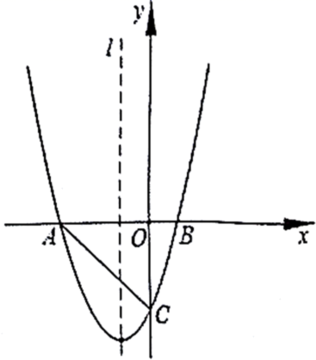

# Mathematics - 题目 1598

**ID**: 6a1b2e9585aa4b8ca1f572109bf6083a
**年级**: Grade 9
**难度**: Medium-Hard
**题型**: Calculation

## 题目
如图，在平面直角坐标系 $xOy$ 中，已知直线 $y=-x-3$ 与 $x$ 轴交于点 $A$ ，与 $y$ 轴交于点 $C$ ，过 $A$ 、 $C$ 两点的抛物线 $y=ax{^{2}}+bx+c$ 与 $x$ 轴交于另一点 $B(1,0)$ ，抛物线对称轴为直线 $l$ ．（1）求抛物线的解析式；​​​​​​​‌（2）点 $M$ 为直线 $AC$ 下方抛物线上一点，当 $\mathrm{△}MAC$ 的面积最大时，求点 $M$ 的坐标；（3）点 $P$ 是抛物线上的点，过点 $P$ 作 $l$ 的垂线，垂足为 $D$ ， $E$ 是 $l$ 上的点．要使得以 $P$ 、 $D$ 、 $E$ 为顶点的三角形与 $\vartriangle BOC$ 全等，请求出点 $P$ 、点 $E$ 的坐标；（4）在（2）的条件下，点 $N$ 为 $y$ 轴上一点，求 $MN+\frac {1}{2}ON$ 的最小值．

## 解答

1. 解：（1）把 $x=0$ 代入 $y=-x-3$ 得 $y=-3$ ；把 $y=0$ 代入 $y=-x-3$ 得 $x=-3$ ． $\therefore A(-3,0)$ ， $C(0,-3)$ ．
2. $\because $ 抛物线 $y=ax{^{2}}+bx+c$ 经过 $ACB$ 三点，
3. $\therefore \begin{cases}9a-3b+c=0\\a+b+c=0\\c=-3\end{cases}$ ，解得 $\begin{cases}a=1\\b=2\\c=-3\end{cases}$ ．
4. $\therefore $ 抛物线的解析式为 $y=x{^{2}}+2x-3$
5. （2）过点 $M$ 作 $MF$ 垂直于 $x$ 轴交 $AC$ 于点 $F$ ，设 $M\left ({x,x{^{2}}+2x-3}\right )$ ， $F(x,-x-3)$
6. 则 $MF=(-x-3)-\left ({x{^{2}}+2x-3}\right )=-x{^{2}}-3x$
7. $S{{}_{△AMC}}=\frac {1}{2}MF\times \left |{x{{}_{C}}-x{{}_{A}}}\right |=$  $\frac {1}{2}\left ({-x{^{2}}-3x}\right )\times 3=-\frac {3}{2}{\left({x+\frac {3}{2}}\right)^{2}}+\frac {27}{8}$
8. $\therefore $ 当 ${\rm{x}}=-\frac {3}{2}$ 时， $S{{}_{\mathrm{△}AMC}}$ 最大，此时 $y=x{^{2}}+2x-3=-\frac {15}{4}$ ．
9. $\therefore $ 当 $M$ 坐标为 $\left ({-\frac {3}{2},-\frac {15}{4}}\right )$ 时， $S{{}_{\mathrm{△}AMC}}$ 取得最大值．
10. 
11. （3）抛物线对称轴为直线 $x=-1$ ． $\angle PDE=\angle BOC$ ， $OB=1$ ， $OC=3$ ．
12. 设 $P\left ({x,x{^{2}}+2x-3}\right )$ ，则 $D\left ({-1,x{^{2}}+2x-3}\right )$
13. 当 $PD=OC$ ， $DE=OB$ 时， $△PDE≌△COB$ ，此时 $\left |{-1-x}\right |=3$ ，解得 $x=-4$ 或 $x=2$ ．
14. $P$ 点坐标为 $(-4,5)$ 或 $(2,5)$ ， $\because DE=1$ ， $\therefore E(-1,6)$ 或 $(-1,4)$ ．
15. 当 $PD=OB$ ， $DE=OC$ 时， $△EDP≌△COB$ ，此时 $\left |{-1-x}\right |=1$ ，解得 $x=-2$ 或 $x=0$ ．
16. $P$ 点坐标为 $(-2,-3)$ 或 $(0,-3)$ ， $\because DE=3$ ， $\therefore E(-1,-6)$ 或 $(-1,0)$ ．
17. （4）过点 $O$ 作 $\angle GOC=30{}^\circ $ ，过点 $N$ 作 $NG\bot OG$ 于点 $G$ ，过点 $M$ 作 $MH\bot OG$ 于 $H$ ，延长 $MF$ 交 $GH$ 于 $K$ ． $\because \angle GOC=30{}^\circ $ ， $NG\bot OG$ ， $\therefore NG=\frac {1}{2}ON$ ， $\therefore MN+\frac {1}{2}ON=MN+NG$ ， $\therefore $ 当点 $M$ 、 $N$ 、 $G$ 三点共线且垂直于 $OG$ 时， $MN+\frac {1}{2}ON$ 有最小值，最小值为 $MH$ ．
18. $\because \angle GOC=30{}^\circ $ ， $\therefore $ 直线 $OG$ 为 ${\rm{y}}=-\sqrt {3}{\rm{x}}$ ，当 ${\rm{x}}=-\frac {3}{2}$ 时，点 ${\rm{K}}\left ({-\frac {3}{2},\frac {3}{2}\sqrt {3}}\right )$ ，
19. ${\rm{M}}{\rm{K}}=\frac {3}{2}\sqrt {3}+\frac {15}{4}$ ，在 ${\rm Rt}△MHK$ 中， ${\rm{M}}{\rm{H}}=\frac {1}{2}{\rm{M}}{\rm{K}}=\frac {3}{4}\sqrt {3}+\frac {15}{8}$ ，故 ${\rm{M}}{\rm{N}}+\frac {1}{2}{\rm{O}}{\rm{N}}$ 的最小值为 $\frac {3}{4}\sqrt {3}+\frac {15}{8}$ ．
20. 

## 知识点

**中文**:
  - 全等三角形的性质
  - 图形问题

**English**:
  - Properties of Congruent Triangles
  - Geometric Problems

---
