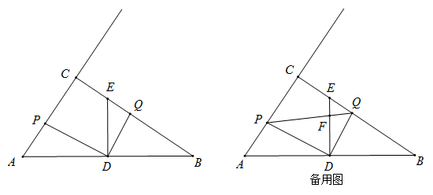

# Mathematics - 题目 3448

**ID**: 6c8f18ef0bf845398cf9499b514bb35e
**年级**: Grade 9
**难度**: Medium-Hard
**题型**: Calculation

## 题目
如图， $Rt\vartriangle ABC$ 中， $\angle ACB=90{}^\circ $ ， $AC=6$ ， $BC=8$ ，点 $D$ 为斜边 $AB$ 的中点， $ED\bot AB$ ，交边 $BC$ 于点 $E$ ，点 $P$ 为射线 $AC$ 上的动点，点 $Q$ 为边 $BC$ 上的动点，且运动过程中始终保持 $PD\bot QD$ ．（1）求证： $△ADP\sim △EDQ$ ；​​​​​​​‌（2）设 $AP=x$ ， $BQ=y$ ，求 $y$ 关于 $x$ 的函数解析式，并写出该函数的定义域；（3）连接 $PQ$ ，交线段 $ED$ 于点 $F$ ，当 $\vartriangle PDF$ 为等腰三角形时，求线段 $AP$ 的长．

## 解答

1. 解：（1） $\because $   $PD\bot QD$ ， $ED\bot AB$
2. ∴ $\angle A=\angle DEQ$ ， $\angle ADP=\angle EDQ$ ，
3. ∴ $△ADP\sim △EDQ$ ．
4. （2） $\because $  $△ADP\sim △EDQ$ ，
5. ∴ $\frac {EQ}{AP}=\frac {ED}{AD}$
6. 又 $\because $ 点 $D$ 为斜边 $AB$ 的中点，
7. ∴ $AD=BD$  ，
8. $\frac {EQ}{AP}=\frac {ED}{AD}=\frac {ED}{BD}$
9. 又 $\because $  $ED\bot AB$
10. 在 $Rt\vartriangle BDE$  中
11. ${\tan}B{\rm{=}}\frac {ED}{BD}=\frac {ED}{AD}=\frac {EQ}{AP}$ ，
12. 又 $\because $  ${\tan}B{\rm{=}}\frac {AC}{BC}=\frac {DE}{BD}=\frac {6}{8}$ ，由勾股定理得：BC=10
13. $\because $D为AB中点，
14. ∴BD=5，DE= $\frac {15}{4}$ ，由勾股定理得：BE= $\frac {25}{4}$
15. $\because $  $AP=x$ ，
16. 可得 $EQ=\frac {3}{4}x$ ，
17. $BQ=BE-EQ$ ，
18. $y=\frac {25}{4}-\frac {3}{4}x\left ({0\leqslant x\leqslant \frac {25}{3}}\right )$ ．
19. （3） ${\tan}\angle FPD=\frac {DQ}{DP}=\frac {ED}{AD}=\frac {ED}{BD}={\tan}B$ ，
20. ∴ $\angle FPD=\angle B$ ，
21. 又∵ $\angle PDF=\angle BDQ$ ，
22. ∴ $△PDF\sim △BDQ$ ，
23. ∴ $\vartriangle PDF$ 为等腰三角形时， $\mathrm{△}BDQ$ 亦为等腰三角形．
24. 若 $DQ=BQ$ ，
25. $\frac {\frac {1}{2}BD}{BQ}={\cos}B$ ，
26. $\frac {\frac {5}{2}}{\frac {25}{4}-\frac {3}{4}x}=\frac {4}{5}$ ，
27. 解得 $x=\frac {25}{6}$ ．
28. 若 $BD=BQ$ ，
29. $\frac {25}{4}-\frac {3}{4}x=5$ ，
30. 解得 $x=\frac {5}{3}$ ．
31. ③若 $DQ=BD$ ，
32. $\angle B+\angle DQB+\angle BDQ=2\angle B+\angle BDQ<180{}^\circ $ ，此种情况舍去．
33. 

## 知识点

**中文**:
  - 列一次函数解析式
  - 等腰三角形的判定与性质
  - 相似三角形的判定与性质综合

**English**:
  - Writing Linear Function Expressions
  - Determination and Properties
  - Determination and Properties

---
