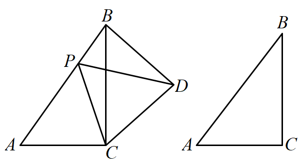

# Mathematics - 题目 685

**ID**: 6ee848184953469da86746e394a36234
**年级**: Grade 9
**难度**: Medium-Hard
**题型**: Calculation

## 题目
如图， ${\rm{R}}{\rm{t}}\mathrm{△}ABC$ 中， $\angle ACB=90{}^\circ $ ， $AC=3$ ， $BC=4$ ．动点 $P$ 从点A出发，沿线段 $AB$ 以每秒5个单位的速度向终点 $B$ 运动，连接 $PC$ ，作点A关于 $PC$ 的对称点 $D$ ，连结 $CD$ 、 $DP$ ，设点 $P$ 的运动时间为 $t$ （秒）．(1)线段 $AB$ 的长是．(2)连结 $BD$ ，则线段 $BD$ 的最小值是，最大值是(3)当点 $D$ 落在 $\vartriangle ABC$ 的内部时，求 $t$ 的取值范围．(4)当直线 $PD$ 与 $\vartriangle ABC$ 的一边垂直时，求出 $t$ 的值．​​​​​​​‌

## 解答

1. （1）在 ${\rm{R}}{\rm{t}}\mathrm{△}ABC$ 中， $AB=\sqrt {AC{^{2}}+BC{^{2}}}=\sqrt {4{^{2}}+3{^{2}}}=5$ ，
2. 故此题答案为：5；
3. （2）∵作点A关于 $PC$ 的对称点 $D$ ，
4. ∴ $CA=CD=3$ ，
5. ∴D点运动轨迹是以C为圆心， $AC$ 长为半径的半圆，
6. ∴当D在线段 $BC$ 上时， $BD$ 的最小，此时 $BD=BC-CD=4-3=1$ ；
7. 当P与B重合时， $BD$ 的最大，此时点A关于 $BC$ 的对称点 $D$ ， $BD=AB=5$ ；
8. 故此题答案为：1，5；
9. （3）由题意得， $AP=5t$
10. 当点D落在 $AB$ 上时， $CP\bot AB$ ．
11. 
12. ∵ $\angle A=\angle A{\rm{，}}\angle CPA=\angle ACB=90{}^\circ $ ，
13. ∴ $\vartriangle APC\sim \vartriangle ACB$ ，
14. ∴ $\frac {AP}{AC}=\frac {AC}{AB}$ ，∴ $\frac {5t}{3}=\frac {3}{5}$ ，
15. ∴ $t=\frac {9}{25}$
16. 如图1-2中，当点D落在 $BC$ 上时， $\angle ACP=\angle PCB=45{}^\circ $ ．
17. 
18. 过点P作 $PT\bot AC$ 于点T．则 $CT=PT$ ，
19. ∵ $PT{\rm{/\mskip-4mu/}}CB$ ，
20. ∴ $\frac {AP}{AB}=\frac {PT}{BC}=\frac {AT}{AC}$ ，
21. ∴ $\frac {5t}{5}=\frac {PT}{4}=\frac {AT}{3}$
22. ∴ $PT=4t,AT=3t$
23. ∴ $CT=AC-AT=3-3t$
24. ∴ $CT=3-3t=PT=4t$ ，
25. 解得 $t=\frac {3}{7}$ ，
26. 观察图象可知，满足条件的t的值为： $\frac {9}{25}<t<\frac {3}{7}$ ；
27. （4）当 $PD\bot AC$ 时，延长 $DP$ 交 $AC$ 于点R．
28. 
29. 则 $CJ\bot AB$ ， $CR=CJ$ ，
30. ∵ $S{{}_{\vartriangle ABC}}=\frac {1}{2}CJ\cdot AB=\frac {1}{2}BC\cdot AC$
31. ∴ $CR=CJ=\frac {3\times 4}{5}=\frac {12}{5}$
32. ∴ $AR=AC-CR=3-\frac {12}{5}=\frac {3}{5}$ ，
33. ∵ $PR{\rm{/\mskip-4mu/}}CB$ ，
34. ∴ $\frac {AP}{AB}=\frac {AR}{AC}$ ，
35. ∴ $\frac {5t}{5}=\frac {\frac {3}{5}}{3}$ ．
36. 解得 $t=\frac {1}{5}$ ，
37. 如图3-2中，当 $DP\bot BC$ 时，四边形 $ACDP$ 是菱形，此时 $AP=AC=3=5t$ ， $t=\frac {3}{5}$ ，
38. 
39. 如图3-3中，当 $PD\bot AB$ 时，过点作 $CH\bot AB$ 于点H．
40. 
41. ∵ $\angle CPH=\angle CPD=45{}^\circ $ ，
42. ∴ $CH=PH$
43. ∵ $S{{}_{\vartriangle ABC}}=\frac {1}{2}CH\cdot AB=\frac {1}{2}BC\cdot AC$
44. ∴ $PH=CH=\frac {3\times 4}{5}=\frac {12}{5}$ ，
45. ∴ $AH=AP-PH=5t-\frac {12}{5}$
46. ∵ $\angle A=\angle A{\rm{，}}\angle CHA=\angle ACB=90{}^\circ $ ，
47. ∴ $\vartriangle AHC\sim \vartriangle ACB$ ，
48. ∴ $\frac {AH}{AC}=\frac {AC}{AB}$ ，
49. ∴ $\frac {5t-\frac {12}{5}}{3}=\frac {3}{5}$ ，
50. 解得 $t=\frac {21}{25}$ ．
51. 综上所述，满足条件的t的值为 $\frac {1}{5}$ 或 $\frac {3}{5}$ 或 $\frac {21}{25}$ ．

## 知识点

**中文**:
  - 几何变换——轴对称综合题
  - 角平分线的性质
  - 相似三角形的判定与性质综合

**English**:
  - Axial Symmetry Comprehensive Problems
  - Properties of Angle Bisectors
  - Determination and Properties

---
