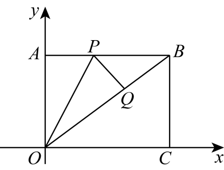

# Mathematics - 题目 1008

**ID**: 6ef38e024c1f417a8ccdb2397f32e650
**年级**: Grade 9
**难度**: Medium-Hard
**题型**: Calculation

## 题目
如图，将矩形纸片 $OABC$ 放在平面直角坐标系中，O为坐标原点．点A在y轴上，点C在x轴上， $OA，OB$ 的长是 $x{^{2}}-16x+60=0$ 的两个根，P是边 $AB$ 上的一点，将 $\mathrm{△}OAP$ 沿 $OP$ 折叠，使点A落在 $OB$ 上的点Q处．（1）求点B的坐标；​​​​​​​‌（2）求直线 $PQ$ 的解析式；（3）点M在直线 $OP$ 上，点N在直线 $PQ$ 上，是否存在点M，N，使以A，C．M，N为顶点的四边形是平行四边形？若存在，请直接写出点N的坐标；若不存在，请说明理由．

## 解答

1. （1）解：由 $x{^{2}}-16x+60=0$ ，解得 $x=6$ 或 $x=10$ ，
2. ∵ $OA<OB$ ，
3. ∴ $OA=6，OB=10$ ，
4. ∵四边形 $OABC$ 是矩形，
5. ∴ $\angle OAB=90{}^\circ $ ，
6. 在 ${\rm{R}}{\rm{t}}\mathrm{△}AOB$ 中，由勾股定理得 $AB=\sqrt {OB{^{2}}-OA{^{2}}}=8$ ，
7. ∴ $B\left ({8，6}\right )$ ；
8. （2）解：由折叠的性质可得， $PQ=AP$ ， $OQ=OA=6$ ， $\angle BQP=90{}^\circ $ ， $BQ=4$ ，
9. 设 $PQ=AP=x$ ，则 $BP=8-x$ ，
10. 在 ${\rm{R}}{\rm{t}}\vartriangle BPQ$ 中，由勾股定理得 $BP{^{2}}-PQ{^{2}}=BQ{^{2}}$ ，即 ${\left({8-x}\right)^{2}}-x{^{2}}=4{^{2}}$ ，解得 $x=3$ ，
11. ∴ $P\left ({3，6}\right )$ ，
12. 如图，过 $Q$ 作 $QH\bot OC$ 于 $H$ ，则 $QH/\mskip-4mu/BC$ ，
13. 
14. ∴ $\vartriangle OHQ∽\vartriangle OCB$ ，
15. ∴ $\frac {OH}{OC}=\frac {QH}{BC}=\frac {OQ}{OB}$ ，即 $\frac {OH}{8}=\frac {QH}{6}=\frac {6}{10}$ ，解得 $OH=\frac {24}{5}$ ， $QH=\frac {18}{5}$ ，
16. ∴ $Q\left ({\frac {24}{5}，\frac {18}{5}}\right )$ ，
17. 设直线 $PQ$ 的解析式为 $y=kx+b$ ，
18. 将 $P\left ({3，6}\right )$ ， $Q\left ({\frac {24}{5}，\frac {18}{5}}\right )$ 代入得， $\begin{cases}\frac {18}{5}=\frac {24}{5}k+b\\6=3k+b\end{cases}$ ，解得 $\begin{cases}k=-\frac {4}{3}\\b=10\end{cases}$ ，
19. ∴ $y=-\frac {4}{3}x+10$ ，
20. ∴直线 $PQ$ 的解析式为 $y=-\frac {4}{3}x+10$ ；
21. （3）解：存在点M，N，使以A，C．M，N为顶点的四边形是平行四边形，理由如下：
22. 由（2）得 $P\left ({3，6}\right )$ ，直线 $PQ$ 的解析式为 $y=-\frac {4}{3}x+10$ ，
23. 设直线 $OP$ 解析式为 $y=kx$ ，
24. 将 $P\left ({3，6}\right )$ 代入得 $6=3k$ ，解得 $k=2$ ，
25. ∴ $y=2x$ ，
26. ∴直线 $OP$ 解析式为 $y=2x$ ，
27. 设 $M\left ({m，2m}\right )$ ， $N\left ({n，-\frac {4}{3}n+10}\right )$ ，
28. 当以A，C．M，N为顶点的四边形是平行四边形时， $A\left ({0，6}\right )、C\left ({8，0}\right )$ ，
29. ①当 $MN，AC$ 为对角线，则 $MN，AC$ 的中点重合，
30. ∴ $\begin{cases}m+n=0+8\\2m-\frac {4}{3}n+10=6+0\end{cases}$ ，
31. 解得 $\begin{cases}m=2\\n=6\end{cases}$ ，
32. ∴ $N\left ({6，2}\right )$ ；
33. ②当 $MA，NC$ 为对角线，则 $MA，NC$ 的中点重合，
34. ∴ $\begin{cases}m+0=n+8\\2m+6=-\frac {4}{3}n+10+0\end{cases}$ ，
35. 解得 $\begin{cases}m=\frac {22}{5}\\n=-\frac {18}{5}\end{cases}$ ；
36. ∴ $N\left ({-\frac {18}{5}，\frac {74}{5}}\right )$ ；
37. ③当 $MC，NA$ 为对角线，则 $MC，NA$ 的中点重合，
38. ∴ $\begin{cases}m+8=0+n\\2m+0=-\frac {4}{3}n+10+6\end{cases}$ ，
39. 解得 $\begin{cases}m=\frac {8}{5}\\n=\frac {48}{5}\end{cases}$ ，
40. ∴ $N\left ({\frac {48}{5}，-\frac {14}{5}}\right )$ ．
41. 综上所述，N的坐标为 $\left ({6，2}\right )$ 或 $\left ({-\frac {18}{5}，\frac {74}{5}}\right )$ 或 $\left ({\frac {48}{5}，-\frac {14}{5}}\right )$ ．

## 知识点

**中文**:
  - 待定系数法求一次函数解析式
  - 矩形的性质
  - 相似三角形的判定与性质综合
  - 折叠问题

**English**:
  - Finding Expressions by Undetermined Coefficients
  - Properties of Rectangles
  - Determination and Properties
  - Folding Problems

---
