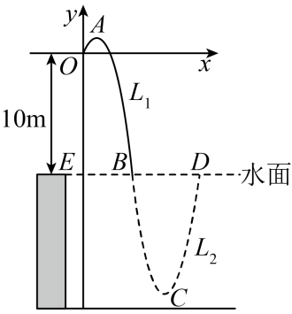

# Mathematics - 题目 3343

**ID**: 7066c60d1e7c44e6a454c528eb38427b
**年级**: Grade 9
**难度**: Medium-Hard
**题型**: Calculation

## 题目
如图，在平面直角坐标系中，某跳水运动员站在跳台上的 $O$ 处进行 $10{\rm{m}}$ 跳台跳水训练，水面平行于 $x$ 轴，水面边缘点 $E$ 的坐标为 $\left ({-\frac {3}{2},-10}\right )$ ．运动员（将运动员看成一点）在空中运动的路线是经过原点 $O$ ,最高点 $A$ ,入水点 $B$ 的抛物线 $L{{}_{1}}$ ，最高点 $A$ 的坐标为 $\left ({1,\frac {5}{4}}\right )$ ．(1)求抛物线 $L{{}_{1}}$ 的函数表达式，及点 $B$ 的坐标．(2)如图，该运动员从点 $B$ 入水后，经过最低点 $C$ ，再从点 $D$ 出水，运动路线为另一条抛物线 $L{{}_{2}}$ ．若抛物线 $L{{}_{1}}$ 与 $L{{}_{2}}$ 开口大小相同，且 $BD=BE$ ，求最低点 $C$ 离水面的距离．​​​​​​​‌

## 解答

1. （1）解：由题意可设抛物线 $L{{}_{1}}$ 的函数表达式为 $y=a{\left({x-1}\right)^{2}}+\frac {5}{4}$ ，
2. 将 $\left ({0,0}\right )$ 代入抛物线 $L{{}_{1}}$ 的函数表达式得 $a\times 1+\frac {5}{4}=0$ ，
3. 解得 $a=-\frac {5}{4}$ ，
4. ∴抛物线 $L{{}_{1}}$ 的函数表达式为 $y=-\frac {5}{4}{\left({x-1}\right)^{2}}+\frac {5}{4}$ ，
5. 令 $y=-10$ ，则 $-\frac {5}{4}{\left({x-1}\right)^{2}}+\frac {5}{4}=-10$ ，
6. 解得 $x{{}_{1}}=4$ ， $x{{}_{2}}=-2$ （舍去），
7. ∴点 $B$ 的坐标为 $\left ({4,-10}\right )$ ；
8. （2）解：由（1）得,点 $B$ 的坐标为 $\left ({4,-10}\right )$ ，抛物线 $L{{}_{1}}$ 的函数表达式为 $y=-\frac {5}{4}{\left({x-1}\right)^{2}}+\frac {5}{4}$ ，
9. $\therefore BE=4-\left ({-\frac {3}{2}}\right )=\frac {11}{2}$ ，
10. ∴ $BD=BE=\frac {11}{2}$ ，
11. ∴点 $D$ 的横坐标为 $\frac {11}{2}+4=\frac {19}{2}$ ，即 $D\left ({\frac {19}{2},-10}\right )$ ，
12. ∵抛物线 $L{{}_{1}}$ 与 $L{{}_{2}}$ 开口大小相同，
13. ∴设抛物线 $L{{}_{2}}$ 的解析式为 $y=\frac {5}{4}x{^{2}}+bx+c$ ，
14. 将 $D\left ({\frac {19}{2},-10}\right )$ ， $B\left ({4,-10}\right )$ 代入解析式得 $\begin{cases}\frac {5}{4}\times {\left({\frac {19}{2}}\right)^{2}}+\frac {19}{2}b+c=-10\\\frac {5}{4}\times 4{^{2}}+4b+c=-10\end{cases}$ ，
15. 解得 $\begin{cases}b=-\frac {135}{8}\\c=\frac {75}{2}\end{cases}$ ，
16. ∴抛物线 $L{{}_{2}}$ 的解析式为 $y=\frac {5}{4}x{^{2}}-\frac {135}{8}x+\frac {75}{2}$ ，
17. ∵ $y=\frac {5}{4}x{^{2}}-\frac {135}{8}x+\frac {75}{2}=\frac {5}{4}\left ({x{^{2}}-\frac {27}{2}x}\right )+\frac {75}{2}=\frac {5}{4}{\left({x-\frac {27}{4}}\right)^{2}}-\frac {1245}{64}$ ，
18. ∴ $C\left ({\frac {27}{4},-\frac {1245}{64}}\right )$ ，
19. $\frac {1245}{64}-10=\frac {605}{64}$
20. ∴最低点 $C$ 离水面的距离 $\frac {605}{64}{\rm{m}}$ ．

## 知识点

**中文**:
  - y=a（x-h）²+k的图象与性质
  - 其他问题
  - 待定系数法求二次函数解析式

**English**:
  - Graph and Properties of y=a(x-h)²+k
  - Other Problems
  - Finding Quadratic Expressions by Undetermined Coefficients

---
