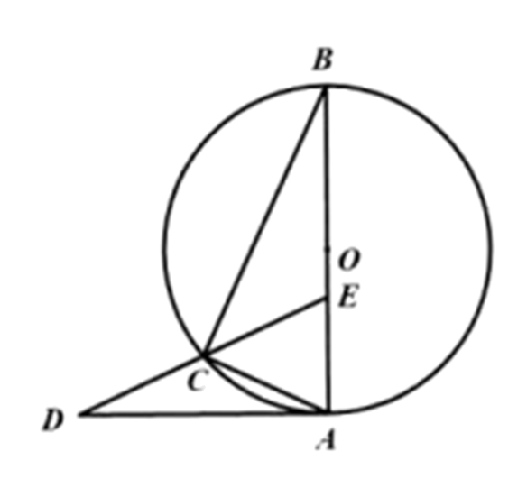

# Mathematics - 题目 2016

**ID**: 706a00158c05494e803bad7db757b30c
**年级**: Grade 9
**难度**: Medium-Hard
**题型**: Calculation

## 题目
如图， $AB$ 是 $\odot O$ 的直径， $AD$ 与 $\odot O$ 交于点A，点E是半径 $OA$ 上一点（点E不与点O，A重合）．连接 $DE$ 交 $\odot O$ 于点C，连接 $CA$ ， $CB$ ．若 $CA=CD$ ， $\angle ABC=\angle D$ ．（1）求证： $AD$ 是 $\odot O$ 的切线．（2）若 $AB=13$ ， $CA=CD=5$ ，则 $AD$ 的长是．​​​​​​​‌

## 解答

1. 解：（1） $\because AB$ 是 $\odot O$ 的直径，
2. $\therefore \angle ACB=90\mathrm{°}$ ，
3. $\therefore \angle BAC+\angle ABC=90{}^\circ $ ．
4. 又 $\because CA=CD$ ，
5. $\therefore \angle D=\angle CAD$ ，
6. 又 $\because \angle ABC=\angle D$ ，
7. $\therefore \angle CAD+\angle BAC=90{}^\circ $ ，
8. 即 $OA\bot AD$ ，
9. $\therefore AD$ 是 $\odot O$ 的切线；
10. （2）由（1）可得 $\angle ABC+\angle BAC=90{}^\circ =\angle D+\angle DEA$ ，
11. $\because \angle ABC=\angle D$ ，
12. $\therefore \angle BAC=\angle DEA$ ，
13. $\therefore CE=CA=CD=5$ ，
14. $\therefore DE=10$ ，
15. 在 ${\rm{R}}{\rm{t}}Δ{\rm{A}}{\rm{B}}{\rm{C}}$ 中，由勾股定理得，
16. $BC=\sqrt {AB{^{2}}-AC{^{2}}}=\sqrt {13{^{2}}-5{^{2}}}=12$ ，
17. $\because \angle ACB=\angle DAE=90{}^\circ $ ， $\angle ABC=\angle D$ ，
18. $\therefore ΔABC∽ΔEDA$ ，
19. $\therefore $  $\frac {AB}{ED}=\frac {BC}{AD}$ ，
20. 即 $\frac {13}{10}=\frac {12}{AD}$ ，
21. 解得 $AD=\frac {120}{13}$ ．

## 知识点

**中文**:
  - 切线的判定定理
  - 圆周角定理及推论
  - 相似三角形的判定与性质综合

**English**:
  - Tangent Determination Theorem
  - Inscribed Angle Theorem
  - Determination and Properties

---
