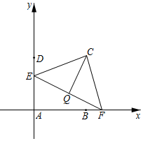

# Mathematics - 题目 157

**ID**: 70ea6a4d43bd4c5ba4955d775aff2324
**年级**: Grade 9
**难度**: Medium-Hard
**题型**: Calculation

## 题目
如图，点A坐标是(0，0)，点C坐标是(2，2)，现有E、F两点分别从点D(0，2)和点B(2，0)向下和向右以每秒一个单位速度移动，Q为EF中点．设运动时间为t．（1）在运动过程中始终与线段EC相等的线段是；​​​​​​​‌四边形CEAF面积＝．（2）当t＝1秒时，求线段CQ的长．（3）过点B作BP平行于CF交EC于点P．当t＝时，线段AP最短，此时作直线EP与x轴交于点K，试证明，点K是线段AB的黄金分割点．

## 解答

1. 解：（1）连接CD、CB，如图1所示：
2. 
3. ∵A（0，0）、C（2，2）、D（0，2）、B（2，0），
4. ∴CD＝CB＝AB=AD=2，
5. ∴四边形DABC是菱形
6. 又 $\angle DAB=90{}^\circ $
7. ∴四边形ABCD是正方形，
8. ∵E、F两点分别从点D和点B向下和向右以每秒一个单位速度移动，
9. ∴DE＝BF，
10. ∵∠CDE＝∠CBF＝90°，
11. ∴△CDE≌△CBF（SAS），
12. ∴EC＝FC，
13. S_{四}_{边}_{形}CEAF＝S_{四}_{边}_{形}CEAB+S△CBF＝S_{四}_{边}_{形}CEAB+S△CDE＝S_{正方形}ABCD＝CB•CD＝2×2＝4，
14. 故答案为：FC，4；
15. （2）∵△CDE≌△CBF，
16. ∴EC＝FC，∠DCE＝∠BCF，
17. ∵∠DCE+∠ECB＝90°，
18. ∴∠BCF+∠ECB＝90°，即∠ECF＝90°，
19. ∴△ECF是等腰直角三角形，
20. 当t＝1时，DE＝1，
21. 在Rt△CDE中，由勾股定理得：CE＝ $\sqrt {DE{^{2}}+CD{^{2}}}$ ＝ $\sqrt {1{^{2}}+2{^{2}}}$ ＝ $\sqrt {5}$ ，
22. ∴EF＝ $\sqrt {2}$CE＝ $\sqrt {2}$ × $\sqrt {5}$ ＝ $\sqrt {10}$ ，
23. ∵Q为EF中点，
24. ∴CQ＝ $\frac {1}{2}$EF＝ $\frac {1}{2}\times \sqrt {10}$ ＝ $\frac {\sqrt {10}}{2}$ ；
25. （3）∵BP∥CF，∠ECF＝90°，
26. ∴∠BPC＝90°，
27. ∴点P的轨迹在以BC为直径的圆弧上，
28. 设BC的中点为G，连接AG，如图2所示：
29. 
30. 当点P在AG上时，AP最短，
31. 此时，PG＝BG＝1，
32. 在Rt△ABG中，由勾股定理得AG＝ $\sqrt {AB{^{2}}+BG{^{2}}}$ ＝ $\sqrt {2{^{2}}+1{^{2}}}$ ＝ $\sqrt {5}$ ，
33. ∴AP＝AG﹣PG＝ $\sqrt {5}$ ﹣1，
34. ∵BC∥DE，
35. ∴∠AEP＝∠GCP，
36. ∵GC＝GP，
37. ∴∠GCP＝∠GPC，
38. ∵∠GPC＝∠APE，
39. ∴∠AEP＝∠APE，
40. ∴AP＝AE＝ $\sqrt {5}$ ﹣1，
41. ∴E（0，1﹣ $\sqrt {5}$ ），
42. ∴DE＝2﹣（1﹣ $\sqrt {5}$ ）＝ $\sqrt {5}$ +1，
43. ∴t＝（ $\sqrt {5}$ +1）s，
44. 故答案为：（ $\sqrt {5}$ +1）s；
45. 设CE的解析式为：y＝kx+b（k≠0），
46. 将C（2，2）、E（0，1﹣ $\sqrt {5}$ ）代入解析式得： $\begin{cases}2k+b=2\\b=1-\sqrt {5}\end{cases}$ ，
47. 解得： $\begin{cases}k=\frac {\sqrt {5}+1}{2}\\b=1-\sqrt {5}\end{cases}$ ，
48. ∴CE的解析式为：y＝ $\frac {\sqrt {5}+1}{2}$x+1﹣ $\sqrt {5}$ ，
49. 令y＝0，x＝3﹣ $\sqrt {5}$ ，
50. ∴K（3﹣ $\sqrt {5}$ ，0），
51. ∴BK＝2﹣（3﹣ $\sqrt {5}$ ）＝ $\sqrt {5}$ ﹣1，
52. ∴ $\frac {BK}{AB}$ ＝ $\frac {\sqrt {5}-1}{2}$ ，
53. ∴点K是线段AB的黄金分割点．

## 知识点

**中文**:
  - 黄金分割

**English**:
  - Golden Ratio

---
