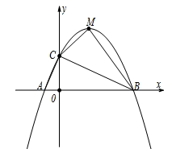

# Mathematics - 题目 677

**ID**: 7321fe675804461abe67474b47dcc32e
**年级**: Grade 9
**难度**: Medium-Hard
**题型**: Calculation

## 题目
如图，已知抛物线 $y=-\frac {2}{5}x{^{2}}+\frac {8}{5}x+2$ 交x轴于A、B两点(点A在点B的左侧)，与y轴交于点C．（1）求点A、B、C的坐标；​​​​​​​‌（2）若点M为抛物线的顶点，连接BC、CM、BM，求△BCM的面积；（3）连接AC，在x轴上是否存在点P使△ACP为等腰三角形，若存在，请求出点P的坐标；若不存在，请说明理由．

## 解答

1. 解：（1）令 $-\frac {2}{5}$ x^{2}+ $\frac {8}{5}$ x+2=0，
2. 解得： $x{{}_{1}}$ =－1， $x{{}_{2}}$ =5，
3. 令x=0，则y=2，
4. ∴A、B、C的坐标分别是：A(－1，0)、B(5，0)、C(0，2)；
5. （2）∵ $y=-\frac {2}{5}x{^{2}}+\frac {8}{5}x+2$
6. ∴顶点M的坐标是M(2， $\frac {18}{5}$ )，
7. 过M作MN垂直y轴于N，
8. 
9. ∴△BCM的面积= ${\rm{S}}{{}_{{\rm{O}}{\rm{B}}{\rm{M}}{\rm{N}}}}$ － ${\rm{S}}{{}_{Δ{\rm{O}}{\rm{B}}{\rm{C}}}}$ － ${\rm{S}}{{}_{Δ{\rm{M}}{\rm{N}}{\rm{C}}}}$
10. = $\frac {{\rm{1}}}{{\rm{2}}}$ (2+5)× $\frac {18}{5}$ － $\frac {{\rm{1}}}{{\rm{2}}}$ ×5×2－ $\frac {{\rm{1}}}{{\rm{2}}}$ ×( $\frac {18}{5}$ －2)×2=6；
11. （3）存在
12. 当以AC为腰时，在x轴上有两个点分别为 ${\rm{P}}{{}_{{\rm{1}}}}$ ， ${\rm{P}}{{}_{{\rm{2}}}}$ ，
13. ∵ $AC=\sqrt {2{^{2}}+1{^{2}}}=\sqrt {{\rm{5}}}$
14. 则 ${\rm{O}}{\rm{P}}{{}_{{\rm{1}}}}$ =1+ $\sqrt {{\rm{5}}}$ ， ${\rm{O}}{\rm{P}}{{}_{{\rm{2}}}}$ = $\sqrt {{\rm{5}}}$ －1，
15. ∴ ${\rm{P}}{{}_{{\rm{1}}}}$ ， ${\rm{P}}{{}_{{\rm{2}}}}$ 的坐标分别是： ${\rm{P}}{{}_{{\rm{1}}}}$ (－1－ $\sqrt {{\rm{5}}}$ ，0)， ${\rm{P}}{{}_{{\rm{2}}}}$ ( $\sqrt {{\rm{5}}}$ －1，0)；
16. 当以AC为底时，作AC的垂直平分线交x轴于 ${\rm{P}}{{}_{{\rm{3}}}}$ ，交y轴于F，垂足为E，
17. ∴CE= $\frac {{\rm{A}}{\rm{C}}}{{\rm{2}}}=\frac {\sqrt {{\rm{5}}}}{{\rm{2}}}$ ，
18. 易证△CEF∽△COA，
19. ∴ $\frac {{\rm{C}}{\rm{F}}}{{\rm{C}}{\rm{E}}}=\frac {{\rm{C}}{\rm{A}}}{{\rm{C}}{\rm{O}}}$ ，
20. ∴ $\frac {{\rm{C}}{\rm{F}}}{\frac {\sqrt {{\rm{5}}}}{{\rm{2}}}}=\frac {\sqrt {{\rm{5}}}}{{\rm{2}}}$ ，
21. ∴CF= $\frac {5}{{\rm{4}}}$ ，
22. ∴OF=OC－CF=2－ $\frac {5}{{\rm{4}}}$ = $\frac {3}{4}$ ，
23. ∴EF= $\sqrt {{\rm{C}}{\rm{F}}{^{{\rm{2}}}}{\rm{-}}{\rm{C}}{\rm{E}}{^{{\rm{2}}}}}=$  $\sqrt {\left ({\frac {{\rm{5}}}{{\rm{4}}}}\right ){^{{\rm{2}}}}{\rm{-}}\left ({\frac {\sqrt {{\rm{5}}}}{{\rm{2}}}}\right ){^{{\rm{2}}}}}=$  $\frac {\sqrt {{\rm{5}}}}{{\rm{4}}}$
24. 又△CEF∽△ ${\rm{P}}{{}_{{\rm{3}}}}$ OF，
25. ∴ $\frac {{\rm{C}}{\rm{E}}}{{\rm{E}}{\rm{F}}}=\frac {{\rm{O}}{\rm{P}}{{}_{{\rm{3}}}}}{{\rm{O}}{\rm{F}}}$ ，
26. ∴ $P{{}_{{\rm{3}}}}O=\frac {3}{2}$ ，
27. 则 ${\rm{P}}{{}_{{\rm{3}}}}$ 的坐标为 ${\rm{P}}{{}_{{\rm{3}}}}$ ( $\frac {3}{2}$ ，0)；
28. 当以AC为腰时，点C为顶点时，有AC=PC，
29. 则点P_{4}为（1，0）；
30. ∴存在 ${\rm{P}}{{}_{{\rm{1}}}}$ 、 ${\rm{P}}{{}_{{\rm{2}}}}$ 、 ${\rm{P}}{{}_{{\rm{3}}}}$ 三点，它们的坐标分别是：
31. ${\rm{P}}{{}_{{\rm{1}}}}$ (－1－ $\sqrt {{\rm{5}}}$ ，0)， ${\rm{P}}{{}_{{\rm{2}}}}$ ( $\sqrt {{\rm{5}}}$ －1，0)， ${\rm{P}}{{}_{{\rm{3}}}}$ ( $\frac {3}{2}$ ，0)， ${\rm{P}}{{}_{4}}(1,0)$ ；

## 知识点

**中文**:
  - y=a（x-h）²+k的图象与性质
  - 二次函数的综合
  - 等腰三角形的性质
  - 勾股定理
  - 相似三角形的判定与性质综合

**English**:
  - Graph and Properties of y=a(x-h)²+k
  - Comprehensive Quadratic Function Problems
  - Properties of Isosceles Triangles
  - Pythagorean Theorem
  - Determination and Properties

---
