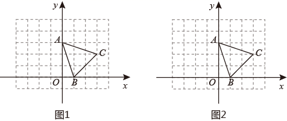

# Mathematics - 题目 1115

**ID**: 73870a4b308d45ef80e300e9fab99a6d
**年级**: Grade 9
**难度**: Medium-Hard
**题型**: Calculation

## 题目
在如图所示的平面直角坐标系中，△ABC的顶点坐标分别为A（0，3），B（1，0），C（3，2），仅用无刻度的直尺在给出的网格中画图（画图用实线表示），并回答题目中的问题（1）在图1中画出△ABC关于点D成中心对称的图形；​​​​​​​‌（2）在图2中作出△ABC的外接圆的圆心M（保留作图痕迹）；（3）△ABC外接圆的圆心M的坐标为．

## 解答

1. 解：（1）如图，△A'B'C′为所求；
2. 
3. （2）如图，取格点E、F、D，连接EF和AD相交于点M；
4. ∵AE∥BF，
5. ∴∠AEN=∠BFN，
6. ∵AE=BF，∠ANE=∠BNF，
7. ∴△AEN≌△BFN，
8. ∴AN=BN，
9. ∵ $AB=\sqrt {3{^{2}}+1{^{2}}}=\sqrt {10}$ ， $EF=\sqrt {3{^{2}}+9{^{2}}}=3\sqrt {10}$ ，
10. ∴ $NB=\frac {\sqrt {10}}{2}$ ， $NF=\frac {3\sqrt {10}}{2}$ ，
11. ∴ $NB{^{2}}+NF{^{2}}={\left({\frac {\sqrt {10}}{2}}\right)^{2}}+{\left({\frac {3\sqrt {10}}{2}}\right)^{2}}=25=BF{^{2}}$ ，
12. ∴∠BNF=90°，
13. ∴EF垂直平分AB，
14. 根据正方形的性质可得：AD垂直平分BC，
15. ∴点M为△ABC的外接圆的圆心；
16. 
17. （3）设直线AD的解析式为y=kx+b，则有 $\begin{cases}3k+b=0\\b=3\end{cases}$ ；
18. 解得： $\begin{cases}k=-1\\b=3\end{cases}$ ；
19. ∴直线AD的解析式为y=-x+3，
20. 设直线EF的解析式为y=mx+n，则有 $\begin{cases}5m+n=3\\-4m+n=0\end{cases}$ ；
21. 解得： $\begin{cases}m=\frac {1}{3}\\n=\frac {4}{3}\end{cases}$ ；
22. ∴直线AD的解析式为 $y=\frac {1}{3}x+\frac {4}{3}$ ，
23. ∴ $\hspace{-0.5em}\begin{array}{l}\\\begin{cases}y=\frac {1}{3}x+\frac {4}{3}\\y=-x+3\end{cases}\end{array}\hspace{-0.5em}$ ；解得： $\begin{cases}x=\frac {5}{4}\\y=\frac {7}{4}\end{cases}$
24. ∴ $M\left ({\frac {5}{4}，\frac {7}{4}}\right )$

## 知识点

**中文**:
  - 一次函数与一元一次方程
  - 三角形的外接圆
  - 中心对称——作图

**English**:
  - Linear Functions and Linear Equations
  - Circumcircle of Triangle
  - Construction: Central Symmetry

---
