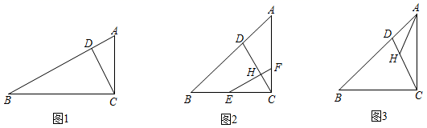

# Mathematics - 题目 3702

**ID**: 77001832032c425e940c27906bde077a
**年级**: Grade 9
**难度**: Medium-Hard
**题型**: Calculation

## 题目
在Rt△ABC中，∠ACB=90°，点D为AB上一点．（1）如图1，若CD⊥AB，求证：AC^{2}=AD·AB；​​​​​​​‌（2）如图2，若AC=BC，EF⊥CD交CD于H，交AC于F，且 $\frac {FH}{HE}=\frac {4}{9}$ ，求 $\frac {AD}{BD}$ 的值；（3）如图3，若AC=BC，点H在CD上，∠AHD=45°，CH=3DH，则tan∠ACH的值为．

## 解答

1. （1）证明：∵ $CD\bot AB$ ，∴ $\angle ADC=\angle CDB=90{}^\circ $ ，
2. ∵ $\angle ACB=90{}^\circ $ ，
3. ∴ $\angle B+\angle BCD=\angle ACD+\angle BCD=90{}^\circ $ ，
4. ∴ $\angle B=\angle ACD$ ，
5. ∴ $\vartriangle CBD$ ∽ $△ACD$ ，
6. ∴ $\frac {CD}{AD}=\frac {BD}{CD}$ ，
7. ∴ $CD{^{2}}=AD\cdot DB$ ；
8. （2）解：∵ $\frac {FH}{HE}=\frac {4}{9}$ ，
9. ∴设 $FH=4a$ ，则 $HE=9a$ （ $a>0$ ），
10. ∵ $\angle ACB=90{}^\circ $ ， $EF\bot CD$ ，
11. 同（1）得： $CH{^{2}}=HE\cdot FH=9a\times 4a=36a{^{2}}$ ，
12. ∴ $CH=6a$ ，
13. 在 $Rt\vartriangle CHF$ 中， ${\tan}\angle ACD=\frac {FH}{CH}=\frac {4a}{6a}=\frac {2}{3}$ ，
14. 过 $D$ 作 $DP\bot AC$ 于 $P$ ，如图2所示：
15. 
16. 则 $DP{\rm{/}}{\rm{/}}BC$ ，
17. 在 $Rt\vartriangle DPC$ 中， ${\tan}\angle ACD=\frac {DP}{PC}=\frac {2}{3}$ ，
18. ∵ $AC=BC$ ， $\angle ACB=90{}^\circ $ ，
19. ∴ $\angle A=45{}^\circ $ ，
20. ∴ $\mathrm{△}ADP$ 是等腰直角三角形，
21. ∴ $AP=DP$ ，
22. ∴ $\frac {AP}{PC}=\frac {DP}{PC}=\frac {2}{3}$ ，
23. ∵ $DP{\rm{/}}{\rm{/}}BC$ ，
24. ∴ $\frac {AD}{BD}=\frac {AP}{PC}=\frac {2}{3}$ ；
25. （3）解：过点 $D$ 作 $DM\bot AH$ 于 $M$ ，如图3所示：
26. 
27. ∵ $CH=3DH$ ，
28. ∴设 $DH=2x$ ，则 $CH=6x$ （ $x>0$ ），
29. ∴ $CD=DH+CH=8x$ ，
30. ∵ $AC=BC$ ， $\angle ACB=90{}^\circ $ ，
31. ∴ $\angle BAC=45{}^\circ $ ，
32. ∴ $\angle BAC=\angle AHD{\rm{=}}45{}^\circ $
33. 又∵ $\angle ADH=\angle CDA$ ，
34. ∴ $\vartriangle ADH$ ∽ $\vartriangle CDA$ ，
35. ∴ $\angle DAH=\angle ACH$ ， $\frac {AD}{CD}=\frac {DH}{AD}$ ，
36. ∴ $AD{^{2}}=DH\cdot CD=16x{^{2}}$ ，
37. ∴ $AD=4x$ ，
38. ∵ $DM\bot AH$ ，
39. ∴ $\angle DMH=90{}^\circ $ ，
40. ∵ $\angle AHD=45{}^\circ $ ，
41. ∴ $\angle HDM=45{}^\circ =\angle AHD$ ，
42. ∴ $\mathrm{△}HDM$ 是等腰直角三角形，
43. ∴ $DM=HM=\frac {\sqrt {2}}{2}DH=\sqrt {2}x$ ，
44. ∴ $AM=\sqrt {AD{^{2}}-DM{^{5}}}=\sqrt {{\left({4x}\right)^{2}}-{\left({\sqrt {2}x}\right)^{2}}}=\sqrt {14}x$ ，
45. ∴ ${\tan}\angle ACH={\tan}\angle DAH=\frac {DM}{AM}=\frac {\sqrt {2}x}{\sqrt {14}x}=\frac {\sqrt {7}}{7}$ ；
46. 故答案为： $\frac {\sqrt {7}}{7}$ ．

## 知识点

**中文**:
  - 正切
  - 相似三角形的判定与性质综合
  - 等腰直角三角形的性质

**English**:
  - Tangent
  - Determination and Properties
  - Properties of Isosceles Right Triangles

---
