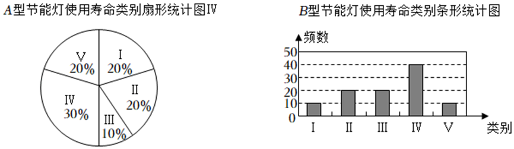

# Mathematics - 题目 3757

**ID**: 77d462a01e634d51961a0d193af47789
**年级**: Grade 9
**难度**: Medium-Hard
**题型**: Calculation

## 题目
节能灯质量可根据其正常使用寿命的时间来衡量，使用时间越长，表明质量越好，且使用时间大于5千小时的节能灯定为优质品，否则为普通品．设节能灯的使用寿命时间为t千小时，节能灯使用寿命类别如下：寿命时间（单位：千小时）$0<t\leqslant 3$$3<t\leqslant 4$$4<t\leqslant 5$$5<t\leqslant 6$$t>6$节能灯使用寿命类别ⅠⅡⅢⅣⅤ某生产厂家产品检测部门对 $A、B$ 两种不同型号的节能灯做质量检测试验，各随儿田耳权才产品作为样本，并将得到的试验结果制作成如下图所示的扇形统计图和条形统计图：根据上述调查数据，解决下列问题：(1)现从生产线上随机抽取 $A、B$ 两种型号的节能灯各1盏，求其中至少有1盏节能灯是优质品的概率；​​​​​​​‌(2)工厂对节能灯实行“三包”服务，根据多年生产销售经验可知，每盏节能灯的利润y（单位：元）与其使用时间t（单位：千小时）的关系如下表：使用时间t（单位：千小时）$0<t\leqslant 3$$3<t\leqslant 4$$t>4$每盏节能灯的利润y（单位：无）$-10$1020请从平均利润角度考虑，该生产厂家应选择多生产哪种节能灯比较合算，说明理由．

## 解答

1. （1）根据扇形统计图中的数据，可以计算出 $A$ 种型号的节能灯至少有1盏节能灯是优质品的概率，根据频数分布直方图可得 $B$ 种型号的节能灯至少有1盏节能灯是优质品的概率；
2. （2）根据表格中的数据，可以计算出一台 $A$ 种型号的节能灯的平均利润和一台 $B$ 种型号的节能灯的平均利润，然后比较大小即可．
3. (1)
4. 解：由扇形统计图可得： $A$ 种型号的节能灯至少有1盏节能灯是优质品的概率是 $30\%+20\%=50\%=0.5$ ，
5. 由频数分布直方图可得： $B$ 种型号的节能灯至少有1盏节能灯是优质品的概率是： $\frac {40+10}{10+20+20+40+10}=0.5$ ，
6. 即 $A$ 种型号的节能灯至少有1盏节能灯是优质品的概率是0.5， $B$ 种型号的节能灯至少有1盏节能灯是优质品的概率是0.5；
7. (2)
8. 该生产厂家应选择多生产 $B$ 种节能灯比较合算，理由如下：
9. 由题意可得，
10. 一台 $A$ 种型号的节能灯的平均利润为：
11. $-10\times 20\%+10\times 20\%+20\times (10\%+30\%+20\%)=12$ （元），
12. 一台 $B$ 种型号的节能灯的平均利润为：
13. $-10\times \frac {10}{10+20+20+40+10}+10\times \frac {20}{10+20+20+40+10}+20\times \frac {20+40+10}{10+20+20+40+10}=15$ （元），
14. $\because 12<15$ ，
15. $\therefore $ 该生产厂家应选择多生产 $B$ 种节能灯比较合算．

## 知识点

**中文**:
  - 概率的应用

**English**:
  - Applications of Probability

---
