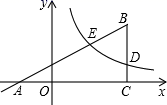

# Mathematics - 题目 1129

**ID**: 7863570e2c6041a1a48f6b7d2cdba3ed
**年级**: Grade 9
**难度**: Medium-Hard
**题型**: Calculation

## 题目
Rt△ABC在直角坐标系内的位置如图所示，反比例函数 $y=\frac {k}{x}(k\ne 0)$ 在第一象限内的图象与BC边交于点D（4，m），与AB边交于点E（2，n），△BDE的面积为2．（1）求m与n的数量关系；​​​​​​​‌（2）当tan∠BAC＝ $\frac {1}{2}$ 时，求反比例函数的解析式和直线AB的解析式；（3）设P是线段AB边上的点，在（2）的条件下，是否存在点P，以B，C，P为顶点的三角形与△EDB相似？若存在，求出此时点P的坐标；若不存在，请说明理由．

## 解答

1. 解：（1）∵D（4，m）、E（2，n）在反比例函数y＝ $\frac {k}{x}$ 的图象上，
2. ∴4m＝k，2n＝k，
3. 整理，得n＝2m；
4. （2）如图1，过点E作EH⊥BC，垂足为H．
5. 
6. 在Rt△BEH中，tan∠BEH＝tan∠A＝ $\frac {1}{2}$ ，EH＝2，所以BH＝1．
7. 因此D（4，m），E（2，2m），B（4，2m+1）．
8. 已知 $\vartriangle BDE$ 的面积为2，
9. ∴ $\frac {1}{2}$BD•EH＝ $\frac {1}{2}$ （m+1）×2＝2，
10. 所以解得m＝1．
11. 因此D（4，1），E（2，2），B（4，3）．
12. 因为点D（4，1）在反比例函数y＝ $\frac {k}{x}$ 的图象上，
13. 所以k＝4．
14. 因此反比例函数的解析式为： $y=\frac {4}{x}$ ．
15. 设直线AB的解析式为y＝kx+b，代入B（4，3）、E（2，2），
16. 得 $\begin{cases}4k+b=3\\2k+b=2\end{cases}$
17. 解得： $\begin{cases}k=\frac {1}{2}\\b=1\end{cases}$
18. 因此直线AB的函数解析式为： $y=\frac {1}{2}x+1$ ．
19. （3）如图2，作EH⊥BC于H，PF⊥BC于F，
20. 
21. 当 $\mathrm{△}BED∽\mathrm{△}BPC$ 时， $\frac {BE}{BP}$ ＝ $\frac {BD}{BC}$ ＝ $\frac {2}{3}$ ，
22. $\frac {BH}{BF}$ ＝ $\frac {2}{3}$ ，
23. ∵BH＝1，
24. ∴BF=$\frac {3}{2}$ ，
25. ∴CF＝ $\frac {3}{2}$ ，
26. $\frac {3}{2}$ ＝ $\frac {1}{2}$x+1，x＝1，
27. 点P的坐标为（1， $\frac {3}{2}$ ）；
28. 如图3，
29. 
30. 当 $\mathrm{△}BED∽\mathrm{△}BCP$ 时， $\frac {BE}{BC}$ ＝ $\frac {BD}{BP}$ ，
31. EH＝2，BH＝1，由勾股定理，BE＝ $\sqrt {5}$ ，
32. $\frac {\sqrt {5}}{3}$ ＝ $\frac {2}{BP}$ ，BP＝ $\frac {6\sqrt {5}}{5}$ ，
33. 同理可得： $\frac {BH}{BF}$ ＝ $\frac {BE}{BP}$ ，BH＝1，
34. $\therefore $BF＝ $\frac {6}{5}$ ，
35. ∴CF＝ $\frac {9}{5}$ ，
36. $\frac {9}{5}$ ＝ $\frac {1}{2}x+1$ ，x＝ $\frac {8}{5}$ ，
37. 点P的坐标为（ $\frac {8}{5}$ ， $\frac {9}{5}$ ）
38. 点P的坐标为（1， $\frac {3}{2}$ ）；（ $\frac {8}{5}$ ， $\frac {9}{5}$ ）

## 知识点

**中文**:
  - 列一次函数解析式
  - 反比例函数系数k的几何意义及应用
  - 反比例函数综合
  - 相似三角形的实际应用
  - 正切

**English**:
  - Writing Linear Function Expressions
  - Geometric Meaning and Application of Coefficient k
  - Comprehensive Inverse Proportionality Problems
  - Applications of Similar Triangles
  - Tangent

---
