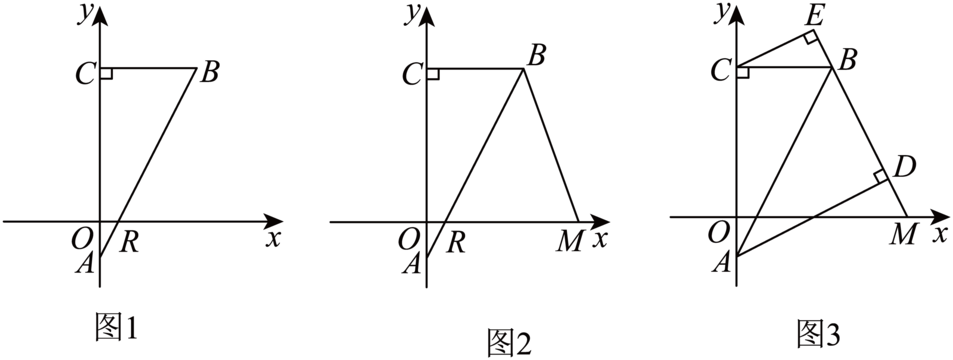

# Mathematics - 题目 1130

**ID**: 7b0f13c94b7f49d1bcefefd7774a997a
**年级**: Grade 9
**难度**: Medium-Hard
**题型**: Calculation

## 题目
已知：如图，在平面直角坐标系中， $△ACB$ 是直角三角形， $\angle ACB\mathrm{=}90{}\degree $ ，点 $B$ 的坐标为 $\left ({5,8}\right )$ ， $AB$ 交 $x$ 轴于点 ${\rm \mathit{R}，}{\rm{R}}{\rm{t}}\mathrm{△}ACB$ 的面积为 $25$ ．（1）如图1，求点 $A$ 坐标；​​​​​​​‌（2）如图2，点 $M$ 在 $OR$ 的延长线上，连接 $BM$ ，设点 $M$ 的横坐标为 $t$ ， $\mathrm{△}RMB$ 的面积为 $\mathrm{S}$ ，求 $\mathrm{S}$ 与 $t$ 的函数关系式；（不要求写出自变量 $t$ 的取值范围）（3）如图3，在（2）的条件下，过点 $A$ 作 $BM$ 的垂线，垂足为 $D$ ，过点 $C$ 作 $BM$ 的垂线，垂足为 $E$ ，当 $AD=DE$ 时，求 $t$ 的值．

## 解答

1. （1）解： $\because $ 点 $B$ 的坐标为 $\left ({5,8}\right )$ ， $\angle ACB\mathrm{=}90{}\degree $ ，
2. $\therefore BC=5,OC=8$ ，
3. ∵ $S{{}_{\vartriangle ABC}}=\frac {1}{2}BC\cdot AC=25$ ，
4. ∴ $AC=10$ ，
5. ∴ $OA=AC-OC=10-8=2$
6. $\therefore A\left ({0,-2}\right )$
7. （2） $\because OR/\mskip-4mu/BC$
8. $\therefore \vartriangle AOR∽\vartriangle ACB$
9. $\therefore \frac {OR}{BC}=\frac {AO}{AC}$
10. $\therefore \frac {OR}{5}=\frac {2}{10}$
11. $\therefore OR=1$
12. $\because $ 点 $M$ 的横坐标为 $t$
13. $\therefore OM=t$
14. $\therefore MR=OM-OR=t-1$
15. $\therefore S=\frac {1}{2}RM\cdot OC=\frac {1}{2}\left ({t-1}\right )\cdot 8$
16. ∴ $S=4t-4$ ；
17. （3）过点 $A$ 向 $CE$ 作垂线，垂足为 $F$ ，连接 $AE$ ，
18. $\because AD\bot BM$ ， $AD=DE$
19. ∴ $\angle DAE=\angle DEA=45{}\degree $
20. 
21. ∵ $\angle BEC=90{^{\circ }}$
22. ∴ $\angle FAE=\angle AEF=45{}\degree $ ，
23. ∴ $AF=EF$
24. ∵ $\angle ACB\mathrm{=}90{}\degree $ ，
25. ∴ $\angle BCE=\angle CAF$ ，
26. $\therefore \vartriangle AFC∽\vartriangle CEB$
27. $\therefore \frac {BE}{CF}=\frac {CE}{AF}=\frac {BC}{AC}=\frac {5}{10}=\frac {1}{2}$
28. 设 $BE=m$ ，则 $CF=2{\rm{m}}$ ．
29. 设 $CE=n$ ，则 $AF=2n$
30. $\because EF=AF$
31. $\therefore 2m+n=2n$
32. $\therefore n=2{\rm{m}}$
33. $\therefore {\rm{t}}{\rm{a}}{\rm{n}}∠CBE=\frac {2{\rm{m}}}{m}=2$
34. 过点 $B$ 作 $BN\bot OM$ 于 $N$ ，
35. $\therefore $ 四边形 $BCON$ 为矩形
36. $\therefore BN=OC=8，ON=BC=5$
37. $\because BC/\mskip-4mu/OM$
38. $\therefore \angle BMN=\angle CBE$
39. $\therefore {\rm{t}}{\rm{a}}{\rm{n}}∠BMN=2$
40. 在 ${\rm{R}}{\rm{t}}\mathrm{△}BMN$ 中
41. ${\rm{t}}{\rm{a}}{\rm{n}}∠BMN=\frac {BN}{MN}=\frac {8}{MN}=2$
42. $\therefore MN=4$
43. $\therefore OM=ON+MN=5+4=9$
44. $\therefore t=9$ ．

## 知识点

**中文**:
  - 函数解析式
  - 矩形的判定与性质综合
  - 相似三角形的判定与性质综合
  - 解直角三角形

**English**:
  - Analytic Expressions of Functions
  - Determination and Properties of Rectangles
  - Determination and Properties
  - Solving Right Triangles

---
