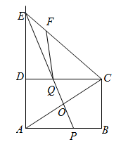

# Mathematics - 题目 1695

**ID**: 7c31d10695434392b851d803183e8ae6
**年级**: Grade 9
**难度**: Medium-Hard
**题型**: Calculation

## 题目
如图，在矩形 $ABCD$ 中， $AB=8$ ， $O$ 是对角线 $AC$ 的中点， $P$ 是线段 $AB$ 上一点，射线 $PO$ 交 $CD$ 于点 $Q$ ，交 $AD$ 延长线于点 $E$ ，连接 $CE$ ，在 $CE$ 上取点 $F$ ，使 $FQ=CQ$ ，设 $AP=x\left ({x>4}\right )$ ，（1）连接 $DB$ ，当 $x=\frac {16}{3}$ 时，判断四边形 $EDBC$ 是否为平行四边形，并说明理由．（2）当 $x=6$ 时，若 $FQ$ 平行 $\mathrm{△}ACB$ 的某一边，求 $AD$ 的长．（3）若 $EA=EC$ ，分别记 $\mathrm{△}FQC$ 和 $\mathrm{△}EDC$ 的面积为 $S{{}_{1}}$ 和 $S{{}_{2}}$ ，且 $\frac {S{{}_{1}}}{S{{}_{2}}}=\frac {1}{2}$ ．求 $\frac {ED}{AD}$ 的值．​​​​​​​‌

## 解答

1. 解：（1）四边形EDBC是平行四边形，理由如下：
2. 
3. ∵四边形 $ABCD$ 是矩形， $AB=8$ ，
4. ∴ $CD=AB=8,CD{\rm{/}}{\rm{/}}AB,DA{\rm{/}}{\rm{/}}CB,DA=CB$ ，
5. ∴ $\angle DCA=\angle CAB$ ，
6. ∵ $O$ 是对角线 $AC$ 的中点，
7. ∴ $OC=AO$ ，
8. ∵ $\angle QOC=\angle AOP$ ，
9. ∴ $\vartriangle COQ≌\vartriangle AOP\left ({ASA}\right )$ ，
10. ∴ $CQ=AP=\frac {16}{3}$ ，
11. ∴ $DQ=8-\frac {16}{3}=\frac {8}{3}$ ，
12. ∵ $CD{\rm{/}}{\rm{/}}BA$ ，
13. ∴ $\vartriangle EDQ∽\vartriangle EAP$ ，
14. ∴ $\frac {ED}{EA}=\frac {DQ}{AP}=\frac {1}{2}$ ，
15. ∴ $ED=DA$ ，
16. ∴ $ED=CB$ ，
17. ∴四边形EDBC是平行四边形；
18. （2）由（1）及题意得： $CQ=AP=6$ ，
19. ①当 $FQ{\rm{/}}{\rm{/}}BC$ 时，则 $\angle FQC=\angle QCB=90{}^\circ $ ，如图所示：
20. 
21. ∴∠FCQ=45°，
22. ∴△FQC、△EDC都为等腰直角三角形，
23. ∴ED=DC=8， $FQ=QC=6$ ,
24. ∴ $DQ=2$ ，
25. ∵ $\vartriangle EDQ∽\vartriangle EAP$ ，
26. ∴ $\frac {ED}{EA}=\frac {DQ}{AP}$ ，即 $\frac {8}{EA}=\frac {2}{6}$ ，
27. ∴ $EA=24$ ，
28. ∴AD=24-8=16；
29. ②当 $FQ{\rm{/}}{\rm{/}}AC$ 时，如图所示：
30. 
31. 作DH∥FC交AC于点H，
32. ∴ $\angle FQC=\angle HCD,\angle FCQ=\angle HDC$ ，
33. ∴ $\vartriangle QFC∽\vartriangle CDH$ ，
34. ∴ $CD=CH=8$ ，
35. ∵ $\vartriangle EDQ∽\vartriangle EAP$ ，DQ=CD-CQ=8-6=2，
36. ∴ $\frac {ED}{EA}=\frac {DQ}{AP}=\frac {2}{6}=\frac {1}{3}$ ，
37. ∵DH∥EC，
38. ∴ $\frac {ED}{EA}=\frac {CH}{CA}=\frac {1}{3}$ ，
39. ∴AC=24，
40. ∴ $AD=\sqrt {AC{^{2}}-CD{^{2}}}=\sqrt {24{^{2}}-8{^{2}}}=16\sqrt {2}$ ，
41. 综上所述： $AD=16$ 或 $16\sqrt {2}$ ；
42. （3）过点Q作QN⊥CF于点N，如图所示：
43. 
44. ∴ $\vartriangle CNQ∽\vartriangle CDE$ ，
45. ∵ $FQ=CQ$ ，
46. ∴ $CN=FN$ ，
47. ∴ $\frac {S{{}_{\vartriangle CNQ}}}{S{{}_{1}}}=\frac {1}{2}$ ，
48. ∵ $\frac {S{{}_{1}}}{S{{}_{2}}}=\frac {1}{2}$ ，
49. ∴ $\frac {S{{}_{\vartriangle CNQ}}}{S{{}_{2}}}=\frac {1}{4}$ ，
50. ∴ $\frac {CN}{CD}=\frac {1}{2}$ ，
51. ∴ $CN=4$ ，
52. ∵ $EA=EC,OA=OC$ ，
53. ∴EO是∠AEC的角平分线，
54. ∴ $DQ=QN=m$ ，
55. ∴ $AP=CQ=8-m$ ，
56. 在Rt△CNQ中， $CN{^{2}}+QN{^{2}}=CQ{^{2}}$ ，即 $4{^{2}}+m{^{2}}={\left({8-m}\right)^{2}}$ ，
57. 解得： $m=3$ ，
58. $\therefore DQ=3，AP=CQ=8-3=5$ ，
59. ∴ $\frac {ED}{EA}=\frac {DQ}{AP}=\frac {3}{5}$ ，
60. ∴ $\frac {ED}{AD}=\frac {3}{2}$ ．

## 知识点

**中文**:
  - 相似三角形的综合问题

**English**:
  - Comprehensive Similar Triangle Problems

---
