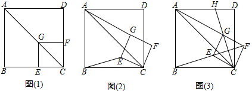

# Mathematics - 题目 1659

**ID**: 7c3a971521fb4125ad1fb2c629e6e459
**年级**: Grade 9
**难度**: Medium-Hard
**题型**: Calculation

## 题目
如图（1），已知点G在正方形ABCD的对角线AC上，GE⊥BC，垂足为点E，GF⊥CD，垂足为点F．（1）证明与推断：①求证：四边形CEGF是正方形；​​​​​​​‌②推断： $\frac {AG}{BE}$ 的值为：（2）探究与证明：将正方形CEGF绕点C顺时针方向旋转α角（0°＜α＜45°），如图（2）所示，试探究线段AG与BE之间的数量关系，并说明理由：（3）拓展与运用：正方形CEGF在旋转过程中，当B，E，F三点在一条直线上时，如图（3）所示，延长CG交AD于点H．若AG=6，GH=2 $\sqrt {2}$ ，则BC=．

## 解答

1. （1）①∵四边形ABCD是正方形，
2. ∴∠BCD=90°，∠BCA=45°，
3. ∵GE⊥BC、GF⊥CD，
4. ∴∠CEG=∠CFG=∠ECF=90°，
5. ∴四边形CEGF是矩形，∠CGE=∠ECG=45°，
6. ∴EG=EC，
7. ∴四边形CEGF是正方形；
8. ②由①知四边形CEGF是正方形，
9. ∴∠CEG=∠B=90°，∠ECG=45°，
10. ∴ $\frac {CG}{CE}=\sqrt {2}$ ，GE∥AB，
11. ∴ $\frac {AG}{BE}=\frac {CG}{CE}=\sqrt {2}$ ，
12. 故答案为 $\sqrt {2}$ ；
13. （2）连接CG，
14. 
15. 由旋转性质知∠BCE=∠ACG=α，
16. 在Rt△CEG和Rt△CBA中，
17. $\frac {CE}{CG}$ = $\frac {\sqrt {2}}{2}$ 、 $\frac {CB}{CA}$ = $\frac {\sqrt {2}}{2}$ ，
18. ∴ $\frac {CG}{CE}$ = $\frac {CA}{CB}=\sqrt {2}$ ，
19. ∴△ACG∽△BCE，
20. ∴ $\frac {AG}{BE}=\frac {CA}{CB}=\sqrt {2}$ ，
21. ∴线段AG与BE之间的数量关系为AG= $\sqrt {2}$ BE；
22. （3）∵∠CEF=45°，点B、E、F三点共线，
23. ∴∠BEC=135°，
24. ∵△ACG∽△BCE，
25. ∴∠AGC=∠BEC=135°，
26. ∴∠AGH=∠CAH=45°，
27. ∵∠CHA=∠AHG，
28. ∴△AHG∽△CHA，
29. ∴ $\frac {AG}{AC}=\frac {GH}{AH}=\frac {AH}{CH}$ ，
30. 设BC=CD=AD=a，则AC= $\sqrt {2}$ a，
31. 则由 $\frac {AG}{AC}=\frac {GH}{AH}$ 得 $\frac {6}{\sqrt {2}a}=\frac {2\sqrt {2}}{AH}$ ，
32. ∴AH= $\frac {2}{3}$ a，
33. 则DH=AD﹣AH= $\frac {1}{3}$ a，CH= $\sqrt {CD{^{2}}+DH{^{2}}}$ = $\frac {\sqrt {10}}{3}$ a，
34. ∴由 $\frac {AG}{AC}=\frac {AH}{CH}$ 得 $\frac {6}{\sqrt {2}a}=\frac {\frac {2}{3}a}{\frac {\sqrt {10}}{3}a}$ ，
35. 解得：a=3 $\sqrt {5}$ ，即BC=3 $\sqrt {5}$ ，
36. 故答案为3 $\sqrt {5}$ ．

## 知识点

**中文**:
  - 正方形的判定与性质综合
  - 相似三角形的判定与性质综合

**English**:
  - Determination and Properties of Squares
  - Determination and Properties

---
