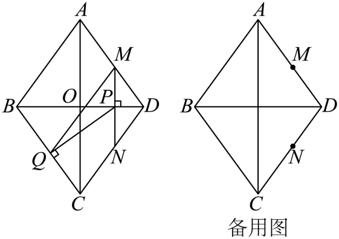

# Mathematics - 题目 602

**ID**: 7e4df302b9e24e64af93eebda92683e6
**年级**: Grade 9
**难度**: Medium-Hard
**题型**: Calculation

## 题目
已知：如图，菱形 $ABCD$ 中， $AB=10{\rm{c}}{\rm{m}}，BD=12{\rm{c}}{\rm{m}}$ ，对角线 $AC$ 与 $BD$ 相交于点 $O$ ，直线 $MN$ 以 $1{\rm{c}}{\rm{m}}{\rm{/}}{\rm{s}}$ 从点 $D$ 出发，沿 $DB$ 方向匀速运动，运动过程中始终保持 $MN\bot BD$ ，垂足是点 $P$ ，过点 $P$ 作 $PQ\bot BC$ ，交 $BC$ 于点 $Q．\left ({0<t<6}\right )$（1）求线段 $PQ$ 的长；​​​​​​​‌（用含 $t$ 的代数式表示）（2）设 $\mathrm{△}MQP$ 的面积为 $y$ （单位： ${\rm{c}}{\rm{m}}{^{2}}$ ），求 $y$ 与 $t$ 的函数关系式；（3）是否存在某时刻 $t$ ，使线段 $MQ$ 恰好经过点 $O$ ？若存在求出此时 $t$ 的值；若不存在，请说明理由．

## 解答

1. （1）解：∵菱形 $ABCD$ 中， $AB=10{\rm{c}}{\rm{m}}，BD=12{\rm{c}}{\rm{m}}$ ，
2. ∴ $AC\mathrm{⊥}BD$ ， $AO=CO=\frac {1}{2}AC$ ， $BO=DO=\frac {1}{2}BD=6{\rm{c}}{\rm{m}}$ ，
3. $AB=BC=CD=DA=10{\rm{c}}{\rm{m}}$ ，
4. ∴ $CO=AO=\sqrt {AB{^{2}}-BO{^{2}}}=\sqrt {10{^{2}}-6{^{2}}}=8\left ({{\rm{c}}{\rm{m}}}\right )$ ，
5. 根据平移可知： $DP=t$ ，
6. ∴ $BP=12-t$ ，
7. ∵ $\sin \angle CBO=\frac {PQ}{BP}=\frac {CO}{BC}$ ，
8. ∴ $\frac {PQ}{12-t}=\frac {8}{10}$ ，
9. ∴ $PQ=\frac {48-4t}{5}$ ；
10. （2）解：过点Q作 $QE\bot BD$ 于点E，如图所示：
11. 
12. ∵ $MN\bot BD$ ，
13. ∴ $\angle MPD=90{}\degree $ ，
14. ∴ ${\tan}\angle MDP=\frac {MP}{DP}=\frac {AO}{DO}=\frac {8}{6}=\frac {4}{3}$ ，
15. ∴ $MP=\frac {4}{3}DP=\frac {4}{3}t$ ，
16. ∵ ${\cos}\angle CBO=\frac {BQ}{BP}=\frac {BO}{BC}=\frac {6}{10}=\frac {3}{5}$ ，
17. ∴ $BQ=\frac {3}{5}BP=\frac {3\left ({12-t}\right )}{5}$ ，
18. ∵ $\angle BEQ=90{}\degree $ ，
19. ∴ ${\cos}\angle EBQ=\frac {BE}{BQ}=\frac {BO}{BC}=\frac {3}{5}$ ，
20. ∴ $BE=\frac {3}{5}BQ=\frac {9\left ({12-t}\right )}{25}$ ，
21. ∴ $PE=BD-BE-PD$
22. $=12-t-\frac {9\left ({12-t}\right )}{25}$
23. $=-\frac {16}{25}t+\frac {192}{25}$ ，
24. ∴ $y=\frac {1}{2}MP\cdot EP$
25. $=\frac {1}{2}\times \frac {4}{3}t\times \left ({-\frac {16}{25}t+\frac {192}{25}}\right )$
26. $=-\frac {32}{75}t{^{2}}+\frac {128}{25}t\left ({0<t<6}\right )$ ；
27. （3）解：存在某时刻 $t$ ，使线段 $MQ$ 恰好经过点 $O$ ；
28. 过点Q作 $QE\bot BD$ 于点E，如图所示：
29. 
30. 则 $\angle BEQ=90{}\degree $ ，
31. 根据解析（2）可知： $BQ=\frac {3}{5}BP=\frac {3\left ({12-t}\right )}{5}$ ， $MP=\frac {4}{3}t$ ，
32. ∵ $\sin \angle EBQ=\frac {EQ}{BQ}=\frac {OC}{BC}=\frac {8}{10}=\frac {4}{5}$ ，
33. ∴ $EQ=\frac {4}{5}BQ=\frac {12\left ({12-t}\right )}{25}$ ，
34. 当 $MQ$ 经过点O时， $OP=OD-DP=6-t$ ，
35. $S{{}_{\vartriangle MPQ}}=S{{}_{\vartriangle MOP}}+S{{}_{\vartriangle QOP}}$
36. $=\frac {1}{2}OP\cdot MP+\frac {1}{2}OP\cdot EQ$
37. $=\frac {1}{2}OP\left ({MP+EQ}\right )$
38. $=\frac {1}{2}\left ({6-t}\right )\left [\frac {4}{3}t+\frac {12\left ({12-t}\right )}{25}\right ]$
39. $=-\frac {32}{75}t{^{2}}-\frac {8}{25}t+\frac {432}{25}$ ，
40. 根据解析（2）可知： $S{{}_{\vartriangle MPQ}}=-\frac {32}{75}t{^{2}}+\frac {128}{25}t\left ({0<t<6}\right )$ ，
41. ∴ $-\frac {32}{75}t{^{2}}+\frac {128}{25}t=-\frac {32}{75}t{^{2}}-\frac {8}{25}t+\frac {432}{25}$ ，
42. 解得， $t=\frac {54}{17}$ ．

## 知识点

**中文**:
  - 菱形的性质
  - 解直角三角形

**English**:
  - Properties of Rhombuses
  - Solving Right Triangles

---
