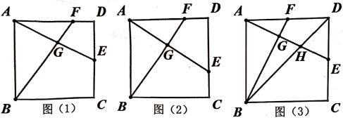

# Mathematics - 题目 2833

**ID**: 7e6d2842f187438bb1302f3ffbffb92e
**年级**: Grade 9
**难度**: Medium-Hard
**题型**: Calculation

## 题目
如图，正方形ABCD的边长为6，E、F分别是边CD、AD上动点，AE和BF交于点G．（1）如图（1），若E为边CD的中点，AF=2FD，求AG的长．（2）如图（2），若点F在AD上从A向D运动，点E在DC上从D向C运动，两点同时出发，同时到达各自终点，求在运动过程中，点G运动的路径长．（3）如图（3），若E、F分别是边CD、AD上的中点，BD与AE交于点H，求∠FBD的正切值．​​​​​​​‌

## 解答

1. 解：（1）延长AE交BC延长线于M,
2. 
3. 在正方形ABCD中，∠DAE =∠M
4. ∵E为DC的中点，AF=2FD,正方形边长为6
5. ∴DE = CE = 3，AF = 4
6. 在△ADE和△MCE中
7. $\begin{cases}\angle DAE{\rm{ }}=\angle M\\\angle AED{\rm{ }}=\angle MEC\\DE=CE\end{cases}$
8. ∴△ADE≌△MCE（AAS）
9. ∴AD = MC = 6
10. 在△AGF和△MBG中
11. $\begin{cases}\angle FAG{\rm{ }}=\angle M\\\angle AFG{\rm{ }}=\angle GBM\end{cases}$
12. ∴△AGF∽△MBG
13. ∴ $\frac {AG}{GM}=\frac {AF}{MB}=\frac {4}{12}=\frac {1}{3}$
14. AM= $\sqrt {6{^{2}}+12{^{2}}}=6\sqrt {5}$
15. ∴AG ${\rm{=}}\frac {1}{4}AM{\rm{=}}\frac {3\sqrt {5}}{2}$ .
16. （2）设AB的中点为点O，则OA = $\frac {1}{2}$ AB = 3，
17. 
18. 由题意知：AF=DE，AB=AD
19. ∴△ABF≌△DAE(HL)
20. ∴∠AFG =∠AED，∠DAE =∠ABF
21. ∵∠AFG +∠ABF=90°，∠DAE +∠AED=90°
22. ∴∠AFG+∠DAE=90°
23. ∴∠AGB=90°
24. ∴点G 在以O为圆心，OA为半径的圆上运动了 $\frac {1}{4}$ 圆周
25. ∴点G运动的路径长 =  $\frac {90{}^\circ }{180{}^\circ }\times 3$ π =  $\frac {3}{2}$ π；
26. （3）过点F作FN⊥BD于点D，据题意知∠FDN=45°，BD =  $\sqrt {6{^{2}}+6{^{2}}}=6\sqrt {2}$
27. 
28. ∵E、F分别是边CD、AD上的中点
29. ∴DF =  $\frac {1}{2}$ ×6 = 3
30. ∴在Rt△DNF中,FN = DN = sin45°•DF  ${\rm{=}}\frac {3\sqrt {2}}{2}$
31. ∴BN = BD–DN = $6\sqrt {2}-\frac {3\sqrt {2}}{2}=\frac {9\sqrt {2}}{2}$
32. ∴ $\tan \angle FBD=\frac {FN}{BN}=\frac {\frac {3\sqrt {2}}{2}}{\frac {9\sqrt {2}}{2}}=\frac {1}{3}$

## 知识点

**中文**:
  - 相似三角形的判定
  - 确定圆的条件
  - 解直角三角形

**English**:
  - Determination of Similar Triangles
  - Conditions to Determine a Circle
  - Solving Right Triangles

---
