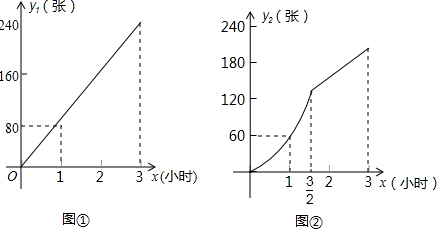

# Mathematics - 题目 439

**ID**: 7e815e91586640549ab1d142f1eb511f
**年级**: Grade 9
**难度**: Medium-Hard
**题型**: Calculation

## 题目
某市对火车站进行了大规模的改建，改建后的火车站除原有的普通售票窗口外，新增了自动打印车票的无人售票窗口．某日，从早8点开始到上午11点，每个普通售票窗口售出的车票数y_{1}（张）与售票时间x（小时）的正比例函数关系满足图①中的图象，每个无人售票窗口售出的车票数y_{2}（张）与售票时间x（小时）的函数关系满足图②中的图象．（1）图②中图象的前半段（含端点）是以原点为顶点的抛物线的一部分，根据图中所给数据确定抛物线的表达式为，其中自变量x的取值范围是；​​​​​​​‌（2）若当天共开放5个无人售票窗口，截至上午9点，两种窗口共售出的车票数不少于1450张，则至少需要开放多少个普通售票窗口？（3）上午10点时，每个普通售票窗口与每个无人售票窗口售出的车票数恰好相同，试确定图②中图象的后半段一次函数的表达式．

## 解答

1. （1）设函数的解析式为y=ax^{2}，把点（1，60）代入解析式得：a=10，
2. 则函数解析式为. y=60x^{2}（0⩽x⩽ $\frac {3}{2}$ ）
3. （2）设需要开放x个普通售票窗口，普通售票窗口的函数解析式为y=kx，
4. 把点（1，80）代入得k=80，则y=80x，
5. 由题意得，80x+60×5 $\geqslant $ 1450，
6. 解得x $\geqslant $ 14 $\frac {3}{8}$ ，
7. ∵x为整数，
8. ∴x=15，即至少需要开放15个普通售票窗口.
9. （3）由（2）知普通售票窗口的解析式为y=80x.
10. ∵10点对应x=2，
11. ∴当x=2时，y=160，
12. 即上午10点每个普通窗口与每个无人售票窗口售出的车票数均为160张.
13. 由（1）得，当x= $\frac {3}{2}$ 时，y=135，
14. ∴图2中的一次函数过点（ $\frac {3}{2}$ ，135）、（2，160），
15. 设一次函数的解析式为y=mx+n，
16. 把点（ $\frac {3}{2}$ ，135）、（2，160）的坐标代入得 $\begin{cases}\frac {3}{2}{\rm{m}}{\rm{+}}{\rm{n}}{\rm{=}}135\\2{\rm{m}}{\rm{+}}{\rm{n}}{\rm{=}}160\end{cases}$ ，解得 $\begin{cases}{\rm{m}}{\rm{=}}50\\{\rm{n}}{\rm{=}}60\end{cases}$ ，
17. 则一次函数的解析式为y=50x+60.

## 知识点

**中文**:
  - 函数的应用
  - 分段函数

**English**:
  - Applications of Functions
  - Piecewise Functions

---
