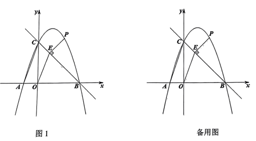

# Mathematics - 题目 3238

**ID**: 8095219400de4390aaa90557c0360570
**年级**: Grade 9
**难度**: Medium-Hard
**题型**: Calculation

## 题目
如图1，抛物线 $y=-x{{}^{2}}+2x+3$ 与x轴交于A和B两点（点A在点B左侧），与y轴交于点C，连接 $AC$ ，直线 $y=kx+b$ 经过点B、C．(1)求直线 $BC$ 的函数表达式；​​​​​​​‌(2)点P是位于直线 $BC$ 上方抛物线上的一个动点，过点P作 $PE\bot BC$ 于点E，连接 $OE$ ，求 $\mathrm{△}BOE$ 面积的最大值及此时点P的坐标；(3)在（2）的条件下，将抛物线沿着射线 $CA$ 方向平移 $2\sqrt {10}$ 个单位得到新抛物线 $y^{′}$ ， $y^{′}$ 与原抛物线相交于点M，点Q是新抛物线 $y^{′}$ 对称轴上的一个动点，点N为平面内一点，若以P、Q、M、N为顶点的四边形是以 $MQ$ 为边的菱形，直接写出所有符合条件的点N的坐标，并写出求解点N的坐标的其中一种情况的过程．

## 解答

1. （1）将 $x=0$ 代入 $y=-x{{}^{2}}+2x+3$ 得 $y=3$
2. ∴ $C\left ({0,3}\right )$
3. 将 $y=0$ 代入 $y=-x{{}^{2}}+2x+3$ ，得： $-x{{}^{2}}+2x+3=0$
4. 解得 $x{{}_{1}}=-1$ ， $x{{}_{2}}=3$
5. ∴ $A\left ({-1,0}\right )$ ， $B\left ({3,0}\right )$
6. 设 $B$ ， $C$ 所在直线的解析式为： $y=kx+b$
7. 代入 $B\left ({3,0}\right )$ ， $C\left ({0,3}\right )$ 得
8. $\left \{\hspace{-0.5em}\begin{array}{l}0=3k+b\\3=b\end{array}\hspace{-0.5em}\right.$
9. 解得 $\left \{\hspace{-0.5em}\begin{array}{l}k=-1\\b=3\end{array}\hspace{-0.5em}\right.$
10. ∴直线 $BC$ 的解析式为： $y=-x+3$
11. （2）过 $P$ 点作 $PM\bot x$ 轴于 $M$ 点，交直线 $BC$ 于点 $R$ ，过点 $E$ 作 $EN\bot PM$ 于点 $N$
12. 
13. ∵ $\angle COB=90{}^\circ $ ， $\angle MRB=\angle ERP=\angle EPN=45{}^\circ $
14. ∴ $PN=\frac {1}{2}PR$ ，
15. 设点 $P\left ({m,-m{{}^{2}}+2m+3}\right )$ ， $R(m,-m+3)$
16. ∴ $EH=NM=PM-PN=-\frac {1}{2}m{{}^{2}}+\frac {1}{2}m+3$
17. ∴当 $m=\frac {1}{2}$ 时， $EH$ 最大 $=\frac {25}{8}$
18. $S{{}_{\vartriangle BOE}}$ 最大 $=\frac {75}{16}$ ，此时 $P\left ({\frac {1}{2},\frac {15}{4}}\right )$
19. （3）∵抛物线沿射线 $CA$ 方向平移 $2\sqrt {10}$ 个单位得到新的抛物线 $y^{′}$ ， $CA=\sqrt {10}$
20. ∴当平移 $\sqrt {10}$ 个单位的时候，平移之后原来的C点到了A点的位置，可以看做抛物线先向下平移3个单位长度，再向左平移1个单位长度，
21. 故当平移 $2\sqrt {10}$ 个单位的时候，可以看做抛物线先向下平移6个单位长度，再向左平移2个单位长度，
22. ∴新抛物线的解析式为 $y^{′}=-\left ({x+2}\right ){{}^{2}}+2\left ({x+2}\right )+3-6=-x{{}^{2}}-2x-3$
23. ∴ $y^{′}$ 的对称轴为 $x{\rm{=}}-{\rm{1}}$
24. ∵ $y^{′}$ 与原抛物线相交于点M
25. 故令 $-x{{}^{2}}-2x-3=-x{{}^{2}}+2x+3$
26. 解得 $x=-\frac {3}{2}$
27. 则 $-\left ({-3}\right ){{}^{2}}-2\left ({-3}\right )-3=-\frac {9}{4}$
28. 所以点M坐标为 $\left ({-\frac {3}{2},-\frac {9}{4}}\right )$
29. 由（2）得知 $P\left ({\frac {1}{2},\frac {15}{4}}\right )$
30. 设 $Q\left ({-1,m}\right )$
31. ∴ $MP{{}^{2}}=\left ({\frac {1}{2}-\left ({-\frac {3}{2}}\right )}\right ){{}^{2}}+\left ({\frac {15}{4}-\left ({-\frac {9}{4}}\right )}\right ){{}^{2}}=40$
32. $MQ{{}^{2}}=\left ({-1-\left ({-\frac {3}{2}}\right )}\right ){{}^{2}}+\left ({m-\left ({-\frac {9}{4}}\right )}\right ){{}^{2}}=\frac {1}{4}+\left ({m+\frac {9}{4}}\right ){{}^{2}}$
33. $PQ{{}^{2}}=\left ({\left ({-1}\right )-\frac {1}{2}}\right ){{}^{2}}+\left ({m-\frac {15}{4}}\right ){{}^{2}}=\frac {9}{4}+\left ({m-\frac {15}{4}}\right ){{}^{2}}$
34. 当 $MP=MQ$ 时， $40=\frac {1}{4}+\left ({m+\frac {9}{4}}\right ){{}^{2}}$
35. 解得 $m=\frac {-9\pm 2\sqrt {159}}{4}$
36. 故 $Q{{}_{1}}\left ({-1,\frac {-9+2\sqrt {159}}{4}}\right )$ ， $Q{{}_{2}}\left ({-1,\frac {-9-2\sqrt {159}}{4}}\right )$
37. 则可以看做 $Q$ 是有 $M$ 先向右平移 $\frac {1}{2}$ 单位，再向上或向下平移 $\frac {2\sqrt {159}}{4}$ 个单位得到
38. 故 $N$ 点可以看做点 $P$ 同样平移可得，故 $\left ({\frac {1}{2}+\frac {1}{2},\frac {15}{4}\pm \frac {2\sqrt {159}}{4}}\right )$
39. ∴ $N{{}_{1}}\left ({1,\frac {15+2\sqrt {159}}{4}}\right )$ ， $N{{}_{2}}\left ({1,\frac {15-2\sqrt {159}}{4}}\right )$
40. 当 $PQ=MQ$ 时， $\frac {9}{4}+\left ({m-\frac {15}{4}}\right ){{}^{2}}=\frac {1}{4}+\left ({m+\frac {9}{4}}\right ){{}^{2}}$
41. 解得 $m=\frac {11}{12}$
42. 故 $Q{{}_{3}}\left ({-1,\frac {11}{12}}\right )$ ，
43. 则可以看做 $M$ 是 $Q$ 有先向左平移 $\frac {1}{2}$ 单位，再向下平移 $\frac {19}{6}$ 个单位得到
44. 故 $N$ 点可以看做点 $P$ 同样平移可得，故 $\left ({\frac {1}{2}-\frac {1}{2},\frac {15}{4}-\frac {19}{6}}\right )$
45. ∴ $N{{}_{3}}\left ({0,\frac {7}{12}}\right )$

## 知识点

**中文**:
  - 二次函数的对称
  - 二次函数的综合

**English**:
  - Symmetry of Quadratic Functions
  - Comprehensive Quadratic Function Problems

---
