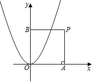

# Mathematics - 题目 1090

**ID**: 81a245b9680f4993a162c6374eca534e
**年级**: Grade 9
**难度**: Medium-Hard
**题型**: Calculation

## 题目
在平面直角坐标系中，过一点分别作坐标轴的垂线，若与坐标轴围成的矩形的周长与面积相等，则称这个点为“美好点”，如图，过点P分别作x轴，y轴的垂线，与坐标轴围成的矩形OAPB的周长与面积相等，则P为“美好点”．（1）在点M（2，2），N（4，4），Q（﹣6，3）中，是“美好点”的有；​​​​​​​‌（2）若“美好点”P（a，﹣3）在直线y＝x+b（b为常数）上，求a和b的值；（3）若“美好点”P恰好在抛物线y＝ $\frac {1}{12}$x^{2}第一象限的图象上，在x轴上是否存在一点Q使得△POQ为直角三角形？若存在，请求出点Q的坐标；若不存在，请说明理由．

## 解答

1. 解：（1）对于M点，对应图形的周长为：2×（2+2）＝8，面积为2×2＝4≠8，故点M不是“美好点”；
2. 对于点N，对应图形的周长为：2×（4+4）＝16，面积为4×4＝16，故点N是“美好点”；
3. 对于点Q，对应图形的周长为：2×（6+3）＝18，面积为6×3＝18，故点Q是“美好点”；
4. 故答案为：N、Q；
5. （2）对于P点，对应图形的周长为2×（|a|+3）＝2|a|+6，面积为3|a|，
6. ∵点P是“美好点”，
7. ∴2|a|+6＝3|a|，解得：a＝±6，
8. 将P（a，﹣3）代入y＝x+b得：﹣3＝a+b，则b＝﹣3﹣a，
9. ∴当a=6时，b=-9；当a=-6时，b=3，
10. 故a＝6，b＝﹣9或a＝﹣6，b＝3；
11. （3）存在，理由如下：
12. 设点P的坐标为（m，n），则n＝ $\frac {1}{12}$m^{2}（m＞0，n＞0），
13. 由题意得：2m+2n＝mn，∴2m+ $\frac {1}{6}$m^{2}＝ $\frac {1}{12}$m^{3}，
14. 解得：m＝6或﹣4（舍去）或0（舍去），
15. 故点P的坐标为（6，3）；
16. 设点Q的坐标为（x，0），
17. 则PQ^{2}＝（x﹣6）^{2}+3^{2}＝（x﹣6）^{2}+9，
18. PO^{2}＝36+9＝45，
19. OQ^{2}＝x^{2}，
20. 当∠POQ=90°时，∵点Q在x轴上，则∠POQ≠90°，此种情况不存在；
21. 当∠PQO=90°时，则PO^{2}=PQ^{2}+OQ^{2}，∴45=（x﹣6）^{2}+9+x^{2}，解得x＝6或x=0（舍去）；
22. 当∠OPQ=90°时，则OQ^{2}=PQ^{2}+OP^{2}，∴x^{2}=（x﹣6）^{2}+9+45，解得x＝ $\frac {15}{2}$ ；
23. 综上所述，符合条件的点Q的坐标为：（6，0）或（ $\frac {15}{2}$ ，0）．

## 知识点

**中文**:
  - y=ax²的图象与性质
  - 因式分解法解一元二次方程
  - 求自变量的值或函数值
  - 一次函数的图象和性质
  - 勾股定理的应用

**English**:
  - Graph and Properties of y=ax²
  - Solving by Factorization
  - Finding Variable or Function Values
  - Graphs and Properties of Linear Functions
  - Applications of Pythagorean Theorem

---
