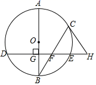

# Mathematics - 题目 2076

**ID**: 8354d6030c3e46c687beb31f628dbe4c
**年级**: Grade 9
**难度**: Medium-Hard
**题型**: Calculation

## 题目
如图， $AB$ 为 $\odot O$ 的直径，弦 $BC$ ， $DE$ 相交于点 $F$ ，且 $DE\bot AB$ 于点 $G$ ，过点 $C$ 作 $\odot O$ 的切线交 $DE$ 的延长线于点 $H$ ．（1）求证： $HC=HF$ ；​​​​​​​‌（2）若 $\odot O$ 的半径为5，点 $F$ 是 $BC$ 的中点， ${\tan}\angle HCF=m$ ，写出求线段 $BC$ 长的思路．

## 解答

1. （1）证明：连接 $OC$ ，如图1．
2. 
3. ∵ $CH$ 是 $\odot O$ 的切线，
4. ∴ $\angle 2+\angle 1=90{^{0}}$ ，
5. ∵ $DE\bot AB$ ，
6. ∴ $\angle 3+\angle 4=90{^{0}}$ ，
7. ∵ $OB=OC$ ，
8. ∴ $\angle 1=\angle 4$ ，
9. ∴ $∠2=∠3$ ，
10. 又∵ $\angle 5=\angle 3$ ，
11. ∴ $\angle 2=\angle 5$ ，
12. ∴ $HC=HF$ ．
13. （2）求解思路如下：
14. 思路一：连接 $OF$ ，如图2．
15. 
16. ① $OF$ 过圆心且点 $F$ 是 $BC$ 的中点，由垂径定理可得 $BC=2CF$ ， $\angle OFC=90{^{0}}$ ；
17. ②由 $\angle 6$ 与 $\angle 1$ 互余， $\angle 2$ 与 $\angle 1$ 互余可得 $\angle 6=\angle 2$ ，从而可知 ${\tan}\angle 6=m$ ；
18. ③在 $Rt\Delta OFC$ 中，由 ${\tan}\angle 6=\frac {CF}{OF}=π$ ，可设 $OF=x$ ， $CF=mx$ ，由勾股定理，得 $x{^{2}}+{\left({mx}\right)^{2}}=5{^{2}}$ ，可解得 $x$ 的值；
19. ④由 $BC=2CF=2mx$ ，可求 $BC$ 的长．
20. 思路二：连接 $AC$ ，如图3．
21. 
22. ①由 $AB$ 是 $\odot O$ 的直径，可得 $\Delta ACB$ 是直角三角形，知 $\angle 6$ 与 $\angle 4$ 互余，
23. 又 $DE\bot AB$ 可知 $\angle 3$ 与 $\angle 4$ 互余，得 $\angle 6=\angle 3$ ；
24. ②由 $\angle 6=\angle 3$ ， $\angle 3=\angle 2$ ，可得 $\angle 6=\angle 2$ ，从而可知 ${\tan}\angle 6=m$ ；
25. ③在 $Rt\Delta ACB$ 中，由 ${\tan}\angle 6=\frac {BC}{AC}=π$ ，可设 $AC=x,BC=mx$ ，
26. 由勾股定理，得 $x{^{2}}+{\left({mx}\right)^{2}}=10{^{2}}$ ，可解得 $x$ 的值；
27. ④由 $BC=mx$ ，可求 $BC$ 的长．

## 知识点

**中文**:
  - 圆的综合问题
  - 解直角三角形

**English**:
  - Comprehensive Circle Problems
  - Solving Right Triangles

---
