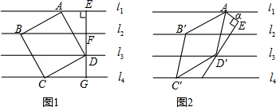

# Mathematics - 题目 3958

**ID**: 84074fb1369948b48ed83a135c10959c
**年级**: Grade 9
**难度**: Medium-Hard
**题型**: Calculation

## 题目
如图1，有一组平行线 $l{{}_{1}}\parallel l{{}_{2}}\parallel l{{}_{3}}\parallel l{{}_{4}}$ ，正方形 $ABCD$ 的四个顶点分别在 $l{{}_{1}},l{{}_{2}},l{{}_{3}},l{{}_{4}}$ 上， $EG$ 过点D且垂直于于点Ｅ，分别交 $l{{}_{2}},l{{}_{4}}$ 于点F，G， $EF=DG=1,DF=2$ ．（1）AE=，正方形ABCD的边长＝；​​​​​​​‌（2）如图2，将 $\angle AEG$ 绕点A顺时针旋转得到 $\angle AE^{′}D^{′}$ ，旋转角为 $α(0{^{\circ }}<α<90{^{\circ }})$ ，点 $D^{′}$ 在直线 $l{{}_{3}}$ 上，以 $AD^{′}$ 为边在的 $E^{′}D^{′}$ 左侧作菱形 $AD^{′}C^{′}B^{′}$ ，使点 $B^{′},C^{′}$ 分别在直线 $l{{}_{2}},l{{}_{4}}$ 上．①写出 $\angle B^{′}AD^{′}$ 与 $α$ 的函数关系并给出证明；②若 $α$ =30°，求菱形 $AD^{′}C^{′}B^{′}$ 的边长．

## 解答

1. （1）由题意可得：∠1+∠3=90°，∠1+∠2=90°，
2. ∴∠2=∠3，
3. 在△AED和△DGC中，
4. $\begin{cases}\angle AEF=\angle DGC\\\angle 3=\angle 2\\AD=CD\end{cases}$ ，
5. ∴△AED≌△DGC（AAS），
6. ∴AE=GD=1，
7. 又∵DE=1+2=3，
8. ∴正方形ABCD的边长= $\sqrt {1{^{2}}+3{^{2}}}=\sqrt {10}$ ，
9. 故答案为1， $\sqrt {10}$ ；
10. （2）①∠B′AD′=90°﹣α；
11. 理由：过点B′作B′M垂直于l_{1}于点M，
12. 在Rt△AED′和Rt△B′MA中，
13. $\begin{cases}B^{′}M=AE\\AB^{′}=AD^{′}\end{cases}$ ，
14. ∴Rt△AED′≌Rt△B′MA（HL），
15. ∴∠D′AE+∠B′AM=90°，
16. ∠B′AD′+α=90°，
17. ∴∠B′AD′=90°﹣α；
18. ②过点E作ON垂直于l_{1}分别交l_{1}，l_{2}于点O，N，
19. 若α=30°，则∠ED′N=60°，AE=1，故EO=，EN=，ED′= $\frac {5\sqrt {3}}{3}$ ，
20. 由勾股定理可知菱形的边长为： $\sqrt {\frac {25}{3}+1}=\frac {\sqrt {84}}{3}$ ．
21. 

## 知识点

**中文**:
  - 全等三角形实际应用
  - 勾股定理的应用
  - 几何变换——旋转综合题

**English**:
  - Applications of Congruent Triangles
  - Applications of Pythagorean Theorem
  - Rotation Comprehensive Problems

---
