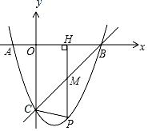

# Mathematics - 题目 258

**ID**: 84641d160e1145b3a52b6836bfbb7367
**年级**: Grade 9
**难度**: Medium-Hard
**题型**: Calculation

## 题目
如图，若抛物线y＝x^{2}+bx+c与x轴相交于A，B两点，与y轴相交于点C，直线y＝x﹣3经过点B，C．（1）求抛物线的解析式；​​​​​​​‌（2）点P是直线BC下方抛物线上一动点，过点P作PH⊥x轴于点H，交BC于点M，连接PC．①线段PM是否有最大值？如果有，求出最大值；如果没有，请说明理由；②在点P运动的过程中，是否存在点M，恰好使△PCM是以PM为腰的等腰三角形？如果存在，请直接写出点P的坐标；如果不存在，请说明理由．

## 解答

1. 解：（1）对于y＝x﹣3，令x＝0，y＝﹣3，y＝0，x＝3，
2. 故点B、C的坐标分别为（3，0）、（0，﹣3），
3. 将点B、C的坐标代入抛物线表达式得： $\begin{cases}9+3b+c=0\\c=-3\end{cases}$ ，
4. 解得： $\begin{cases}c=-3\\b=-2\end{cases}$ ，
5. 故抛物线的表达式为：y＝x^{2}﹣2x﹣3；
6. （2）设：点M（x，x﹣3），则点P（x，x^{2}﹣2x﹣3），
7. ①有，理由：PM＝（x﹣3）﹣（x^{2}﹣2x﹣3）＝﹣（x﹣ $\frac {3}{2}$ ）^{2}+ $\frac {9}{4}$ ，
8. ∵﹣1＜0，故PM有最大值，当x＝ $\frac {3}{2}$ 时，PM最大值为： $\frac {9}{4}$ ；
9. ②存在，理由：
10. PM^{2}＝（x﹣3﹣x^{2}+2x+3）^{2}＝（﹣x^{2}+3x）^{2}；
11. PC^{2}＝x^{2}+（x^{2}﹣2x﹣3+3）^{2}；
12. MC^{2}＝（x﹣3+3）^{2}+x^{2}；
13. （Ⅰ）当PM＝PC时，则（﹣x^{2}+3x）^{2}＝x^{2}+（x^{2}﹣2x﹣3+3）^{2}，
14. 解得：x＝0或2（舍去0），
15. 故x＝2，故点P（2，﹣3）；
16. （Ⅱ）当PM＝MC时，则（﹣x^{2}+3x）^{2}＝（x﹣3+3）^{2}+x^{2}，
17. 解得：x＝0或3± $\sqrt {2}$ （舍去0和3+ $\sqrt {2}$ ），
18. 故x＝3﹣ $\sqrt {2}$ ，则x^{2}﹣2x﹣3＝2﹣4 $\sqrt {2}$ ，
19. 故点P（3﹣ $\sqrt {2}$ ，2﹣4 $\sqrt {2}$ ）．
20. 综上，点P的坐标为：(2，﹣3)或(3﹣ $\sqrt {2}$ ，2﹣4 $\sqrt {2}$ )．

## 知识点

**中文**:
  - 二次函数的综合

**English**:
  - Comprehensive Quadratic Function Problems

---
