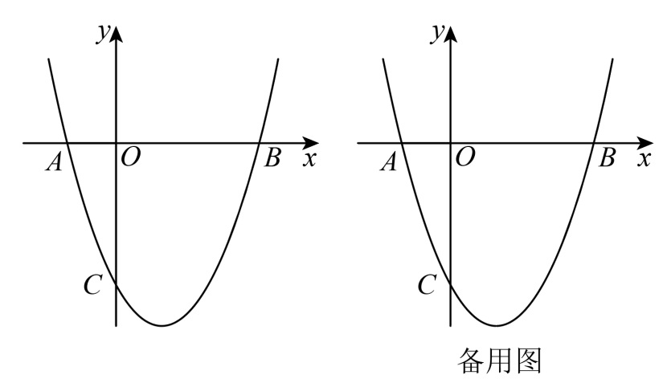

# Mathematics - 题目 3119

**ID**: 84ad6bcd9bc242d2aa484b0fa41893c9
**年级**: Grade 9
**难度**: Medium-Hard
**题型**: Calculation

## 题目
如图，在平面直角坐标系 $xOy$ 中，二次函数 $y=ax{^{2}}+bx-3$ 的图象与x轴相交于点 $A\left ({-1,0}\right )$ 、B，与y轴相交于点C，其对称轴是直线 $x=1$ ．(1) $a=$， $b=$；​​​​​​​‌(2)连接 $BC{\rm ，\mathit{P}}$ 是抛物线上一动点，记点P横坐标为p，满足 $1<p<3$ ，过点p分别作 $PD\parallel x$ 轴，交抛物线于点D，作 $PE\bot BC$ ，垂足为E，求 $PD+\sqrt {2}PE$ 的最大值；(3)将原抛物线向右平移一定距离，使得平移后的抛物线经过点B，M是第二象限原抛物线上的一点，过点M作直线 $MB$ ，交平移后抛物线于点N．记点M、N的横坐标分别为m、n，判断 $n-m$ 的值是否为定值，若是，请求出这个定值，若不是，请说明理由．

## 解答

1. （1）解：∵二次函数 $y=ax{^{2}}+bx-3$ 的图象与x轴相交于点 $A\left ({-1,0}\right )$ ，对称轴是直线 $x=1$ ．
2. ∴ $\begin{cases}a-b-3=0\\-\frac {b}{2a}=1\end{cases}$ ，解得： $\begin{cases}a=1\\b=-2\end{cases}$ ；
3. 故答案为： $1,-2$ ；
4. （2）由（1）知： $y{\rm{=}}x{^{{{2}}}}-{{2}}x-{{3}}$ ，
5. ∴当 $y=x{^{2}}-2x-3=0$ 时， $x{{}_{1}}=3,x{{}_{2}}=-1$ ，当 $x=0$ 时， $y{\rm{=}}-{{3}}$ ，
6. ∴ $B\left ({3,0}\right ),C\left ({0,-3}\right )$ ，
7. ∴ $OB=OC=3$ ，
8. ∴ $\angle OBC=\angle OCB=45{}\degree $ ，
9. 设 $BC$ 的解析式为： $y=kx-3$ ，把 $B\left ({3,0}\right )$ ，代入 $y=kx-3$ ，得： $k=1$ ，
10. ∴ $y=x-3$ ，
11. 过点 $P$ 作 $PF\bot x$ 轴交 $BC$ 于点 $G$ ，则： $PF\mathrm{/\mskip-4mu/}OC$ ，
12. 
13. ∴ $\angle PGE=\angle OCB=45{}\degree $ ，
14. 由题意，得： $P\left ({p,p{^{2}}-2p-3}\right )$ ，则： $G\left ({p,p-3}\right )$ ，
15. ∴ $PG=p-3-p{^{2}}+2p+3=-p{^{2}}+3p$ ，
16. ∵ $PE\bot BC$ ，  $\angle PGE=45{}\degree $ ，
17. ∴ $\mathrm{△}PEG$ 为等腰直角三角形，
18. ∴ $PG=\sqrt {2}PE=-p{^{2}}+3p$ ，
19. ∵ $PD\parallel x$ 轴，
20. ∴ $PD=p$ ，
21. ∴ $PD+\sqrt {2}PE=p-p{^{2}}+3p=-p{^{2}}+4p=-{\left({p-2}\right)^{2}}+4$ ，
22. ∵ $1<p<3$ ，
23. ∴当 $p=2$ 时， $PD+\sqrt {2}PE$ 有最大值为4；
24. （3）是定值：
25. ∵ $y=x{^{2}}-2x-3={\left({x-1}\right)^{2}}-4$ ，
26. ∵将原抛物线向右平移一定距离，使得平移后的抛物线经过点B，
27. ∴设平移后的抛物线为： $y={\left({x-1-h}\right)^{2}}-4\left ({h>0}\right )$ ，把 $B\left ({3,0}\right )$ ，代入，得： ${\left({3-1-h}\right)^{2}}-4=0$ ，
28. 解得： $h=4$ 或 $h=0$ （舍去）；
29. ∴ $y={\left({x-5}\right)^{2}}-4=x{^{2}}-10x+21$ ，
30. 设 $M\left ({m,m{^{2}}-2m-3}\right )$ ， $N\left ({n,n{^{2}}-10n+21}\right )$ ，
31. 设直线 $BM$ 的解析式为： $y=k\left ({x-3}\right )$ ，把点 $M\left ({m,m{^{2}}-2m-3}\right )$ ，代入得：
32. $m{^{2}}-2m-3=k\left ({m-3}\right )$ ，
33. 解得： $k=m+1$ ，
34. ∴ $y=\left ({m+1}\right )\left ({x-3}\right )$ ，
35. 把点 $N\left ({n,n{^{2}}-10n+21}\right )$ 代入 $y=k\left ({x-3}\right )$ ，得： $n{^{2}}-10n+21=k\left ({n-3}\right )$ ，
36. 解得： $k=n-7$ ，
37. ∴ $m+1=n-7$ ，
38. ∴ $m-n=-8$ ，即： $m-n$ 为定值，为8．
39. 

## 知识点

**中文**:
  - 二次函数图象的平移
  - 二次函数的综合
  - 待定系数法求二次函数解析式

**English**:
  - Translation of Quadratic Graphs
  - Comprehensive Quadratic Function Problems
  - Finding Quadratic Expressions by Undetermined Coefficients

---
