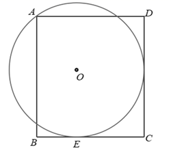

# Mathematics - 题目 2390

**ID**: 84c7cd7f38954d0c89467f66b4621acd
**年级**: Grade 9
**难度**: Medium-Hard
**题型**: Calculation

## 题目
如图，在矩形ABCD中，AB＝9，BC＝8，⊙O过点A且与BC相切于点E．设BE＝m．（1）当⊙O与CD相切时，求m的值；​​​​​​​‌（2）点E从B向C运动，⊙O与CD边公共点的个数随m的变化而变化．直接写出公共点的个数及其对应的m的取值范围；（3）在点E从B向C运动的过程中，画出点O的运动路径，这个路径是．（填写序号）①线段；②弧；③双曲线的一部分；④抛物线的一部分

## 解答

1. 解：（1）如图①，设⊙O与CD相切于点F，连接OF、OA，连接OE并延长交AD于G．
2. 
3. ∵⊙O与CD相切于点F、与BC相切于点E．
4. ∴OE⊥BC，OF⊥CD
5. ∴∠BEO＝∠OFC＝90°．
6. ∵四边形ABCD是矩形，
7. ∴∠BAD＝∠B＝∠C＝∠D＝90°．
8. AD＝BC＝8，AB＝CD＝9，AD∥CB．
9. ∴∠BEO＋∠AGE＝180°．
10. ∴∠AGE＝90°．
11. ∴四边形ABEG和四边形OECF都是矩形．
12. ∵OE＝OF，
13. ∴四边形OECF是正方形．
14. ∵BE＝m，
15. ∴AG＝m，AO＝OE＝OF＝EC＝8－m，
16. ∴GO＝9－（8－m）＝1＋m
17. 在Rt△AGO中，由勾股定理得：
18. AO^{2}＝AG^{2}＋GO^{2}.
19. 即（8－m）^{2}＝m^{2}＋（1＋m）^{2}
20. ∴解得：m_{1}＝3，m_{2}＝－21（舍去）；
21. 所以，当⊙O与CD相切时，m＝3；
22. （2）①由（1）知，m=3时，⊙O与CD只有一个交点，
23. ∴ $0\leqslant m<3$ 时， $\odot O$ 与CD有0个公共点，如下图：
24. 
25. ②由（1）知，m=3时， $\odot O$ 与CD只有1个公共点，
26. 当 $OA>OD$ 时， $\odot O$ 与CD也只有1个公共点，如下图：
27. 
28. 点D在圆上时，如下图，再根据（1）的方法，OA=OD时，m=4，
29. 
30. 所以当 $m=3$ 或 $4<m\leqslant 8$ 时， $\odot O$ 与CD有1个公共点；
31. ③由（1）可知，m=3时， $\odot O$ 与CD有1个公共点，
32. 当 $m>4$ 时， $\odot O$ 与CD也有1个公共点，
33. ∴当 $3<m\leqslant 4$  时， $\odot O$ 与CD有2个公共点，如下图：
34. 
35. 综上所述：
36. 图形
37. 公共点个数
38. m的范围
39. 
40. 0
41. 0⩽m＜3
42. 
43. 1
44. m＝3
45. 
46. 2
47. 3＜m<4
48. 
49. 2
50. $m=4$
51. 
52. 1
53. 4＜m⩽8
54. （3）如下图，即为点O的运动路径，
55. 
56. 理由：
57. 如下图，设OE＝y，则AO＝y，GO＝9－y，
58. 
59. 在Rt△AGO中，由勾股定理得：
60. AO^{2}＝AG^{2}＋GO^{2}，
61. 即y^{2}＝m^{2}＋（9－y）^{2}，整理得： $y=\frac {1}{18}m{^{2}}+\frac {9}{2}$ （0⩽m⩽8），
62. 所以，⊙O的圆心的运动路径是抛物线．

## 知识点

**中文**:
  - 二次函数的定义
  - 四边形综合
  - 切线的性质和判定的综合应用

**English**:
  - Definition of Quadratic Functions
  - Comprehensive Quadrilateral Problems
  - Tangent Applications

---
