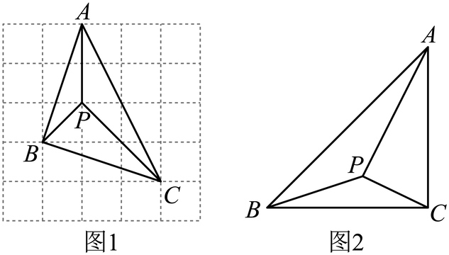

# Mathematics - 题目 1290

**ID**: 850d73011be94808a1de92bc53dc9bcd
**年级**: Grade 9
**难度**: Medium-Hard
**题型**: Calculation

## 题目
我们定义：在 $\vartriangle ABC$ 内有一点 $P$ ，连接 $PA$ ， $PB$ ， $PC$ ，在所得的 $\mathrm{△}ACP$ ， $\vartriangle ABP$ ， $\vartriangle BCP$ 中，有且只有两个三角形相似，则称点 $P$ 为 $\vartriangle ABC$ 的相似心．（1）如图1，在 $5\times 5$ 的方格纸中，每个小正方形的边长均为 ${\rm 1，}\vartriangle ABC$ 的顶点在格点上，若点 $P$ 为 $\vartriangle ABC$ 的相似心，则下列结论正确的是．​​​​​​​‌

## 解答

1. （1）解：如图1，取格点 $E$ 、 $F$ ，连接 $PE$ 、 $BE$ 、 $PF$ 、 $CF$ ，
2. $\because $ 在 $5\times 5$ 的方格纸中，每个小正方形的边长均为1，
3. $\therefore $  $\angle APE=\angle APF=\angle PEB=\angle PFC=90{}\degree $ ， $PE=BE=1$ ， $PF=CF=PA=2$ ，
4. $\therefore $  $\angle BPE=\angle PBE=\angle CPF=\angle PCF=45{}\degree $ ， $PB=\sqrt {1{^{2}}+1{^{2}}}=\sqrt {2}$ ， $PC=\sqrt {2{^{2}}+2{^{2}}}=2\sqrt {2}$ ，
5. $\therefore $  $\angle BPA=\angle APC=90{}\degree +45{}\degree =135{}\degree $ ， $\frac {PB}{PA}=\frac {\sqrt {2}}{2}$ ， $\frac {PA}{PC}=\frac {2}{2\sqrt {2}}=\frac {\sqrt {2}}{2}$ ，
6. $\therefore $  $\frac {PB}{PA}=\frac {PA}{PC}=\frac {\sqrt {2}}{2}$ ，
7. $\therefore $  $\mathrm{△}BAP{\rm{∽}}\mathrm{△}ACP$ ，
8. $\because $  $\angle BPC=360{}\degree -135{}\degree -135{}\degree =90{}\degree $ ，
9. $\therefore $  $\mathrm{△}BAP$ 与 $\vartriangle BCP$ 中的最大角 $\angle BPA\ne \angle BPC$ ， $\vartriangle BCP$ 与 $\vartriangle CAP$ 中的最大角 $\angle BPC\ne \angle APC$ ，
10. $\therefore $  $\mathrm{△}BAP$ 与 $\vartriangle BCP$ 不相似， $\vartriangle BCP$ 与 $\vartriangle CAP$ 不相似.
11. 
12. （2）解：① $\because $ 在 ${\rm{R}}{\rm{t}}\vartriangle ABC$ 中， $\angle ACB\mathrm{=}90{}\degree $ ， $AC=BC$ ，
13. $\therefore $  $\angle ABC=\angle BAC=45{}\degree $ ，
14. $\because $ 点 $P$ 是 ${\rm{R}}{\rm{t}}\mathrm{△}ABC$ 的相似心， $\mathrm{△}APB{\rm{∽}}\mathrm{△}BPC$ ，
15. $\therefore $  $\angle ABP=\angle BCP$ ， $\angle BAP=\angle CBP$ ， $\angle APB=\angle BPC$ ，
16. $\because $  $\angle APB=\angle BPC=180{}\degree -\left ({\angle ABP+\angle BAP}\right )$ ，
17. $\therefore $  $\angle APB=\angle BPC=180{}\degree -\left ({\angle ABP+\angle CBP}\right )=180{}\degree -\angle ABC=180{}\degree -45{}\degree =135{}\degree $ ；
18. 
19. ② $\because $  $AB=\sqrt {BC{^{2}}+AC{^{2}}}=\sqrt {2}BC$ ，
20. $\therefore $  $\frac {AB}{BC}=\sqrt {2}$ ，
21. $\because $  $\mathrm{△}APB{\rm{∽}}\mathrm{△}BPC$ ，
22. $\therefore $  $\frac {PA}{PB}=\frac {PB}{PC}=\frac {AB}{BC}=\sqrt {2}$ ，
23. $\therefore $  $PA=\sqrt {2}PB$ ， $PB=\sqrt {2}PC$ ，
24. $\therefore $  $PA=\sqrt {2}\times \sqrt {2}PC=2PC$ ，
25. $\because $  $\angle APC=360{}\degree -\angle APB-\angle BPC=360{}\degree -135{}\degree -135{}\degree =90{}\degree $ ，
26. $\therefore $  ${\tan}\angle PAC=\frac {PC}{PA}=\frac {1}{2}$ ．

## 知识点

**中文**:
  - 正切
  - 相似三角形的判定与性质综合

**English**:
  - Tangent
  - Determination and Properties

---
