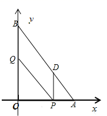

# Mathematics - 题目 2949

**ID**: 858a4bcef3ad4660b7c20a130f448420
**年级**: Grade 9
**难度**: Medium-Hard
**题型**: Calculation

## 题目
如图，将 $�{\rm{A}}{\rm{B}}{\rm{C}}$ 放在平面直角坐标系中，点 $O(0,0)$ ，点 $A(6,0)$ ，点 $B(0,8)$ 动点 $P$ 从点 $A$ 开始沿边 $AO$ 向点 $O$ 以1个单位长度的速度运动，同一时间，动点 $Q$ 从点 $O$ 开始沿边 $OB$ 向点 $B$ 以每秒2个单位长度的速度运动，当其中一点到达端点时，另一点也随之停止运动.​​​​​​​‌过点 $P$ 作 $PD\mathrm{/\mskip-4mu/}BO$ ，交 $AB$ 于点 $D$ ，连接 $PQ$ ，设运动时间为 $t$ 秒(t $\geqslant 0）$ .（Ⅰ）用含 $t$ 的代数式表示 $PD$ ；（Ⅱ）①是否存在 $t$ 的值，使四边形 $PDBQ$ 为平行四边形？若存在，求出 $t$ 的值；若不存在，说明理由；②是否存在 $t$ 的值，使四边形 $PDBQ$ 为菱形？若存在，求出 $t$ 的值；若不存在，说明理由.（Ⅲ）在整个运动过程中，求出线段 $PQ$ 的中点 $M$ 所经过的路径长.（直接写出结果即可）.

## 解答

1. 解：（I）∵点 $A\left ({6,0}\right )$ ，点 $B\left ({0,8}\right )$ ，
2. ∴ $OA=6$ ，  $OB=8$  ，
3. 且由题意， $PA=t$  ， $OQ=2t$  ，
4. ∵ $PD\mathrm{/\mskip-4mu/}BO$ ，
5. ∴ $\frac {PD}{BO}=\frac {PA}{AO}$ ，
6. 又 $BO=8$ ， $AO=6$ ， $PA=t$  ，
7. ∴ $\frac {PD}{8}=\frac {t}{6}$
8. ∴ $PD=\frac {4}{3}t$ .
9. （Ⅱ）①∵ $BQ\mathrm{/\mskip-4mu/}DP$ ，若 $BQ=DP$ ，
10. ∴则四边形 $PDBQ$ 是平行四边形，
11. 即 $8-2t=\frac {4}{3}{\rm{t}}$ ，解得： $t=\frac {12}{5}$ .
12. ∴当 $t=\frac {12}{5}$ 时，∴四边形 $PDBQ$ 为平行四边形.
13. ②不存在，理由如下：
14. ∵ $OA=6$ ， $OB=8$  ，
15. ∴在 $Rt\vartriangle AOB$ 中，  $ AB=\sqrt {OA{^{2}}+OB{^{2}}}=\sqrt {6{^{2}}+8{^{2}}}=10$   ，
16. ∵ $PD\mathrm{/\mskip-4mu/}BO$ ，∴ $\frac {AD}{AB}=\frac {PA}{AO}$ ， $\therefore \frac {AD}{10}=\frac {t}{6}$ ， $\therefore {\rm{A}}{\rm{D}}=\frac {5t}{3}$ ， $\therefore BD=10-\frac {5t}{3}$
17. ∴当 $t=\frac {12}{5}$ ，四边形 $PDBQ$ 为平行四边形时，
18. $PD=\frac {16}{5}$ ， $BD=6$
19. ∴ $DP\ne BD$ ，
20. ∴四边形PDBC不能为菱形.
21. （Ⅲ））∵点Q在BO上运动，点P在AO上运动，
22. ∴线段PQ的中点M的运动路径为一条线段，
23. ∵当Q在点O时，点P在点A处，
24. ∵点M为PQ的中点
25. ∴OM= $\frac {1}{2}$ PQ= $\frac {1}{2}\times 6=3$ ，
26. ∵当Q在点B时，AP=4，则OP=2
27. 
28. 此时，连接PQ，取PQ的中点 $M^{′}$ ，过 $M^{′}$ 作 $M^{′}E$  $\bot $ OA于E，
29. ∴OE=1，
30. ∴EM=2，
31. ∵AO⊥BO、 $M^{′}$ E⊥OA，
32. ∴ $M^{′}$ E∥BO，
33. ∵ $M^{′}$ 为PQ的中点，
34. ∴ $M^{′}$ E为△BOP的中位线，
35. ∴ $M^{′}$ E= $\frac {1}{2}$ BO=4，
36. 点M的运动路径为M $M^{′}$ = $\sqrt {2{^{2}}+4{^{2}}}$ =2 $\sqrt {5}$ ．

## 知识点

**中文**:
  - 平行四边形的性质
  - 直角三角形的性质
  - 相似三角形的判定与性质综合

**English**:
  - Properties of Parallelograms
  - Properties of Right Triangles
  - Determination and Properties

---
