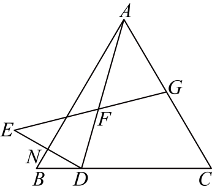

# Mathematics - 题目 3056

**ID**: 85a7d3e999b946b499cb1036eda30acd
**年级**: Grade 9
**难度**: Medium-Hard
**题型**: Calculation

## 题目
如图，在等边 ${\rm △}ABC$ 中，点 $D$ 是 $BC$ 边上一点（点 $D$ 不与 $B$ ， $C$ 重合） $BD<CD$ ，连接 $AD$ ，点 $D$ 关于直线 $AB$ 的对称点为点 $E$ ，连接 $DE$ 交 $AB$ 于点 $N$ ．在 $AD$ 上取一点 $F$ ，使 $∠EFD=∠BAC$ ，延长 $EF$ 交 $AC$ 于点 $G$ ．(1)若 $\angle BAD=α$ ，求 $\angle AGE$ 的度数（用含 ${\rm \mathit{α}}$ 的代数式表示）；​​​​​​​‌(2)用等式表示线段 $CG$ 与 $DE$ 之间的数量关系，并证明．

## 解答

1. （1）解：如图1，
2. 
3. $\because {\rm △}$  $ABC$ 是等边三角形，
4. $\therefore \angle BAC=60{}\degree $
5. $\because \angle EFD=\angle BAC$ ，
6. $\therefore \angle EFD=60{}\degree $ ，
7. $\because \angle EFD=\angle 1+\angle BAD=\angle 1+α$ ，
8. $\therefore \angle 1=60{}\degree -α$ ，
9. $\because \angle AGE+\angle 1+\angle BAC=180{}\degree $ ，
10. $\therefore \angle AGE=180{}\degree -60{}\degree -\angle 1=120{}\degree -\angle 1$ ，
11. $\therefore \angle AGE=120{}\degree -(60{}\degree -α)=60{}\degree +α$ ；
12. （2） $CG=\frac {2\sqrt {3}}{3}DE$ ．理由如下：
13. 如图2中，在 $CG$ 上截取 $CM=BD$ ，连接 $BM$ ， $BE$ ， $AE$ ， $BM$ 交 $AD$ 于点 $H$ ，
14. 
15. $\because {\rm △}$  $BCA$ 为等边三角形，
16. $\therefore \angle ABC=\angle C=60{}\degree $ ， $BC=AB$ ，
17. $\therefore {\rm △}$  $ABD≌{\rm △}$  $BCM\left ({SAS}\right )$ ，
18. $\therefore \angle 3=\angle 4$ ，
19. $\because \angle AHM=\angle 3+\angle 5$ ，
20. $\therefore \angle AHM=\angle 4+\angle 5=60{}\degree $ ，
21. $\because \angle EFD=\angle BAC=60{}\degree $ ，
22. $\therefore \angle AHM=\angle EFD$ ，
23. $\therefore EG/\mskip-4mu/BM$ ，
24. $\because $ 点 $D$ 关于直线 $AB$ 的对称点为点 $E$ ，
25. $\therefore AE=AD$ ， $BE=BD$ ， $\angle ABE=\angle ABC=60{}\degree $ ，
26. $\therefore \angle EBC=120{}\degree $ ，
27. $\therefore \angle EBC+\angle C=180{}\degree $ ，
28. $\therefore EB/\mskip-4mu/AC$ ，
29. $\therefore $ 四边形 $EBMG$ 是平行四边形，
30. $\therefore BE=GM$ ，
31. $\therefore BE=GM=BD=CM$ ，
32. $\therefore CG=2BD$ ，记 $AB$ 与 $DE$ 的交点为点 $N$ ，则由轴对称可知： $DE⊥AB$ ， $NE=ND$ ，
33. 在 $Rt{\rm △}$  $DNB$ 中， $DN=BD\cdot \sin \angle ABC=\frac {\sqrt {3}}{2}BD$ ，
34. $\therefore DE=2DN=\sqrt {3}BD$ ，
35. $\therefore $  $\frac {CG}{DE}=\frac {2BD}{\sqrt {3}BD}=\frac {2\sqrt {3}}{3}$ ，
36. $\therefore CG=\frac {2\sqrt {3}}{3}DE$ ．

## 知识点

**中文**:
  - 等边三角形的性质
  - 轴对称的性质
  - 解直角三角形

**English**:
  - Properties of Equilateral Triangles
  - Properties of Axial Symmetry
  - Solving Right Triangles

---
