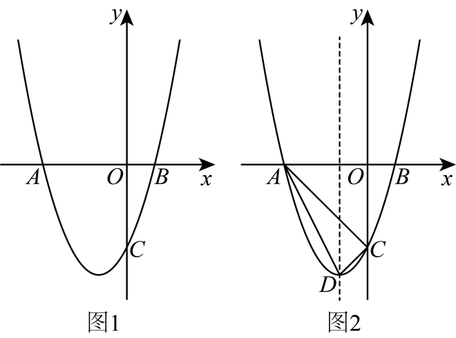

# Mathematics - 题目 2809

**ID**: 86a4826fb5504cc3a0a95655e3bd35ad
**年级**: Grade 9
**难度**: Medium-Hard
**题型**: Calculation

## 题目
如图1，已知二次函数 $y=x{^{2}}+bx+c$ 的图象与 ${\rm \mathit{x}}$ 轴相交于 $A\left ({-3，0}\right )、B\left ({1，0}\right )$ 两点，与 ${\rm \mathit{y}}$ 轴相交于点 ${\rm \mathit{C}}$ ．(1)求该二次函数的表达式；​​​​​​​‌(2)点 ${\rm \mathit{D}}$ 是二次函数图象上位于第三象限内的点．①如图2，当点 ${\rm \mathit{D}}$ 是抛物线的顶点时，连接 $AD,CD,AC$ ，求 $△ADC$ 的面积；②当点 ${\rm \mathit{D}}$ 到直线 $AC$ 的距离为最大值时，求此时点 ${\rm \mathit{D}}$ 的坐标；(3)若点 ${\rm \mathit{M}}$ 是二次函数图象对称轴上的点，在二次函数图象上是否存在点 ${\rm \mathit{N}}$ ，使得以 ${\rm \mathit{M}，\mathit{N}，\mathit{B}，\mathit{O}}$ 为顶点的四边形是平行四边形？若存在，请直接写出点 ${\rm \mathit{N}}$ 的坐标（不写求解过程）．

## 解答

1. （1）解：把 $A\left ({-3，0}\right )、B\left ({1，0}\right )$ 代入 $y=x{^{2}}+bx+c$ ，
2. 则有 $\begin{cases}9-3b+c=0\\1+b+c=0\end{cases}$ ，
3. 解得 $\begin{cases}b=2\\c=-3\end{cases}$ ，
4. ∴二次函数的解析式为 $y=x{^{2}}+2x-3$ ；
5. （2）解：①令 $x=0$ ，得到 $y{\rm{=}}-{{3}}$ ，
6. ∴ $C(0,-3)$ ，
7. $y=x{^{2}}+2x-3={\left({x+1}\right)^{2}}-4$ ，则顶点 $D\left ({-1,-4}\right )$ ，抛物线的对称轴为直线 $x{\rm{=}}-{{1}}$ ，
8. 设直线 $AC$ 解析式为 $y=kx-3$ ，
9. 将 $A(-3,0)$ 代入得， $0=-3k-3$ ，
10. 解得 $k=-1$ ，
11. ∴直线 $AC$ 的解析式为 $y=-x-3$ ，
12. 设直线 $AC$ 与对称轴直线 $x{\rm{=}}-{{1}}$ 的交点为 $E\left ({-1,-2}\right )$ ，
13. 
14. ∴ $DE=-2+4=2$ ，
15. ∴ $S{{}_{\vartriangle ADC}}=\frac {1}{2}DE\cdot \left |{x{{}_{A}}}\right |=\frac {1}{2}\times 2\times 3=3$ ；
16. ②如图，连接 $AD$ ， $CD$ ．
17. 
18. $\because $ 点 $D$ 到直线 $AC$ 的距离取得最大，
19. $\therefore $ 此时 $\mathrm{△}DAC$ 的面积最大，
20. 过点 $D$ 作 $x$ 轴的垂线交 $AC$ 于点 $G$ ，设点 $D$ 的坐标为 $\left ({x,x{^{2}}+2x-3}\right )$ ，
21. 则 $G\left ({x,-x-3}\right )$ ，
22. $\because $ 点 $D$ 在第三象限，
23. $\therefore DG=-x-3-(x{^{2}}+2x-3)=-x-3-x{^{2}}-2x+3=-x{^{2}}-3x$ ，
24. $\therefore S{{}_{{\rm{Δ}}ACD}}=\frac {1}{2}\cdot DG\cdot OA=\frac {1}{2}\left ({-x{^{2}}-3x}\right )\times 3=-\frac {3}{2}x{^{2}}-\frac {9}{2}x=-\frac {3}{2}{\left({x+\frac {3}{2}}\right)^{2}}+\frac {27}{8}$ ，
25. $\therefore $ 当 $x=-\frac {3}{2}$ 时， $S{{}_{最大}}=\frac {27}{8}$ ，点 $D\left ({-\frac {3}{2},-\frac {15}{4}}\right )$ ，
26. $\therefore $ 点 $D$ 到直线 $AC$ 的距离取得最大时， $D\left ({-\frac {3}{2},-\frac {15}{4}}\right )$ ；
27. （3）解：存在．
28. 如图2中，抛物线的对称轴为直线 $x{\rm{=}}-{{1}}$ ，
29. 当 $OB$ 是平行四边形的边时，
30. $OB=MN=1$ ， $OB{\rm{/\mskip-4mu/}}MN$ ，
31. ∴点 $N$ 的横坐标为0或 $-2$ ，
32. $x=-2$ 时， $y={\left({-2}\right)^{2}}+2\times \left ({-2}\right )-3=-3$ ，
33. $x=0$ 时， $y{\rm{=}}-{{3}}$ ，
34. ∴ $N\left ({-2,-3}\right )$ 或 $N^{′}{\left ({0,-3}\right )}$ ，
35. 
36. 当 $OB$ 为对角线时，点 $N^{′′}$ 的横坐标为2，
37. $x=2$ 时， $y=4+4-3=5$ ，
38. $\therefore N^{′′}{\left ({2,5}\right )}$ ．
39. 综上所述，满足条件的点 $N$ 的坐标为 $\left ({-2,-3}\right )$ 或 $\left ({0,-3}\right )$ 或 $\left ({2,5}\right )$ ．

## 知识点

**中文**:
  - 二次函数的对称
  - 二次函数的最值
  - 二次函数的综合
  - 平行四边形的性质

**English**:
  - Symmetry of Quadratic Functions
  - Maximum/Minimum of Quadratic Functions
  - Comprehensive Quadratic Function Problems
  - Properties of Parallelograms

---
