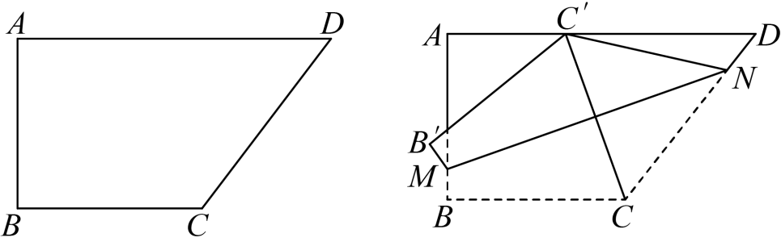

# Mathematics - 题目 2807

**ID**: 86bd657b8ef74271858c86b5b602fccf
**年级**: Grade 9
**难度**: Medium-Hard
**题型**: Calculation

## 题目
【操作观察】如图，在四边形纸片 $ABCD$ 中， $AD{\rm{/\mskip-4mu/}}BC$ ， $\angle ABC=90{}\degree $ ， $BC=8$ ， $AB=8$ ， $AD=14$ ．折叠四边形纸片 $ABCD$ ，使得点 $C$ 的对应点 $C^{′}$ 始终落在 $AD$ 上，点 $B$ 的对应点为 $B^{′}$ ，折痕与 $AB$ ， $CD$ 分别交于点 $M$ ， $N$ ．【解决问题】(1)求 $CD$ 的长以及 $\sin D$ 的值；​​​​​​​‌(2)当点 $N$ 与点 $D$ 重合时，求 $B^{′}M$ 的长；(3)设直线 $B^{′}C^{′}$ 与直线 $AB$ 相交于点 $F$ ，当 $\angle AFC^{′}=\angle ADC$ 时，求 $AC^{′}$ 的长（直接写结果）．

## 解答

1. （1）解：过点 $C$ 作 $CE\bot AD$ ，
2. 
3. ∵ $AD{\rm{/\mskip-4mu/}}BC$ ， $\angle ABC=90{}\degree $ ，
4. ∴ $\angle A=180{}\degree -\angle ABC=90{}\degree $ ，
5. ∴四边形 $ABCE$ 为矩形，
6. ∵ $BC=8$ ， $AB=8$ ，
7. ∴ $BC=AB$ ，
8. ∴四边形 $ABCE$ 为正方形，
9. ∴ $AE=CE=8$ ，
10. ∴ $DE=AD-AE=6$ ，
11. 在 ${\rm{R}}{\rm{t}}\vartriangle CED$ 中， $CD=\sqrt {CE{^{2}}+DE{^{2}}}=10$ ，
12. ∴ $\sin D=\frac {CE}{CD}=\frac {8}{10}=\frac {4}{5}$ ；
13. （2）连接 $CC^{′},C^{′}M,CM$ ，
14. 
15. ∵翻折，
16. ∴ $DM$ 垂直平分 $CC^{′}$ ， $BM=B^{′}M$ ， $C^{′}D=CD=10$ ，
17. ∴ $CM=C^{′}M$ ， $AC^{′}=AD-C^{′}D=4$ ，
18. 设 $BM=B^{′}M=x$ ，则： $AM=AB-BM=8-x$ ，
19. 在 ${\rm{R}}{\rm{t}}\vartriangle AC^{′}M$ 中： $C^{′}M{^{2}}=AM{^{2}}+AC^{′}{{^{2}}}$ ，
20. 在 ${\rm{R}}{\rm{t}}\mathrm{△}BCM$ 中： $CM{^{2}}=BM{^{2}}+BC{^{2}}$ ，
21. ∴ $BM{^{2}}+BC{^{2}}=AM{^{2}}+AC^{′}{{^{2}}}$ ，
22. ∴ $x{^{2}}+8{^{2}}={\left({8-x}\right)^{2}}+4{^{2}}$ ，
23. 解得： $x=1$ ；
24. ∴ $B^{′}M=1$ ；
25. （3）①如图，当点F在 $AB$ 上时，如下图：
26. 
27. 由(1)可知 ${\tan}\angle ADC=\frac {CE}{DE}=\frac {8}{6}=\frac {4}{3}$ ， ${\cos}\angle ADC=\frac {DE}{CD}=\frac {3}{5}$ ，
28. ∵ $\angle AFC^{′}=\angle ADC$
29. ∴ ${\tan}\angle AFC^{′}=\frac {4}{3}$ ， ${\cos}\angle AFC^{′}=\frac {3}{5}$ ，
30. 设 $AF=3x$ ， $AC^{′}=4x$ ，则 $C^{′}F=5x$  ，
31. 根据折叠的性质可得出： $B^{′}C^{′}=BC=8$ ， $B^{′}F=8-5x$ ， $\angle B^{′}=\angle ABC=90{}\degree $ ．
32. ∵ $\angle B^{′}FM=\angle AFC^{′}$ ，
33. ∴ ${\tan}\angle B^{′}FM={\tan}\angle AFC^{′}=\frac {4}{3}$ ， ${\cos}\angle B^{′}FM={\cos}\angle AFC^{′}=\frac {3}{5}$ ，
34. ∴在 ${\rm{R}}{\rm{t}}\vartriangle B^{′}FM$ 中， $FM=B^{′}F\div {\cos}\angle B^{′}FM=\frac {5}{3}\left ({8-5x}\right )$ ， $B^{′}M=MB=B^{′}F·{\tan}\angle B^{′}FM=\frac {4}{3}\left ({8-5x}\right )$ ，
35. 则 $AB=3x+\frac {5}{3}\left ({8-5x}\right )+\frac {4}{3}\left ({8-5x}\right )=8$ ，
36. 解得： $x=\frac {4}{3}$ ，
37. $AC^{′}=4x=\frac {16}{3}$
38. ②如图，当点F在 $BA$ 的延长线上时，
39. 
40. 同上 ${\tan}\angle AFC^{′}=\frac {4}{3}$ ，
41. 在 ${\rm{R}}{\rm{t}}\vartriangle AFC^{′}$ 中，
42. 设 $AF=3x$ ， $AC^{′}=4x$ ， $FC^{′}=5x$ ， $FB^{′}=5x-8$  ，
43. 同理：在 ${\rm{R}}{\rm{t}}\vartriangle MFB^{′}$ 中， $FM=\frac {5}{3}\left ({5x-8}\right )$ ， $B^{′}M=MB=\frac {4}{3}\left ({5x-8}\right )$
44. 则 $FB=3x+8=\frac {4}{3}\left ({5x-8}\right )+\frac {5}{3}\left ({5x-8}\right )$
45. 解得 $x=\frac {8}{3}$ ，
46. 则 $AC^{′}=4x=4\times \frac {8}{3}=\frac {32}{3}$ ，
47. 综上： $AC^{′}$ 的值为： $\frac {16}{3}$ 或 $\frac {32}{3}$ ．

## 知识点

**中文**:
  - 几何变换——旋转综合题
  - 解直角三角形
  - 折叠问题

**English**:
  - Rotation Comprehensive Problems
  - Solving Right Triangles
  - Folding Problems

---
