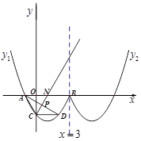

# Mathematics - 题目 1093

**ID**: 87752d4fd9f04a65b7eb80394387d454
**年级**: Grade 9
**难度**: Medium-Hard
**题型**: Calculation

## 题目
如图，曲线 $y{{}_{1}}$ 抛物线的一部分，且表达式为： $y{{}_{1}}=\frac {\sqrt {3}}{3}(x{^{2}}-2x-3)(x\leqslant 3)$ 曲线 $y{{}_{{\rm{2}}}}$ 与曲线 $y{{}_{1}}$ 关于直线 $x=3$ 对称．（1）求A、B、C三点的坐标和曲线 $y{{}_{{\rm{2}}}}$ 的表达式；​​​​​​​‌（2）过点D作 $CD\parallel x$ 轴交曲线 $y{{}_{1}}$ 于点D，连接AD，在曲线 $y{{}_{{\rm{2}}}}$ 上有一点M，使得四边形ACDM为筝形（如果一个四边形的一条对角线被另一条对角线垂直平分，这样的四边形为筝形），请求出点M的横坐标．（3）设直线CM与 $x$ 轴交于点N，试问在线段MN下方的曲线 $y{{}_{{\rm{2}}}}$ 上是否存在一点P，使△PMN的面积最大？若存在，求出点P的坐标；若不存在，请说明理由．

## 解答

1. 解：（1）解：在 $y{{}_{1}}=\frac {\sqrt {3}}{3}(x{^{2}}-2x-3)$ 中，令 $y{{}_{1}}=0$ ，则有 $0=\frac {\sqrt {3}}{3}\left ({x{^{2}}-2x-3}\right )$ ，
2. 解得 $x{{}_{1}}=-1$ 或 $x{{}_{2}}=3$ ，
3. $\therefore $ A（－1,0），B（3，0），
4. 又 $\because $ C与 $y$ 轴的交点，
5. $\therefore $ C（0， $-\sqrt {3}$ ），
6. 又曲线 $y{{}_{2}}$ 与曲线 $y{{}_{1}}$ 关于直线 $x=3$ 对称，
7. $\therefore $ 曲线 $y{{}_{2}}$ 可由曲线 $y{{}_{1}}$ 向右平移4个单位得到，
8. $\therefore $  $y{{}_{{\rm{2}}}}=\frac {\sqrt {3}}{3}(x{^{2}}-10x+21)$  $(x\geqslant 3)$ ．
9. （2）解：若AD垂直平分CM，则可知CDMA为菱形，此时点M（1,0）
10. 显然不在 $y{{}_{{\rm{2}}}}$ 上；
11. 故直线CM垂直平分AD，取AD中点P，易求其坐标为
12. （1， $-\frac {\sqrt {3}}{2}$ ）,
13. 故直线CN的解析式为： $y{{}_{{\rm{C}}{\rm{N}}}}=\sqrt {3}x-\sqrt {3}$
14. 求其与 $y{{}_{{\rm{2}}}}$ 的交点坐标： $\begin{cases}y=\sqrt {3}x-\sqrt {3}\\y=\frac {\sqrt {3}}{3}(x{^{2}}-10x+21)\end{cases}$
15. 解之得： $x{{}_{1}}=\frac {{\rm{1}}3+\sqrt {{\rm{7}}{\rm{3}}}}{{\rm{2}}}$ ， $x{{}_{2}}=\frac {{\rm{1}}3-\sqrt {{\rm{7}}{\rm{3}}}}{{\rm{2}}}$ （不合舍去）
16. 故 $x=\frac {{\rm{1}}3+\sqrt {{\rm{7}}{\rm{3}}}}{{\rm{2}}}$
17. （3）因为MN的长度固定，故点P到MN的距离最大时，△PMN的面积最大
18. 故设：另一直线 $y=\sqrt {3}x+b$ 与 $y{{}_{{\rm{2}}}}$ 相交于点P，很显然它们只有一个交点时，满足条件．
19. 即： $\begin{cases}y=\sqrt {3}x+b\\y=\frac {\sqrt {3}}{3}(x{^{2}}-10x+21)\end{cases}$ 只有唯一一个解的时候，这个点就是点P
20. 解之得：  $x=\frac {13}{2}$
21. 将 $x=\frac {13}{2}$ 代入 $y{{}_{{\rm{2}}}}=\frac {\sqrt {3}}{3}(x{^{2}}-10x+21)$
22. $y=-\frac {7\sqrt {3}}{12}$
23. 故点P的坐标为 $(\frac {13}{2},-\frac {7\sqrt {3}}{4})$
24. 
25. 考点：二次函数的综合题

## 知识点

**中文**:
  - 二次函数图象的平移
  - 二次函数的综合

**English**:
  - Translation of Quadratic Graphs
  - Comprehensive Quadratic Function Problems

---
