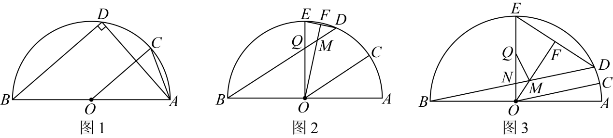

# Mathematics - 题目 1930

**ID**: 88457a5db34247488757c7f403a93dcf
**年级**: Grade 9
**难度**: Medium-Hard
**题型**: Calculation

## 题目
如图 ${\rm 1，}AB$ 为半圆O的直径， $AB=4,C$ 为半圆上的动点，连接 $OC$ ，点A关于 $OC$ 的对称点为点D，连接 $BD$  $\left ({0{}\degree <\angle AOC<45{}\degree }\right )$ ．（1）若 $\angle AOC=40{}\degree $ ，连接 $AC,AD$ ，求 $\angle CAD$ 的度数；（2）如图2，若点E在半圆O上， $\overset{\frown}{{BE}}$ 的长度为 ${\rm{π}}$ ，连接 $DE,F$ 为 $DE$ 中点，连接 $OF$ 交 $BD$ 于点 $M,Q$ 为 $OE$ 上一点， $OQ=1.​​​​​​​‌2$ ．①当 $\angle AOC=30{}\degree $ 时，判断点Q与直线 $BD$ 的位置关系，并说明理由；②如图3，连接 $QM$ ，在点C运动过程中，当 $EQ=QM$ 时，记 $α=45{}\degree -\angle AOC$ ，求 ${\tan}α$ 的值．

## 解答

1. （1）解：如图所示，连接 $OD$ ，
2. $\because AB$ 为半圆O的直径，点A关于 $OC$ 对称点为点 $D$ ，
3. $\therefore OA=OD,OC\bot AD$ ，
4. $\therefore $ 点D在半圆O上，
5. $\therefore \angle COD=\angle AOC=40{}\degree $ ，
6. $\therefore \angle CAD=\frac {1}{2}\angle COD=20{}\degree $ ；
7. 
8. （2）解：①点Q在直线 $BD$ 外，理由如下：
9. 连接 $OD$ ，如图所示，
10. $\because AB$ 为 $\odot O$ 直径，点A关于 $OC$ 对称点为点D，
11. $\therefore OA=OD,OC\bot AD$ ，
12. $\therefore $ 点D在半圆O上，
13. $\therefore \angle COD=\angle AOC=\frac {1}{2}\angle AOD$ ，
14. 又∵ $\angle B=\frac {1}{2}\angle AOD$ ，
15. $\therefore \angle B=\angle AOC$ ，
16. $\because \overset{\frown}{{BE}}$ 的长度为 ${\rm{π}}$ ，半圆O的直径 $AB=4$ ，
17. ∴ $\frac {2π\cdot ∠BOE}{180}=π$ ，
18. $\therefore \angle BOE=90{}\degree $ ，
19. ∴ $\angle AOE=180{}\degree -\angle BOE=90{}\degree $ ，
20. $\because \angle AOC=30{}\degree $ ，
21. $\therefore \angle B=\angle AOC=30{}\degree $ ，
22. 设 $OE$ 与 $BD$ 交于点P，直角三角形 $BOP$ 中， ${\tan}B=\frac {OP}{OB}$ ，
23. 
24. $\therefore OP=2\times \frac {\sqrt {3}}{3}=\frac {2\sqrt {3}}{3}$ ，
25. 又∵Q在 $OE$ 上， $OQ=1.2,OP\ne OQ$ ，
26. $\therefore $ 点Q在直线 $BD$ 外；
27. ②连接 $OD,EM,BE$ ，如图所示，
28. 则 $\angle EDB=\frac {1}{2}\angle BOE=45{}\degree $ ，
29. $\because OD=OE,F$ 为 $DE$ 中点，
30. $\therefore EF=DF,OF\bot ED,\angle EOF=\angle DOF=\frac {1}{2}\angle EOD$ ，
31. $\therefore ME=MD$ ，
32. $\therefore \angle DEM=\angle EDM=45{}\degree $ ，
33. $\therefore \angle EMD=90{}\degree $ ，
34. ∴ $\angle EMB=180{}\degree -\angle EMD=90{}\degree $ ；
35. 设 $OE$ 交 $BD$ 于点N，
36. 
37. ∵ $\angle QEM=90{}\degree -\angle ENM,\angle DBO=90{}\degree -\angle BNO$ ， $\angle ENM=\angle BNO$ ，
38. $\therefore \angle QEM=\angle DBO$ ，
39. $\because EQ=QM,BO=DO$ ，
40. $\therefore \angle QME=\angle QEM=\angle DBO=\angle BDO$ ，
41. $\therefore \vartriangle QME∽\vartriangle ODB$ ，
42. $\therefore \frac {EM}{BD}=\frac {EQ}{BO}$ ，
43. $\because OQ=1.2,OE=2$ ，
44. $\therefore QE=OE-OQ=0.8$ ，
45. $\therefore \frac {EM}{BD}=\frac {EQ}{BO}=\frac {0.8}{2}=\frac {2}{5}$ ，
46. 设 $EM=2x,BD=5x$ ，
47. $\therefore ME=MD=2x,BM=BD-DM=3x$ ，
48. $\therefore \frac {EM}{BM}=\frac {2x}{3x}=\frac {2}{3}$ ，
49. 直角三角形 $EBM$ 中， $\angle EMB=90{}\degree $ ，
50. ∴ ${\tan}\angle EBM=\frac {EM}{BM}=\frac {2}{3}$ ，
51. $\because \angle EBM=\frac {1}{2}\angle EOD$ ，
52. $\therefore \angle EBM=\angle DOF$ ，
53. $\because \angle AOC=\angle DOC=\frac {1}{2}\angle AOD,\angle EOF=\angle DOF=\frac {1}{2}\angle EOD$ ，
54. $\therefore \angle DOF+\angle AOC=\frac {1}{2}(\angle AOD+\angle EOD)=\frac {1}{2}\angle AOE=45{}\degree $ ，
55. $\therefore \angle DOF=45{}\degree -\angle AOC$ ，
56. $\therefore \angle EBM=\angle DOF=α$ ，
57. $\therefore {\tan}α={\tan}\angle EBM=\frac {2}{3}$ ．

## 知识点

**中文**:
  - 圆周角定理
  - 等腰三角形的性质
  - 相似三角形的判定与性质综合
  - 解直角三角形

**English**:
  - Inscribed Angle Theorem
  - Properties of Isosceles Triangles
  - Determination and Properties
  - Solving Right Triangles

---
