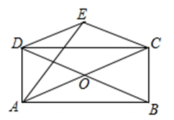

# Mathematics - 题目 1389

**ID**: 89a8824bb4d94e2c85b73e420862580e
**年级**: Grade 9
**难度**: Medium-Hard
**题型**: Calculation

## 题目
如图，矩形 $ABCD$ 的对角线 $AC$ ， $BD$ 相交于点 $O$ ， $ΔCOD$ 关于 $CD$ 的对称图形为 $\Delta CED$ ．（1）求证：四边形 $OCED$ 是菱形；（2）连接 $AE$ ，若 $AB=6{\rm{c}}{\rm{m}}$ ， $BC=\sqrt {5}cm$ ．①求 ${\sin}\angle EAD$ 的值；②若点 $P$ 为线段 $AE$ 上一动点（不与点 $A$ 重合），连接 $OP$ ，一动点 $Q$ 从点 $O$ 出发，以 $1cm/s$ 的速度沿线段 $OP$ 匀速运动到点 $P$ ，再以 $1.​​​​​​​‌5{\rm{c}}{\rm{m}}/s$ 的速度沿线段 $PA$ 匀速运动到点 $A$ ，到达点 $A$ 后停止运动．当点 $Q$ 沿上述路线运动到点 $A$ 所需要的时间最短时，求 $AP$ 的长和点 $Q$ 走完全程所需的时间．

## 解答

1. （1） $\because $  四边形 $ABCD$  是矩形， $\therefore AC=BD$  ，
2. $\because AC$  与 $BD$  交于点O,且 $ΔCOD、ΔCED$  关于 $CD$  对称，
3. $\therefore DO=CO,DO=DE,OC=EC$  ，
4. $\therefore DO=OC=EC=ED$ ，
5. $\therefore $  四边形 $OCED$  是菱形；
6. （2）①连接 $OE$  ,直线 $OE$  分别交 $AB$  于点 $F$  ,交 $DC$  于点 $G$  ，
7. $\because ΔCOD$  关于 $CD$  的对称图形为 $\Delta CED$  ，
8. $\therefore OE\bot DC,\hspace{-0.5em}\begin{array}{}&\end{array}\hspace{-0.5em}\because DC\parallel AB$   $\therefore OF\bot AB,EF\parallel AD$  ，
9. $\because $  在矩形 $ABCD$  中， $G$  为 $DC$  的中点，且O为AC的中点，
10. $\therefore OG$  为 $\Delta CAD$  的中位线 ，   $\therefore OG=GE=\frac {\sqrt {5}}{2}$  ，
11. 同理可得： $F$  为 $AB$  的中点， $OF=\frac {\sqrt {5}}{2}，AF=3$  ，
12. $\therefore AE=\sqrt {EF{^{2}}+AF{^{2}}}=\sqrt {3{^{2}}+(\frac {3\sqrt {5}}{2}){^{2}}}=\frac {9}{2}$   ，
13. $\hspace{-0.5em}\begin{array}{l}\because \angle EAD=\angle AEF\\\therefore {\sin}\angle EAD={\sin}\angle AEF=\frac {3}{\frac {9}{2}}=\frac {2}{3}\end{array}\hspace{-0.5em}$  ；
14. 
15. ②过点P作 $PM\bot AB$  交 $AB$  于点 $M$  ，
16. $\therefore Q$  由 $O$  运动到 $P$  所需的时间为3s，
17. $\because $  由①可得， $AM=\frac {2}{3}AP$ ，
18. $\therefore $  点O以 $1.5cm/s$  的速度从P到A所需的时间等于以   $1cm/s$ 从M运动到A，
19. 即： $t=t{{}_{OP}}+t{{}_{PA}}=\frac {OP}{1}+\frac {MA}{1}=OP+MA$ ，
20. $\therefore Q$  由O运动到P所需的时间就是OP+MA和最小.
21. $\because $  如下图，当P运动到 $P{{}_{1}}$  ,即 $P{{}_{1}}O\parallel AB$  时，所用时间最短.
22. $\therefore t=OP+MA=3$ ，
23. $\because $  在 $RtΔAP{{}_{1}}M{{}_{1}}$  中，设 $AM{{}_{1}}=2x,AP{{}_{1}}=3x$ ， $AP{{}_{1}}{^{2}}=AM{{}_{1}}{^{2}}+P{{}_{1}}M{{}_{1}}{^{2}}$  ，
24. $\therefore (3x){^{2}}{\rm{=}}{\rm{(}}{\rm{2}}x){^{{\rm{2}}}}{\rm{+}}{\rm{(}}\frac {\sqrt {5}}{2}{\rm{)}}{^{{\rm{2}}}}$ ，
25. 解得： $x=\frac {1}{2}$  ，  $\therefore AP=\frac {3}{2}$ ，
26. $\therefore AP=\frac {3}{2}$ 和 $Q$  走完全程所需时间为 $\frac {3}{2}s$ .
27. 

## 知识点

**中文**:
  - 正弦
  - 菱形的判定与性质综合
  - 解直角三角形

**English**:
  - Sine
  - Determination and Properties of Rhombuses
  - Solving Right Triangles

---
