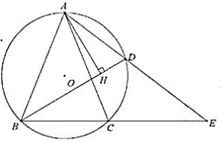

# Mathematics - 题目 1407

**ID**: 89efbd2722d74bf7b72e99fb4ed96c60
**年级**: Grade 9
**难度**: Medium-Hard
**题型**: Calculation

## 题目
如图，△ABC内接于⊙O， $BC=2,AB=AC$ ，点 $D$ 为 $\overset ⌢{{AC}}$ 上的动点，且 ${\rm{c}}{\rm{o}}{\rm{s}}B=\frac {\sqrt {10}}{10}$ .​​​​​​​‌(1)求 $AB$ 的长度；(2)在点D运动的过程中，弦AD的延长线交BC的延长线于点E，问AD•AE的值是否变化？若不变，请求出AD•AE的值；若变化，请说明理由.(3)在点D的运动过程中，过A点作AH⊥BD，求证： $BH=CD+DH$ .

## 解答

1. （1)过A作AF⊥BC，垂足为F，交⊙O于G，
2. ∵AB=AC，AF⊥BC，∴BF=CF= $\frac {1}{2}$ BC=1，
3. 在RtΔAFB中，BF=1，∴AB= $\frac {BF}{{\cos}B}=\frac {1}{\frac {\sqrt {10}}{10}}=\sqrt {10}$ ；
4. （2）连接DG，
5. ∵AF⊥BC，BF=CF，∴AG为⊙O的直径，∴∠ADG=∠AFE=90°，
6. 又∵∠DAG=∠FAE，∴△DAG∽△FAE，
7. ∴AD：AF=AG：AE，
8. ∴AD•AE=AF•AG，
9. 连接BG，则∠ABG=90°，∵BF⊥AG，∴BF^{2}=AF•FG，
10. ∵AF= $\sqrt {AB{^{2}}-BF{^{2}}}$ =3，
11. ∴FG= $\frac {1}{3}$ ，
12. ∴AD•AE=AF•AG=AF•（AF+FG）=3× $\frac {10}{3}$ =10；
13. （3）连接CD，延长BD至点N，使DN=CD，连接AN，
14. ∵∠ADB=∠ACB=∠ABC，∠ADC+∠ABC=180°，∠ADN+∠ADB=180°，
15. ∴∠ADC=∠ADN，
16. ∵AD=AD，CD=ND，
17. ∴△ADC≌△ADN，
18. ∴AC=AN，
19. ∵AB=AC，∴AB=AN，
20. ∵AH⊥BN，
21. ∴BH=HN=HD+CD.
22. 

## 知识点

**中文**:
  - 垂径定理的应用
  - 相似三角形的判定与性质综合

**English**:
  - Applications of Perpendicular Chord Theorem
  - Determination and Properties

---
