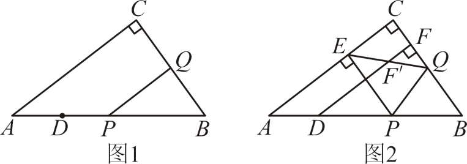

# Mathematics - 题目 806

**ID**: 8ac47790dcef43bf8888e4ca5abb2c2f
**年级**: Grade 9
**难度**: Medium-Hard
**题型**: Calculation

## 题目
如图1，已知，在 ${\rm{R}}{\rm{t}}\mathrm{△}ABC$ 中， $\angle C=90{}\degree ,AC=4,BC=3$ ，点D在AB上，且 $BD=\frac {15}{4}$ ，点P，Q分别从点D，B出发沿线段 $DB,BC$ 向终点B，C匀速移动，P，Q两点同时出发，同时到达终点．设 $BQ=x,AP=y$ ．(1)求 $AD$ 的值．(2)求y关于x的函数表达式．(3)如图2，过点P作 $PE\bot AC$ 于点E，连结PQ，EQ．①当 $PQ\bot EQ$ 时，求x的值．②过D作 $DF\bot BC$ 于点F，作点F关于 $EQ$ 的对称点 $F^{′}$ ，当点 $F^{′}$ 落在 $\mathrm{△}PQB$ 的内部（不包括边界）时，则x的取值范围为（请直接写出答案）．​​​​​​​‌

## 解答

1. （1）解： $\because \angle C=90{}\degree $ ，
2. $\therefore AB=\sqrt {AC{^{2}}+BC{^{2}}}=\sqrt {4{^{2}}+3{^{2}}}=5$ ，
3. ∴ $AD=AB-BD=5-\frac {15}{4}=\frac {5}{4}$ ；
4. （2）∵由P，Q两点同时出发，同时到达终点，
5. ∴ $\frac {DP}{BQ}=\frac {BD}{BC}$ ，
6. $\therefore \frac {DP}{x}=\frac {\frac {15}{4}}{3}$ ，
7. $\therefore DP=\frac {5}{4}x$ ，
8. $\therefore AP=AD+DP=\frac {5}{4}x+\frac {5}{4}$ ，
9. $\therefore y=\frac {5}{4}x+\frac {5}{4}$ ；
10. （3）①如图，
11. 
12. ∵ $PE\bot AE$ ，
13. ∴ $\angle AEP=\angle CEP=90{}\degree $ ，
14. ∴ $PE=AP\cdot \sin A=AP\cdot \frac {3}{5}=\frac {3}{5}\left ({\frac {5}{4}x+\frac {5}{4}}\right )=\frac {3}{4}\left ({x+1}\right )$ ，
15. $AE=AP\cdot {\cos}A=\frac {4}{5}AP=x+1$ ，
16. $\therefore CE=AC-AE=4-\left ({x+1}\right )=3-x$ ，
17. $\because CQ=BC-BQ=3-x$ ，
18. ∴ $CE=CQ$ ，即 $\vartriangle CEQ$ 是等腰直角三角形，
19. $\therefore EQ=\sqrt {2}\left ({3-x}\right )$ ， $\angle CEQ=45{}\degree $ ，
20. ∴ $\angle PEQ=45{}\degree $ ，
21. ∴ $PQ=EQ$ ，即 $\vartriangle PEQ$ 是等腰直角三角形，
22. ∴ $PE=\sqrt {2}EQ=6-2x$ ，
23. ∴ $6-2x=\frac {3}{4}\left ({x+1}\right )$ ，
24. ∴ $x=\frac {21}{11}$ ；
25. ②作 $QG\bot AB$ 于G，
26. 
27. 在 $RT\vartriangle BQG$ 中，
28. $BG=BQ\cdot {\cos}B=\frac {3}{5}x$ ，
29. $QG=BQ\cdot \sin B=\frac {4}{5}x$ ，
30. $\therefore PG=AB-AP-BG=5-\frac {5}{4}\left ({x+1}\right )-\frac {3}{5}x=\frac {15}{4}-\frac {37}{20}x$ ，
31. $\therefore PQ{^{2}}={\left({\frac {4}{5}x}\right)^{2}}+{\left({\frac {15}{4}-\frac {37}{20}x}\right)^{2}}$ ，
32. $\because BF=BD\cdot {\cos}B=\frac {15}{4}\times \frac {3}{5}=\frac {9}{4}$ ，
33. $\therefore x<\frac {9}{4}$ ，
34. 由（2）得：
35. $CE=CQ$
36. $\because \angle C=90{}\degree $ ，
37. $\therefore \angle CQE=\angle CEQ=45{}\degree $ ，
38. $\therefore $ 当 $\angle EQP>\angle CQE$ ，且 $FQ<PQ$ 时，点 $F^{′}$ 在 $△EPQ$ 的内部，
39. 此时 $\angle PQB<90{}\degree $ ，
40. $\therefore \begin{cases}\frac {5}{3}x>\frac {15}{4}-\frac {5}{4}x\\\frac {9}{4}-x<\sqrt {{\left({\frac {4}{5}x}\right)^{2}}+{\left({\frac {15}{4}-\frac {37}{20}x}\right)^{2}}}\end{cases}$ ，
41. $\therefore x>\frac {9}{7}$ ，
42. 又 $\because x<\frac {9}{4}$ ，
43. $\therefore \frac {9}{7}<x<\frac {9}{4}$ ．

## 知识点

**中文**:
  - 列一次函数解析式
  - 解直角三角形
  - 等腰直角三角形的性质

**English**:
  - Writing Linear Function Expressions
  - Solving Right Triangles
  - Properties of Isosceles Right Triangles

---
