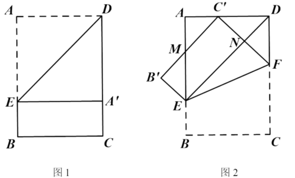

# Mathematics - 题目 1359

**ID**: 8b9bd0b1e1cb4979af6c67852691f823
**年级**: Grade 9
**难度**: Medium-Hard
**题型**: Calculation

## 题目
实践操作：第一步：如图1，将矩形纸片ABCD沿过点D的直线折叠，使点A落在CD上的点 $A^{′}$ 处，得到折痕DE，然后把纸片展平．第二步：如图2，将图1中的矩形纸片ABCD沿过点E的直线折叠，点C恰好落在AD上的点 $C^{′}$ 处，点B落在点 $B^{′}$ 处，得到折痕EF， $B{^{\prime }}C{^{\prime }}$ 交AB于点M， $C^{′}$F交DE于点N，再把纸片展平．问题解决：若 $AC^{′}=2,DC^{′}=4$ ，则 $\frac {DN}{EN}$ 的值为．​​​​​​​‌

## 解答

1. 解：如图1，连接C′E，
2. 由折叠的性质可知，AD=AE，
3. 
4. ∵四边形ABCD是矩形，
5. ∴AD=BC，∠EAC′=∠B=90°，
6. 由折叠知，B′C′=BC，∠B=∠B′，
7. ∴AE=B′C′，∠EAC′=∠B′，
8. 又EC′=C′E，
9. ∴Rt△EC′A≌Rt△C′EB′（HL），
10. ∴AC′=B′E，
11. 由折叠知，B′E=BE，
12. ∴AC′=BE，
13. ∵AC′=2，DC′=4，
14. ∴AB=CD=2+4+2=8，
15. 设DF=x，则FC′=FC=8-x，
16. ∵DC′^{2}+DF^{2}=FC′^{2}，
17. ∴4^{2}+x^{2}=（8-x）^{2}，
18. 解得，x=3，
19. 即DF=3，
20. 如图2，延长BA、FC′交于点G，则∠AC′G=∠DC′F，
21. 
22. ∴tan∠AC′G=tan∠DC′F= $\frac {AG}{AC^{′}}=\frac {DF}{DC^{′}}=\frac {3}{4}$ ，
23. ∴AG＝ $\frac {3}{2}$ ，
24. ∴EG＝ $\frac {3}{2}+6=\frac {15}{2}$ ，
25. ∵DF∥EG，
26. ∴△DNF∽△ENG，
27. ∴ $\frac {DN}{EN}=\frac {DF}{EG}=\frac {3}{\frac {15}{2}}=\frac {2}{5}$ ．
28. 故答案为： $\frac {2}{5}$ ．

## 知识点

**中文**:
  - 正方形的判定与性质综合
  - 等腰三角形的判定
  - 矩形的性质
  - 相似三角形的判定与性质综合

**English**:
  - Determination and Properties of Squares
  - Determination of Isosceles Triangles
  - Properties of Rectangles
  - Determination and Properties

---
