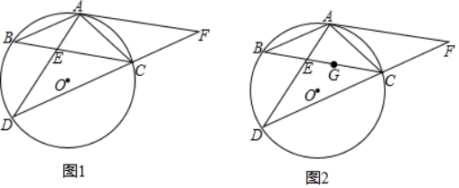

# Mathematics - 题目 1742

**ID**: 8dae15d8b07b49ebae5e7ac080ec61b8
**年级**: Grade 9
**难度**: Medium-Hard
**题型**: Calculation

## 题目
如图1，在△ABC中，AB＝AC，⊙O是△ABC的外接圆，过点C作∠BCD＝∠ACB交⊙O于点D，连接AD交BC于点E，延长DC至点F，使CF＝AC，连接AF．（1）求证：ED＝EC；​​​​​​​‌（2）求证：AF是⊙O的切线；（3）如图2，若点G是△ACD的内心，BC•BE＝25，求BG的长．

## 解答

1. 解：（1）∵AB＝AC，
2. ∴∠ABC＝∠ACB，
3. 又∵∠ACB＝∠BCD，∠ABC＝∠ADC，
4. ∴∠BCD＝∠ADC，
5. ∴ED＝EC；
6. （2）如图1，连接OA，
7. 
8. ∵AB＝AC，
9. ∴ $\overset ⌢{{AB}}$ ＝ $\overset ⌢{{AC}}$ ，
10. ∴OA⊥BC，
11. ∵CA＝CF，
12. ∴∠CAF＝∠CFA，
13. ∴∠ACD＝∠CAF＋∠CFA＝2∠CAF，
14. ∵∠ACB＝∠BCD，
15. ∴∠ACD＝2∠ACB，
16. ∴∠CAF＝∠ACB，
17. ∴AF$//$BC，
18. ∴OA⊥AF，
19. ∴AF为⊙O的切线；
20. （3）∵∠ABE＝∠CBA，∠BAD＝∠BCD＝∠ACB，
21. ∴△ABE∽△CBA，
22. ∴ $\frac {AB}{BC}=\frac {BE}{AB}$ ，
23. ∴AB^{2}＝BC•BE，
24. ∵BC•BE＝25，
25. ∴AB＝5，
26. 如图2，连接AG，
27. 
28. ∴∠BAG＝∠BAD＋∠DAG，∠BGA＝∠GAC＋∠ACB，
29. ∵点G为内心，
30. ∴∠DAG＝∠GAC，
31. 又∵∠BAD＋∠DAG＝∠GAC＋∠ACB，
32. ∴∠BAG＝∠BGA，
33. ∴BG＝AB＝5．

## 知识点

**中文**:
  - 三角形内切圆
  - 等腰三角形的性质
  - 切线的判定定理
  - 切线的性质定理
  - 圆的综合问题
  - 相似三角形的判定与性质综合

**English**:
  - Incircle of Triangle
  - Properties of Isosceles Triangles
  - Tangent Determination Theorem
  - Tangent Properties Theorem
  - Comprehensive Circle Problems
  - Determination and Properties

---
