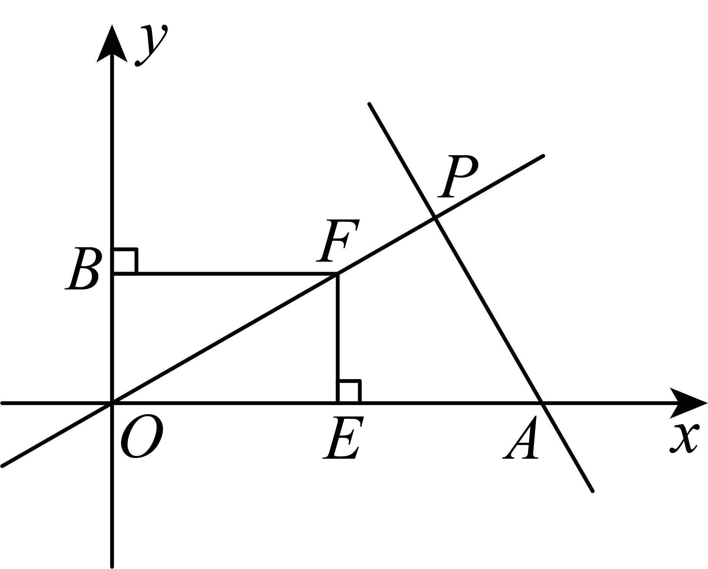

# Mathematics - 题目 2815

**ID**: 8e0419b8991c4195b557bbfc35f17d77
**年级**: Grade 9
**难度**: Medium-Hard
**题型**: Calculation

## 题目
如图，直线 $y=-\sqrt {3}x+4\sqrt {3}$ 与x轴交于点A，与直线 $y=\frac {\sqrt {3}}{3}x$ 交于点P．（1）求点P的坐标．（2）求 $\vartriangle OPA$ 的面积．（3）动点 $E$ 从原点 $O$ 出发，以每秒1个单位长度的速度沿 $OA$ 方向向终点 $\mathrm{A}$ 运动，过点 $E$ 作 $EF\bot x$ 轴，交线段 $OP$ 或线段 $PA$ 于点 $F$ ， $FB\bot y$ 轴于点 $B$ ，设运动时间为 $t$ （秒），长方形 $OEFB$ 与 $\vartriangle OPA$ 重叠部分的面积为 $\mathrm{S}$ ，求 $\mathrm{S}$ 与 $t$ 之间的函数关系式．​​​​​​​‌

## 解答

1. （1）解：联立直线 $y=-\sqrt {3}x+4\sqrt {3}$ 与直线 $y=\frac {\sqrt {3}}{3}x$ ，得
2. $\begin{cases}y=-\sqrt {3}x+4\sqrt {3}\\y=\frac {\sqrt {3}}{3}x\end{cases}$ ，
3. 解得 $\begin{cases}x=3\\y=\sqrt {3}\end{cases}$ ．
4. 即 $P(3,\sqrt {3})$ ；
5. （2）过点P作 $PH\bot OA$ ，
6. 当 $y=0$ 时， $-\sqrt {3}x+4\sqrt {3}=0$ ，解得 $x=4$ ，即 $A(4,0)$
7. $S{{}_{△POA}}=\frac {1}{2}OA\cdot PH=\frac {1}{2}\times 4\times \sqrt {3}=2\sqrt {3}$ ；
8. （3）当 $0\leqslant t\leqslant 3$ 时，如图 $1$ ，
9. ，$∵EF\mathrm{/\mskip-4mu/}PH$
10. ∴ $\vartriangle OEF\sim \vartriangle OHP$ ，
11. $∴\frac {OE}{OH}=\frac {EF}{PH}$ ，
12. 即 $\frac {t}{3}=\frac {EF}{\sqrt {3}}$ ， $EF=\frac {\sqrt {3}t}{3}$ ，
13. 长方形 $OEFB$ 与 $\vartriangle OPA$ 重叠部分的面积为 $\vartriangle OEF$ ，
14. $S=\frac {1}{2}OE\cdot EF=\frac {1}{2}t\cdot \frac {\sqrt {3}t}{3}=\frac {\sqrt {3}t{^{2}}}{6}$ ；
15. 当 $3<t\leqslant 4$ 时，如图 $2$ ，
16. 
17. 重叠部分是四边形 $OEFH$ ，
18. $y=-\sqrt {3}x+4\sqrt {3}$ ，
19. 当 $x=t$ 时， $y=-\sqrt {3}t+4\sqrt {3}$
20. $\therefore EF=\sqrt {3}\left ({4-t}\right )$
21. $y=\frac {\sqrt {3}}{3}x$
22. 当 $y=-\sqrt {3}t+4\sqrt {3}$ 时， $x=-3t+12$
23. $\therefore HF=t-\left ({-3t+12}\right )=4t-12$
24. $\because OE=t$
25. $S=\frac {FH+OE}{2}\cdot EF=\frac {t+4t-12}{2}\cdot \sqrt {3}(4-t)=-\frac {5\sqrt {3}}{2}t{^{2}}+16\sqrt {3}t-24\sqrt {3}$
26. 综上所述： $S=\begin{cases}\frac {\sqrt {3}}{6}t{^{2}}(0\leqslant t\leqslant 3)\\-\frac {5\sqrt {3}}{2}t{^{2}}+16\sqrt {3}t-24\sqrt {3}(3<t\leqslant 4)\end{cases}$ ．

## 知识点

**中文**:
  - 一次函数与二元一次方程（组）
  - 一次函数的图象和性质
  - 相似三角形的判定与性质综合

**English**:
  - Linear Functions and Systems of Linear Equations
  - Graphs and Properties of Linear Functions
  - Determination and Properties

---
