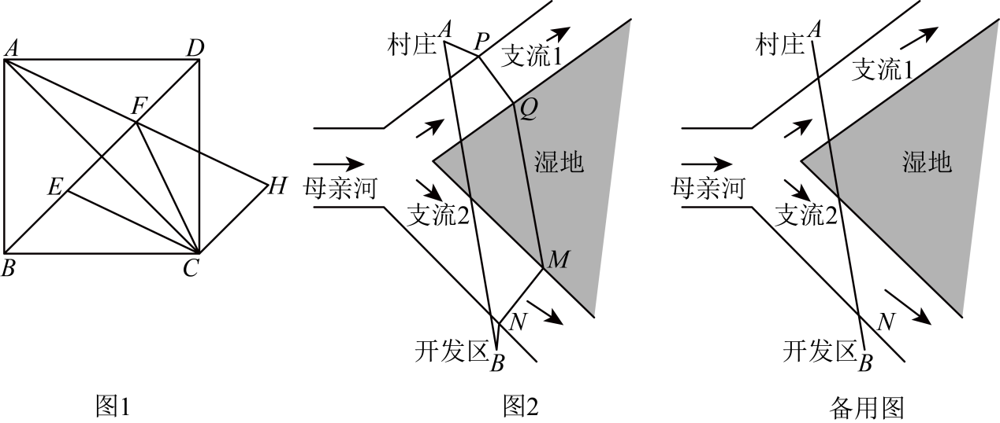

# Mathematics - 题目 3094

**ID**: 8e5b22034b2f48be8f5190ca960a6cdf
**年级**: Grade 9
**难度**: Medium-Hard
**题型**: Calculation

## 题目
如图1，正方形 $ABCD$ 的边长为4，点 $E、F$ 是对角线 $BD$ 上两动点，且 $EF=2$ ，将点 $C$ 沿 $EF$ 的方向平移2个单位得到点 $H$ ，连接 $CH$ 、 $FH$ ．(1)①四边形 $ECHF$ 的形状为；​​​​​​​‌②连接 $AC$ 、 $AF$ ，当点 $\mathrm{A}$ ， $F$ ， $H$ 共线时， $CE+CF$ 的值为．(2)自古以来，黄河就享有“母亲河”的美誉，是中华文明的发源地之一，也是中华民族生生不息、赖以生存的摇篮．如图2，某地黄河的一段出现了分叉，形成了“ $Y$ ”字型支流，分叉口有一片三角形地带的湿地，在支流1的左上方有一村庄 $\mathrm{A}$ ，支流2的右下方有一开发区 $B$ ，为促进当地的经济发展，经政府决定在支流1和支流2上分别修建一座桥梁 $PQ$ 、 $MN$ （支流1的两岸互相平行，支流2的两岸也互相平行，桥梁均与河岸垂直），你能帮助政府计算一下由村庄 $\mathrm{A}$ 到开发区 $B$ 理论上的最短路程吗？（即 $AP+PQ+QM+MN+NB$ 和的最小值）．经测量， $\mathrm{A}$ 、 $B$ 两地的直线距离为2000米，支流1、支流2的宽度分别为 $150\sqrt {3}$ 米、250米，且与线段 $AB$ 所夹的锐角分别为 $60{}\degree $ 、 $30{}\degree $ ．

## 解答

1. （1）解：①由平行的性质可得 $CH/\mskip-4mu/EF，CH=EF=2$ ，
2. ∴四边形 $ECHF$ 是平行四边形，
3. 故答案为：平行四边形；
4. ②∵四边形 $ABCD$ 是正方形，
5. ∴ $\angle ACD=\angle BDC=45{}\degree $ ， $AD=CD=4，\angle ADC=90{}\degree $ ，
6. ∴ $AC=\sqrt {AD{^{2}}+CD{^{2}}}=4\sqrt {2}$ ，
7. ∵ $CH/\mskip-4mu/EF$ ，
8. ∴ $∠DCH=∠BDC=45{}\degree $ ，
9. ∴ $\angle ACH=90{}\degree $ ，
10. ∴ $AH=\sqrt {AC{^{2}}+CH{^{2}}}=6$ ，
11. 由正方形的对称性可得 $AF=CF$ ，
12. 由平行四边形的性质可得 $CE=FH$ ，
13. ∴ $CE+CF=FH+AF=AH=6$ ，
14. 故答案为：6；
15. （2）解：如图所示，将点A沿着垂直于支流1的河岸的方向平移 $150\sqrt {3}$ 米得到 $A^{′}$ ，连接 $A^{′}Q$ ，将点B沿着垂直于支流2的河岸的方向平移 $250$ 米得到 $B^{′}$ ，连接 $B^{′}M$ ，
16. ∴四边形 $APQA^{′}$ 和四边形 $BB^{′}MN$ 都是平行四边形，
17. ∴ $A^{′}Q=AP，B^{′}M=BN$ ，
18. ∴ $AP+PQ+QM+MN+NB=A^{′}Q+QM+B^{′}M+150\sqrt {3}+250$ ，
19. ∴当 $A^{′}、Q、M、B^{′}$ 四点共线时， $A^{′}Q+QM+B^{′}M$ 最小，即此时 $AP+PQ+QM+MN+NB$ 最小；
20. 如图所示， 分别延长 $AA^{′}、BB^{′}$ 交于H，
21. ∵支流1和支流2与线段 $AB$ 所夹的锐角分别为 $60{}\degree $ 、 $30{}\degree $ ，
22. ∴ $∠BAH=30{}\degree ，∠ABH=60{}\degree $ ，
23. ∴ $\angle H=90{}\degree $ ，
24. ∴ $BH=\frac {1}{2}AB=1000$ 米，
25. ∴ $AH=\sqrt {AB{^{2}}-BH{^{2}}}=1000\sqrt {3}$ 米，
26. ∴ $A^{′}H=850\sqrt {3}$ 米， $B^{′}H=750$ 米，
27. ∴ $A^{′}B^{′}=\sqrt {B^{′}H{^{2}}+A^{′}H{^{2}}}=100\sqrt {273}$ 米，
28. ∴ $AP+PQ+QM+MN+NB$ 的最小值为 $\left ({100\sqrt {273}+150\sqrt {3}+250}\right )$ 米．
29. 

## 知识点

**中文**:
  - 平移的性质
  - 平行四边形的判定与性质
  - 解直角三角形

**English**:
  - Properties of Translation
  - Determination and Properties
  - Solving Right Triangles

---
