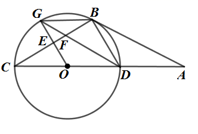

# Mathematics - 题目 761

**ID**: 8e8f2ef1d751421aa92af21d95901200
**年级**: Grade 9
**难度**: Medium-Hard
**题型**: Calculation

## 题目
如图，以 $\vartriangle ABC$ 的边 $AC$ 上一点 $O$ 作 $\odot O$ 经过点 $B$ ，交 $AC$ 于点 $D$ ．连接 $BD$ ，作 $OG{\rm{/}}{\rm{/}}BD$ 交 $\odot O$ 于点 $G$ ，交 $BC$ 于点 $E$ ，连接 $DG$ 交 $BC$ 于点 $F$ ．（1）当 $\angle ABD=\angle C$ 时，求证： $AB$ 为 $\odot O$ 的切线；​​​​​​​‌（2）若 $GB=4$ ， $GD=8$ ，求 $FD$ 的长；（3）若 ${\sin}\angle GDB=\frac {1}{3}$ ，求 ${\tan}\angle BGD$ 的值．

## 解答

1. 解：（1）证明：如图1，连接 $OB$ ，则 $OB=OC$ ，
2. 
3. ∴ $\angle OBC=\angle C$ ，
4. ∵ $\angle ABD=\angle C$
5. ∴ $\angle ABD=\angle OBC$
6. ∵ $CD$ 是 $\odot O$ 的直径，
7. ∴ $\angle CBD=90{}^\circ $ ，
8. 即 $\angle OBC+\angle OBD=90{}^\circ $ ，
9. ∴ $\angle ABO=\angle ABD+\angle OBD=\angle OBC+\angle OBD=90{}^\circ $ ，
10. ∴ $OB\bot AB$ ，
11. ∵ $OB$ 是 $\odot O$ 的半径，
12. ∴ $AB$ 是 $\odot O$ 的切线．
13. （2）证明：∵ $CD$ 是 $\odot O$ 的直径，
14. ∴ $\angle CBD=90{}^\circ $ ，即 $CB\bot BD$
15. ∵ $OG{\rm{/}}{\rm{/}}BD$
16. ∴ $OG\bot BC$
17. ∴ $\overset ⌢{{CG}}=\overset ⌢{{BG}}$
18. ∴ $\angle GDB=\angle GBF$ ，
19. 又∵ $\angle DGB=\angle BGF$ ，
20. ∴ $\mathrm{△}GBD∽\mathrm{△}GFB$ ；
21. ∴ $\frac {GB}{GF}=\frac {GD}{GB}$
22. ∴ $GB{^{2}}=GF\mathbf{⋅}GD$
23. ∴ $4{^{2}}=8GF$
24. ∴ $GF=2$
25. ∴ $FD=8-2=6$
26. （3）连接 $CG$ ，如图2所示：
27. 
28. ∵ $\angle GDB=\angle GCB$ ， $OG\bot BC$ ，
29. ∴ ${\sin}\angle GDB={\sin}\angle GCB=\frac {GE}{CG}=\frac {1}{3}$ ， $BE=CE$ ，
30. 设 $GE=x$ ， $OG=OC=r$ ，则 $OE=r-x$ ， $CG=3x$
31. 在 ${\rm{R}}{\rm{t}}\mathrm{△}CGE$ 中， $CE=\sqrt {CG{^{2}}-GE{^{2}}}=\sqrt {9x{^{2}}-x{^{2}}}=2\sqrt {2}x$ ，
32. ∴ $BC=2CE=4\sqrt {2}x$ ，
33. 在 ${\rm{R}}{\rm{t}}\vartriangle OCE$ 中， $OE{^{2}}+CE{^{2}}=OC{^{2}}$ ，
34. 即 $(r-x){^{2}}+(2\sqrt {2}x){^{2}}=r{^{2}}$
35. 解得： $r=\frac {9}{2}x$ ，
36. ∴ $CD=2r=9x$ ，
37. 在 ${\rm{R}}{\rm{t}}△DBC$ 中， $BD{^{2}}+BC{^{2}}=CD{^{2}}$ ，
38. ∴ $BD{^{2}}+(4\sqrt {2}x){^{2}}=(9x){^{2}}$ ，
39. ∴ $BD=7x$ 或 $BD=-7x$ （舍去），
40. ∴ ${\tan}\angle BGD={\tan}\angle BCD=\frac {BD}{BC}=\frac {7x}{4\sqrt {2}x}=\frac {7}{8}\sqrt {2}$

## 知识点

**中文**:
  - 正切
  - 直线和圆的位置关系
  - 相似三角形的判定与性质综合

**English**:
  - Tangent
  - Line and Circle Relationship
  - Determination and Properties

---
