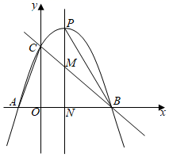

# Mathematics - 题目 3453

**ID**: 8eb8c8f5ce654d84bcda10d16d6c4c01
**年级**: Grade 9
**难度**: Medium-Hard
**题型**: Calculation

## 题目
如图，抛物线 $y=ax{^{2}}+bx+c$ 经过 $A\left ({-1,0}\right )$ 、 $B\left ({3,0}\right )$ 、 $C\left ({0,3}\right )$ 三点，对称轴与抛物线相交于点 $P$ ，与直线 $BC$ 相交于点 $M$ ，连接 $AC$ ， $PB$ ．（1）求该抛物线的解析式；​​​​​​​‌（2）设对称轴与 $x$ 轴交于点 $N$ ，在对称轴上是否存在点 $G$ ，使以 $O$ 、 $N$ 、 $G$ 为顶点的三角形与 $\mathrm{△}AOC$ 相似？如果存在，请求出点 $G$ 的坐标；如果不存在，请说明理由；（3）抛物线上是否存在一点 $Q$ ，使 $\vartriangle QMB$ 与 $\mathrm{△}PMB$ 的面积相等，若存在，求点 $Q$ 的坐标；若不存在，请说明理由．

## 解答

1. 解：（1）把 $A\left ({-1，0}\right )$ 、 $B\left ({3，0}\right )$ 、 $C\left ({0，3}\right )$ 三点代入抛物线解析式得： $\begin{cases}a-b+c=0\\9a+3b+c=0\\c=3\end{cases}$ ，
2. 解得： $\begin{cases}a=-1\\b=2\\c=3\end{cases}$ ，
3. 所以抛物线的解析式为 $y=-x{^{2}}+2x+3$ ；
4. （2）存在，
5. 由 $y=-x{^{2}}+2x+3=-(x-1){^{2}}+4$ ，
6. 则顶点 $P\left ({1，4}\right )$ ，对称轴为直线 $x=1$ ，
7. ∴ $N\left ({1，0}\right )$ ，
8. ∵ $A\left ({-1，0}\right )$ 、 $C\left ({0，3}\right )$ ，
9. ∴ $OA=1$ ， $OC=3$ ，
10. 分两种情况讨论：
11. ①当 $△AOC\sim △ONG$ 时，
12. ∴ $\frac {{\rm{A}}{\rm{O}}}{{\rm{O}}{\rm{N}}}=\frac {{\rm{O}}{\rm{C}}}{{\rm{N}}{\rm{G}}}$ ，即 $\frac {1}{1}=\frac {3}{NG}$ ，
13. ∴ $NG=3$ ，
14. ∴ $G\left ({1，3}\right )$ 或 $\left ({1，-3}\right )$ ，
15. ②当 $△AOC\sim △GNO$ 时，
16. ∴ $\frac {{\rm{A}}{\rm{O}}}{{\rm{G}}{\rm{N}}}=\frac {{\rm{O}}{\rm{C}}}{{\rm{O}}{\rm{N}}}$ ，即 $\frac {1}{GN}=\frac {3}{1}$ ，
17. ∴ $GN=\frac {1}{3}$ ，
18. ∴ $G\left ({1，\frac {1}{3}}\right )$ 或 $\left ({1，-\frac {1}{3}}\right )$ ，
19. 综上，点 $G$ 的坐标为 $G\left ({1，3}\right )$ 或 $\left ({1，-3}\right )$ 或 $\left ({1，\frac {1}{3}}\right )$ 或 $\left ({1，-\frac {1}{3}}\right )$ ；
20. （3）存在，
21. 设直线 $BC$ 的解析式为： $y=mx+n$ ，
22. ∴ $\begin{cases}3m+n=0\\n=3\end{cases}$ ，解得： $\begin{cases}m=-1\\n=3\end{cases}$ ，
23. ∴直线 $BC$ 的解析式为： $y=-x+3$ ，
24. 当 $x=1$ 时， $y=2$ ，
25. ∴ $M\left ({1，2}\right )$ ，
26. ∴设过点 $P$ 与直线 $BC$ 平行的直线为： $y=-x+b{{}_{1}}$ ，
27. 将点 $P\left ({1，4}\right )$ 代入，得 $4=-1+b{{}_{1}}$ ，
28. 解得， $b{{}_{1}}=5$ ，
29. ∴过点 $P$ 与直线 $BC$ 平行的直线解析式为： $y=-x+5$ ，
30. 联立 $\begin{cases}y=-x+5\\y=-x{^{2}}+2x+3\end{cases}$ ，解得： $\begin{cases}x{{}_{1}}=1\\y{{}_{1}}=4\end{cases}$ ， $\begin{cases}x{{}_{2}}=2\\y{{}_{2}}=3\end{cases}$ ，
31. ∵ $P\left ({1，4}\right )$ ，
32. ∴ $Q\left ({2，3}\right )$ ，
33. 设过点 $N\left ({1，0}\right )$ 与直线 $BC$ 平行的直线为： $y=-x+b{{}_{2}}$ ，
34. 同理将点 $N\left ({1，0}\right )$ 代入，得出过点N与直线 $BC$ 平行的直线为： $y=-x+1$ ，
35. 联立 $\begin{cases}y=-x+1\\y=-x{^{2}}+2x+3\end{cases}$ ，解得： $\begin{cases}x{{}_{1}}=\frac {3+\sqrt {17}}{2}\\y{{}_{1}}=\frac {-1-\sqrt {17}}{2}\end{cases}$ ， $\begin{cases}x{{}_{2}}=\frac {3-\sqrt {17}}{2}\\y{{}_{2}}=\frac {-1+\sqrt {17}}{2}\end{cases}$ ，
36. ∴ $Q$ 的坐标为 $\left ({\frac {3+\sqrt {17}}{2}，\frac {-1-\sqrt {17}}{2}}\right )$ 或 $\left ({\frac {3-\sqrt {17}}{2}，\frac {-1+\sqrt {17}}{2}}\right )$ ，
37. 综上，点 $Q$ 的坐标为 $\left ({2,3}\right )$ 或 $\left ({\frac {3+\sqrt {17}}{2}，\frac {-1-\sqrt {17}}{2}}\right )$ 或 $\left ({\frac {3-\sqrt {17}}{2}，\frac {-1+\sqrt {17}}{2}}\right )$ ．

## 知识点

**中文**:
  - 一次函数的实际应用
  - 二次函数的综合
  - 相似三角形的实际应用
  - 待定系数法求二次函数解析式

**English**:
  - Applications of Linear Functions
  - Comprehensive Quadratic Function Problems
  - Applications of Similar Triangles
  - Finding Quadratic Expressions by Undetermined Coefficients

---
