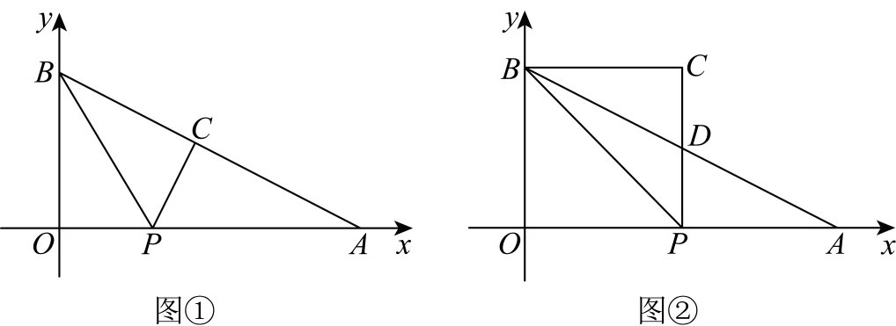

# Mathematics - 题目 3089

**ID**: 8ee18559acbb43af8c09319037ce557e
**年级**: Grade 9
**难度**: Medium-Hard
**题型**: Calculation

## 题目
将一个直角三角形纸片 $ABO$ 放置在平面直角坐标系中，点 $A\left ({16，0}\right )$ ，点 $B\left ({0，8}\right )$ ，点 $O\left ({0，0}\right ){\rm ，\mathit{P}}$ 是边 $OA$ 上的一点（点P不与点A，O重合），沿着 $BP$ 折叠该纸片，得点O的对应点C．（1）填空：如图①，当点C在边 $AB$ 上时，点P的坐标为， $\mathrm{△}ACP$ 的面积为；​​​​​​​‌（2）如图②，当 $BC/\mskip-4mu/x$ 轴时， $PC$ 与 $AB$ 交于点D，求点D的坐标；（3）设点A到直线 $PC$ 的距离为d，在折叠过程中，当 $d=BC$ 时，求 $OP$ 的长（直接写出结果即可）．

## 解答

1. （1）解：∵点 $A\left ({16，0}\right )$ ，点 $B\left ({0，8}\right )$ ，
2. ∴ $OA=16,OB=8$ ，
3. 根据折叠的性质，得 $BC=OB=8,OP=CP,\angle BOP=\angle BCP=\angle ACP=90{}\degree $ ，
4. 设 $OP=CP=x$ ，
5. 则 $PA=OA-OP=16-x$
6. ∴ ${\tan}\angle A=\frac {OB}{OA}=\frac {PC}{AC}=\frac {1}{2}$ ，
7. ∴ $AC=2x$ ，
8. ∴ $PA=\sqrt {PC{^{2}}+AC{^{2}}}=\sqrt {5}x$ ，
9. ∵ $PA+OP=OA$ ，
10. ∴ $x+\sqrt {5}x=16$ ，
11. 解得 $x=4\left ({\sqrt {5}-1}\right )=4\sqrt {5}-4$ ，
12. ∴点 $P\left ({4\sqrt {5}-4，0}\right )$ .
13. ∵ $x=4\sqrt {5}-4$ ，
14. ∴ $S{{}_{\vartriangle ACP}}=\frac {1}{2}CP·CA=x{^{2}}={\left({4\sqrt {5}-4}\right)^{2}}=96-32\sqrt {5}$ .
15. （2）解：∵点 $A\left ({16，0}\right )$ ，点 $B\left ({0，8}\right )$ ，
16. ∴ $OA=16,OB=8$ ，
17. 根据折叠的性质，得 $BC=OB=8,OP=CP,\angle BOP=\angle BCP=\angle ACP=90{}\degree $ ，
18. 设 $OP=CP=x$ ，
19. 则 $PA=OA-OP=16-x$ ，
20. ∵ $BC/\mskip-4mu/x$ 轴，
21. ∴ $\angle OPC+\angle BCP=180{}\degree $ ，
22. ∴ $\angle OPC=90{}\degree $ ，
23. ∴四边形 $OPCB$ 是矩形，
24. ∵ $BC=OB=8,OP=CP$ ，
25. ∴四边形 $OPCB$ 是正方形，
26. ∴ $BC=OB=OP=CP=8$ ，
27. ∴ $PA=OA-OP=16-x=8$ ，
28. ∴ $PA=OP$ ，
29. ∵四边形 $OPCB$ 是正方形，
30. ∴ $PC/\mskip-4mu/OB$ ，
31. ∴ $\frac {BD}{AD}=\frac {OP}{PA}=1$ ，
32. ∴ $BD=AD$ ，
33. ∴ $PD=\frac {1}{2}OB$ ，
34. ∵ $OB=8$ ，
35. ∴ $PD=4$ ，
36. ∵ $PD\bot AO$ ，
37. ∴ $D\left ({8,4}\right )$ ．
38. （3）解：当 $BC/\mskip-4mu/x$ 轴时，
39. ∵点 $A\left ({16，0}\right )$ ，点 $B\left ({0，8}\right )$ ，
40. ∴ $OA=16,OB=8$ ，
41. 根据折叠的性质，得 $BC=OB=8,OP=CP,\angle BOP=\angle BCP=\angle ACP=90{}\degree $ ，
42. 设 $OP=CP=x$ ，
43. 则 $PA=OA-OP=16-x$ ，
44. ∵ $BC/\mskip-4mu/x$ 轴，
45. ∴ $\angle OPC+\angle BCP=180{}\degree $ ，
46. ∴ $\angle OPC=90{}\degree $ ，
47. ∴四边形 $OPCB$ 是矩形，
48. ∵ $BC=OB=8,OP=CP$ ，
49. ∴四边形 $OPCB$ 是正方形，此时 $d=8$ ；
50. ∴ $BC=OB=OP=CP=8$ ；
51. 当 $BC$ 不平行x轴时，如图所示，
52. 过点A作 $AG\bot PC$ 于点G，根据题意，得 $AG=BC=OB=8$ ，
53. 设 $AB,PC$ 的交点为M，
54. ∵ $\begin{cases}\angle BCM=\angle AGM\\\angle BMC=\angle AMG\\BC=AG\end{cases}$ ，
55. ∴ $\vartriangle AMG≌\vartriangle BMC\left ({{\rm{A}}{\rm{A}}{\rm{S}}}\right )$ ，
56. 
57. ∴ $AM=BM,CM=MG$ ，
58. ∵ $AB=\sqrt {OB{^{2}}+OA{^{2}}}=8\sqrt {5}$ ，
59. ∴ $AM=BM=4\sqrt {5},CM=MG=\sqrt {AM{^{2}}-AG{^{2}}}=4$ ，
60. ∴ $PG=PC+CG=8+x$ ，
61. 根据勾股定理，得 ${\left({8+x}\right)^{2}}+8{^{2}}={\left({16-x}\right)^{2}}$ ，
62. 解得 $x=\frac {8}{3}$ ，
63. 此时 $OP=\frac {8}{3}$ ，
64. 故 $OP=\frac {8}{3}$ 或8．

## 知识点

**中文**:
  - 平行线分线段成比例定理
  - 解直角三角形
  - 折叠问题

**English**:
  - Parallel Lines Intercept Theorem
  - Solving Right Triangles
  - Folding Problems

---
