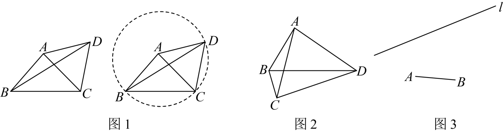
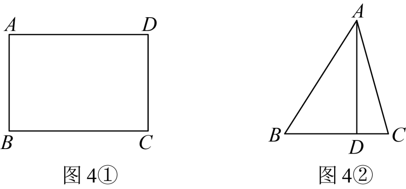

# Mathematics - 题目 2206

**ID**: 8ee871e7e49349f38eee525e52d24494
**年级**: Grade 9
**难度**: Medium-Hard
**题型**: Calculation

## 题目
$[$ 学习心得 $]{\rm （1）}$ 小雯同学在学习完“圆”这一章内容后，感觉到一些几何问题如果添加辅助圆，运用圆的知识解决，可以使问题变得非常容易．例如：如图 $1$ ，在 $\vartriangle ABC$ 中， $AB=AC$ ， $\angle BAC=90{}\degree $ ， $D$ 是 $\vartriangle ABC$ 外一点，且 $AD=AC$ ，求 $\angle BDC$ 的度数．若以点 $\mathrm{A}$ 为圆心， $AB$ 长为半径作辅助圆 $\odot A$ ，则 $C$ 、 $D$ 两点必在 $\odot A$ 上， $∠BAC$ 是 $\odot A$ 的圆心角 ${\rm ．}\angle BDC$ 是 $\odot A$ 的圆周角，则 $\angle BDC=$${}\degree $ ．$[$ 初步运用 $]{\rm （2）}$ 如图 $2$ ，在四边形 $ABCD$ 中， $\angle BAD=\angle BCD=90{}\degree $ ， $\angle BDC=25{}\degree $ ，则 $\angle BAC=$；​​​​​​​‌$[$ 问题迁移 $]{\rm （3）}$ ①如图 $4$ ①，已知矩形 $ABCD$ ， $AB=4$ ， $BC=m$ ， $M$ 为边 $CD$ 上的点，若满足 $\angle AMB=45{}\degree $ 的点 $M$ 恰好有两个，则 $m$ 的取值范围为．②如图 $4$ ②，在 $\vartriangle ABC$ 中， $\angle BAC=45{}\degree $ ， $AD$ 是 $BC$ 边上的高，且 $BD=3$ ， $CD=1$ ，求 $AD$ 的长．

## 解答

1. 解： $\left ({1}\right )\because \angle BAC$ 是 $\odot A$ 的圆心角， $\angle BDC$ 是 $\odot A$ 的圆周角， $\angle BAC=90{}\degree $ ，
2. $\therefore \angle BDC=\frac {1}{2}\angle BAC=45{}\degree $
3. $\left ({2}\right )$ 如图 $2$ ，取 $BD$ 的中点 $O$ ，连接 $AO$ 、 $CO$ ，
4. 
5. $\because \angle BAD=\angle BCD=90{}\degree $ ，
6. $\therefore OA=\frac {1}{2}BD$ ， $OC=\frac {1}{2}BD$ ，
7. $\therefore OA=OB=OC=OD$ ，
8. $\therefore $ 点 $\mathrm{A}$ 、 $B$ 、 $C$ 、 $D$ 共圆，
9. $\therefore \angle BDC=\angle BAC$ ，
10. $\because \angle BDC=25{}\degree $ ，
11. $\therefore \angle BAC=25{}\degree $
12. $\left ({3}\right )①$ 在 $BC$ 上截取 $BF=BA=4$ ，连接 $AF$ ，以 $AF$ 为直径 $\odot O$ ， $\odot O$ 交 $AD$ 于 $E$ ，交 $BC$ 于 $F$ ，连接 $EF$ ，过圆心 $O$ 作 $OG\bot EF$ 于 $H$ 且交圆 $O$ 于 $G$ ，过 $G$ 作 $\odot O$ 的切线 $KQ$ 交 $AD$ 于 $K$ 交 $BC$ 于 $Q$ ，如图所示：
13. 
14. $\because BA=BF=4$ ，
15. $\therefore AF=4\sqrt {2}$ ，
16. $\therefore \odot O$ 的半径为 $2\sqrt {2}$ ，即 $OF=OG=2\sqrt {2}$ ，
17. $\because OG\bot EF$ ，
18. $\therefore FH=2$ ，
19. $\therefore OH=2$ ，
20. $\therefore GH=2\sqrt {2}-2$ ，
21. $\therefore BF\leqslant m<BQ$ ，
22. $\therefore 4\leqslant m<4+2\sqrt {2}-2$ ，即 $4\leqslant m<2+2\sqrt {2}$
23. $②$ 如图，作 $\vartriangle ABC$ 的外接圆，过圆心 $O$ 作 $OE\bot BC$ 于点 $E$ ，作 $OF\bot AD$ 于点 $F$ ，连接 $OA$ 、 $OB$ 、 $OC$ ，
24. ，
25. $\because \angle BAC=45{}\degree $ ，
26. $\therefore \angle BOC=90{}\degree $ ，
27. 在 $Rt\vartriangle BOC$ 中， $BC=3+1=4$ ，
28. $\therefore BO=CO=2\sqrt {2}，$
29. $\because OE\bot BC$ ， $O$ 为圆心，
30. $\therefore BE=CE=\frac {1}{2}BC=2$ ，
31. $\therefore DE=OF=1$ ，
32. 在 $Rt\mathrm{△}BOE$ 中， $BO=2\sqrt {2}$ ， $BE=2$ ，
33. $\therefore OE=DF=2$ ，
34. 在 $Rt\vartriangle AOF$ 中， $AO=2\sqrt {2}$ ， $OF=1$ ，
35. $\therefore AF=\sqrt {OA{^{2}}-OF{^{2}}}=\sqrt {7}$
36. $\therefore AD=\sqrt {7}+2$ ．

## 知识点

**中文**:
  - 三角形的外接圆
  - 勾股定理
  - 圆周角定理及推论

**English**:
  - Circumcircle of Triangle
  - Pythagorean Theorem
  - Inscribed Angle Theorem

---
