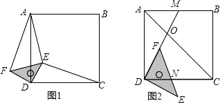

# Mathematics - 题目 3391

**ID**: 9175429b02444ed8971425996fb61903
**年级**: Grade 9
**难度**: Medium-Hard
**题型**: Calculation

## 题目
已知：正方形ABCD，等腰直角三角形的直角顶点落在正方形的顶点D处，使三角板绕点D旋转．（1）当三角板旋转到图1的位置时，猜想CE与AF的数量关系，并加以证明；​​​​​​​‌（2）在（1）的条件下，若DE＝1，AE＝ $\sqrt {7}$ ，CE＝3，求∠AED的度数；（3）若BC＝4，点M是边AB的中点，连结DM，DM与AC交于点O，当三角板的一边DF与边DM重合时（如图2），若OF＝ $\frac {\sqrt {5}}{3}$ ，求CN的长．

## 解答

1. 解：：（1）CE=AF；
2. 在正方形ABCD，等腰直角三角形CEF中，
3. FD=DE，CD=CA，∠ADC=∠EDF=90°
4. ∴∠ADF=∠CDE，
5. ∴△ADF≌△CDE，
6. ∴CE=AF，
7. （2）设DE=k，
8. ∵DE：AE：CE=1： $\sqrt {7}$ ：3
9. ∴AE= $\sqrt {7}$ k，CE=AF=3k，
10. ∴EF= $\sqrt {2}$ k，
11. ∵AE^{2}+EF^{2}=7k^{2}+2k^{2}=9k^{2}，AF^{2}=9k^{2}，
12. 即AE^{2}+EF^{2}=AF^{2}
13. ∴△AEF为直角三角形，
14. ∴∠BEF=90°
15. ∴∠AED=∠AEF+DEF=90°+45°=135°；
16. （3）∵M是AB中点，
17. ∴MA= $\frac {1}{2}$ AB= $\frac {1}{2}$ AD，
18. ∵AB∥CD，
19. ∴ $\frac {OM}{OD}=\frac {OA}{OC}=\frac {AM}{DC}=\frac {1}{2}$ ，
20. 在Rt△DAM中，DM= $\sqrt {AD{^{2}}+AM{^{2}}}=\sqrt {16+4}=2\sqrt {5}$ ，
21. ∴DO= $\frac {4\sqrt {5}}{3}$
22. ∵OF= $\frac {\sqrt {5}}{3}$
23. ∴DF= $\sqrt {5}$
24. ∵∠DFN=∠DCO=45°，∠FDN=∠CDO
25. ∴△DFN∽△DCO
26. ∴ $\frac {DF}{DC}=\frac {DN}{DO}$
27. ∴ $\frac {\sqrt {5}}{4}=\frac {DN}{\frac {4\sqrt {5}}{3}}$
28. ∴DN= $\frac {5}{3}$
29. ∴CN=CD-DN=4- $\frac {5}{3}$ = $\frac {7}{3}$ ．

## 知识点

**中文**:
  - 勾股定理的逆定理
  - 正方形的判定与性质综合
  - 相似三角形的判定与性质综合

**English**:
  - Converse of Pythagorean Theorem
  - Determination and Properties of Squares
  - Determination and Properties

---
