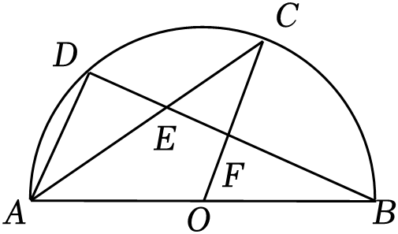

# Mathematics - 题目 2533

**ID**: 91fe2b8965124453aa7fbc51db19f762
**年级**: Grade 9
**难度**: Medium-Hard
**题型**: Calculation

## 题目
如图，已知 $\vartriangle ABC$ 内接于 $\odot O$ ， $AB$ 是该圆的直径， $D$ 是 $\overset ⌢{{AC}}$ 上的点，线段 $BD$ 与 $AC$ 交于点 $E$ ，若 $AB=5$ ， ${\sin}\angle CAB=\frac {3}{5}$ ， $CE=m$ ， $\frac {DE}{BE}=k$ ．(1)试用含m的代数式表示k；​​​​​​​‌(2)若 $AD{\rm{/\mskip-4mu/}}OC$ ，求 $k$ 的值；(3)若 $CE=CF$ ，求 ${\cos}\angle ABD$ ．

## 解答

1. （1）解：如图1，连接 $BC$ ， $CD$ ，
2. 
3. ∵ $AB$ 是的 $\odot O$ 直径，
4. ∴ $\angle ACB=90{}^\circ $ ，
5. ∵ $AB=5\mathrm{，}{\sin}\angle CAB=\frac {3}{5}$ ，
6. ∴ $BC=AB\cdot {\sin}\angle CAB=5\times \frac {3}{5}=3$ ，
7. ∴ $AC=\sqrt {AB{^{2}}-BC{^{2}}}=\sqrt {5{^{2}}-3{^{2}}}{\rm{=}}4$ ，
8. ∵ $\angle ADE=\angle ECB\mathrm{，}\angle DEA=\angle CEB$ ，
9. ∴ $\mathrm{△}DEA\mathrm{∽}\mathrm{△}CEB$ ，
10. ∴ $\frac {DE}{AE}=\frac {CE}{EB}$ ，
11. ∴ $\frac {DE}{4-m}=\frac {m}{BE}$ ，
12. ∴ $DE\cdot BE=m(4-m)$ ，
13. ∵ $\frac {DE}{BE}=k$ ， $BE{^{2}}=m{^{2}}+3{^{2}}{\rm{=}}m{^{2}}+9$ ，
14. ∴ $k=\frac {DE\cdot BE}{BE{^{2}}}=\frac {m(4-m)}{m{^{2}}+9}=\frac {4m-m{^{2}}}{m{^{2}}+9}$ ；
15. （2）解：∵ $AD{\rm{/\mskip-4mu/}}OC$ ，
16. ∴ $\angle DAC=\angle ACO$ ，
17. ∵ $OA=OC$ ，
18. ∴ $\angle OAC=\angle ACO$ ，
19. ∵ $\angle DAC=\angle DBC$ ，
20. ∴ $\angle DBC=\angle OAC$ ，
21. ∵ $\angle ACB=\angle BCE$ ，
22. ∴ $\vartriangle CBE∽\vartriangle CAB$ ，
23. ∴ $\frac {CB}{CA}=\frac {CE}{CB}$ ，
24. ∴ $\frac {3}{4}=\frac {m}{3}$ ，
25. ∴ $m=\frac {9}{4}$ ，
26. ∴ $k=\frac {4m-m{^{2}}}{m{^{2}}+9}=\frac {7}{25}$ ．
27. （3）解：如图2，在线段 $AC$ 上取一点G，使得 $\angle DBG=\angle DBC$ ，
28. 
29. ∵ $CE=CF$ ，
30. ∴ $\angle CEF=\angle CFE$ ，
31. ∵ $\angle CEF+\angle CFE+\angle ECF=180{}^\circ $ ，
32. ∴ $\angle CEF+\frac {1}{2}\angle ECF=90{}^\circ $ ，
33. ∵ $AB$ 是 $\odot O$ 的直径，
34. ∴ $\angle ECB=90{}^\circ $ ，
35. ∴ $\angle CEB+\angle CBD=90{}^\circ $ ，
36. ∴ $\frac {1}{2}\angle ECF{\rm{=}}\angle CBD$ ，
37. ∵ $OA=OC$ ，
38. ∴ $\angle CAB=\angle ACO=2\angle DBC{\rm{=}}\angle CBG$ ，
39. ∵ $\angle BCE=\angle ACB$ ，
40. ∴ $△CBG∽△CAB$ ，
41. ∴ $\frac {CB}{CG}=\frac {CG}{CB}$ ，
42. ∴ $CB{^{2}}=CG\times CA$ ，
43. ∵ $AC=4，BC=3$ ，
44. ∴ $CG=\frac {9}{4}$ ，
45. ∴ $BG=\sqrt {BC{^{2}}+CG{^{2}}}=\sqrt {3{^{2}}+{\left({\frac {9}{4}}\right)^{2}}}{\rm{=}}\frac {15}{4}$ ，
46. ∵ $\angle DBG=\angle DBC$ ，
47. ∴ $\frac {CE}{GE}=\frac {BC}{BG}$ ，
48. ∴ $\frac {CE}{\frac {9}{4}-CE}=\frac {3}{\frac {15}{4}}=\frac {4}{5}$ ，
49. ∴ $CE=1=m$ ，
50. ∴ $BE=\sqrt {10}$ ，
51. ∵ $k=\frac {4m-m{^{2}}}{m{^{2}}+9}=\frac {3}{10}$ ，
52. ∴ $\frac {DE}{\sqrt {10}}=\frac {3}{10}$ ，
53. ∴ $DE=\frac {3}{10}\sqrt {10}$ ，
54. ∴ $BD=\frac {13}{10}\sqrt {10}$ ，
55. ∴ ${\cos}\angle ABD=\frac {\frac {13}{10}\sqrt {10}}{5}=\frac {13}{50}\sqrt {10}$ ．

## 知识点

**中文**:
  - 三角形的外接圆
  - 圆周角定理及推论
  - 相似三角形的判定与性质综合
  - 解直角三角形

**English**:
  - Circumcircle of Triangle
  - Inscribed Angle Theorem
  - Determination and Properties
  - Solving Right Triangles

---
