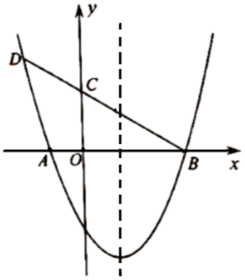

# Mathematics - 题目 2461

**ID**: 92ea23bb679044db99c52cd33c66fe1f
**年级**: Grade 9
**难度**: Medium-Hard
**题型**: Calculation

## 题目
如图，抛物线 $y=\frac {3+\sqrt {3}}{6}x{^{2}}+bx+c$ 与 $x$ 轴交于 $A$ ， $B$ 两点，点 $A$ ， $B$ 分别位于原点的左、右两侧， $BO=3AO=3$ ，过点 $B$ 的直线与 $y$ 轴正半轴和抛物线的交点分别为 $C$ ， $D$ ， $BC=\sqrt {3}CD$ ．（1）求 $b$ ， $c$ 的值；​​​​​​​‌（2）求直线 $BD$ 的函数解析式；（3）点 $P$ 在抛物线的对称轴上且在 $x$ 轴下方，点 $Q$ 在射线 $BA$ 上，当 $ΔABD$ 与 $ΔBPQ$ 相似时，请直接写出所有满足条件的点 $Q$ 的坐标．

## 解答

1. 解：（1）∵ $BD=3AO=3$ ，
2. ∴ $A(-1，0)$ ， $B(3，0)$ ，
3. ∴将A，B代入 $y=\frac {3+\sqrt {3}}{6}x{^{2}}+bx+c$ 得 $\begin{cases}\frac {3+\sqrt {3}}{b}-b+c=0\\\frac {27+9\sqrt {3}}{b}+3b+c=0\end{cases}$ ，
4. 解得 $\begin{cases}b=-1-\frac {\sqrt {3}}{3}\\c=-\frac {\sqrt {3}}{2}-\frac {3}{2}\end{cases}$ ，
5. ∴ $b=-1-\frac {\sqrt {3}}{3}$ ， $c=-\frac {3}{2}-\frac {\sqrt {3}}{2}$ ；
6. （2）∵二次函数是 $y=\frac {(3+\sqrt {3})}{6}x{^{2}}-\left ({1+\frac {\sqrt {3}}{3}}\right )x-\frac {3}{2}-\frac {\sqrt {3}}{2}$ ， $BC=\sqrt {3}CD$ ， $B(3,0)$ ，
7. ∴ $D$ 的横坐标为 $-\sqrt {3}$ ，
8. 代入抛物线解析式得 $y=\frac {3+\sqrt {3}}{6}\times 3+\left ({1+\frac {\sqrt {3}}{3}}\right )\times \sqrt {3}-\frac {3}{2}-\frac {\sqrt {3}}{2}$
9. $=\frac {3+\sqrt {3}}{2}+\sqrt {3}+1-\frac {\sqrt {3}}{2}-\frac {3}{2}$
10. $=\sqrt {3}+1$
11. ∴ $D(-\sqrt {3},\sqrt {3}+1)$ ，
12. 设 $BD$ 得解析式为： $y=kx+b$
13. 将B，D代入得 $\begin{cases}\sqrt {3}+1=-\sqrt {3}k+b\\0=3k+b\end{cases}$ ，
14. 解得 $\begin{cases}k=-\frac {\sqrt {3}}{3}\\b=\sqrt {3}\end{cases}$ ，
15. ∴直线 $BD$ 的解析式为 $y=-\frac {\sqrt {3}}{3}x+\sqrt {3}$ ；
16. （3）由题意得tan∠ABD= $\frac {\sqrt {{\rm{3}}}}{{\rm{3}}}$ ，tan∠ADB=1，
17. 由题意得抛物线的对称轴为直线x=1，设对称轴与x轴交点为M，P（1，n）且n<0，Q（x，0）且x<3，
18. ①当△PBQ∽△ABD时，tan∠PBQ=tan∠ABD即 $\frac {-n}{{\rm{2}}}$ = $\frac {\sqrt {{\rm{3}}}}{{\rm{3}}}$ ，
19. 解得n= $-\frac {2\sqrt {3}}{3}$ ，
20. tan∠PQB=tan∠ADB即 $\frac {-n}{1-x}=1$ ，
21. 解得x=1- $\frac {2\sqrt {3}}{3}$ ，
22. 此时Q的坐标为（1- $\frac {2\sqrt {3}}{3}$ ，0）；
23. ②当△PQB∽△ABD时，tan∠PBQ=tan∠ADB即 $\frac {-n}{{\rm{2}}}$ =1，
24. 解得n=-2，
25. tan∠QPB=tan∠ABD即 $\frac {-n}{1-x}$ = $\frac {\sqrt {{\rm{3}}}}{{\rm{3}}}$ ，
26. 解得x=1- $2\sqrt {3}$ ，
27. 此时Q的坐标为（1- $2\sqrt {3}$ ，0）；
28. ③当△PQB∽△DAB时，tan∠PBQ=tan∠ABD即 $\frac {-n}{{\rm{2}}}$ = $\frac {\sqrt {{\rm{3}}}}{{\rm{3}}}$ ，
29. 解得n= $\frac {2\sqrt {3}}{3}$ ，
30. tan∠PQB=tan∠DAB即 $\frac {-n}{x-1}=\frac {\sqrt {3}+1}{-1+\sqrt {3}}$ ，
31. 解得x= $\frac {4\sqrt {3}}{3}$ -1，
32. 此时Q的坐标为（ $\frac {4\sqrt {3}}{3}$ -1，0）；
33. ④当△PQB∽△ABD时，tan∠PBQ=tan∠ABD即 $\frac {-n}{{\rm{2}}}$ =1，
34. 解得n=-2，
35. tan∠PQB=tan∠DAB即 $\frac {-n}{x-1}=\frac {\sqrt {3}+1}{-1+\sqrt {3}}$ ，
36. 解得x=5- $2\sqrt {3}$ ，
37. Q的坐标为（5- $2\sqrt {3}$ ，0）；
38. 综上：Q的坐标可能为 $\left ({1-\frac {2\sqrt {3}}{3},0}\right )$ ， $(1-2\sqrt {3},0)$ ， $\left ({\frac {4\sqrt {3}}{3}-1,0}\right )$ ， $(5-2\sqrt {3},0)$ ．

## 知识点

**中文**:
  - 待定系数法求二次函数解析式
  - 相似三角形的性质
  - 正切

**English**:
  - Finding Quadratic Expressions by Undetermined Coefficients
  - Properties of Similar Triangles
  - Tangent

---
