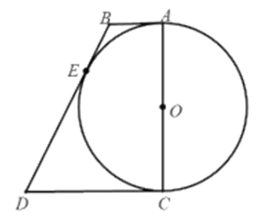
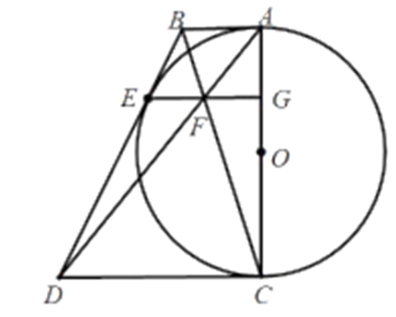
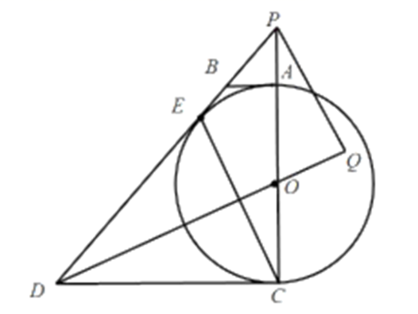

# Mathematics - 题目 3350

**ID**: 9367d9d8ead44d42ae289f56ef61cc99
**年级**: Grade 9
**难度**: Medium-Hard
**题型**: Calculation

## 题目
如图，在 $\odot O$ 中， $AC$ 是直径， $AB,BD,CD$ 是切线，点 $E$ 为切点．（1）求证： $AB\cdot CD=\frac {1}{4}AC{^{2}}$ ；​​​​​​​‌（2）如图，连接 $AD,BC,$ 交于点 $F$ ，连接 $EF$ 并延长，交 $AC$ 于点 $G$ ，求证： $EF=FG$ ；（3）如图，延长 $DB,CA,$ 交于点 $P,$ 连接 $CE,$ 过点 $P$ 作 $PQ\bot DO$ ，交 $DO$ 的延长线于点 $Q$ ．若 $CD=6,$   $PE=4,$ 求 $OQ$ 的长．

## 解答

1. （1）证明：如图，连接OB、OE、OD．
2. 
3. ∵AB、BD、CD是 $\odot O$ 的切线，
4. ∴BA=BE，∠BEO=∠BAO=90 ${}^\circ $ ，DC=DE，
5. 在Rt△BEO和Rt△BAO中，
6. $\begin{cases}BE=BA\\OB=OB\end{cases}$ ，
7. ∴ $Rt\vartriangle BEO\cong Rt\vartriangle BAO\left ({HL}\right )$ ，
8. ∴ $\angle BOE=\angle BOA$ ，
9. 同理可得 $\angle DOE=\angle DOC$ ，
10. ∴ $\angle BOD=\angle BOE+\angle DOE=\frac {1}{2}\angle COA=90{}^\circ $ ，
11. ∴ $\angle BEO=\angle BOD=90{}^\circ $ ，
12. ∴ $\angle BOE+\angle OBE=\angle BOE+\angle DOE$ ，
13. ∴ $\angle OBE=\angle DOE$ ，
14. ∵ $\angle BEO=\angle OED=90{^{\circ }}$ ，
15. ∴Rt△BOE $\sim $ Rt△ODE，
16. ∴ $\frac {BE}{OE}=\frac {OE}{DE}$ ，
17. ∴ $OE{^{2}}=BE\cdot DE=AB\cdot CD$ ，
18. ∵ $OE=\frac {1}{2}AC$
19. ∴ $AB\cdot CD=\frac {1}{4}AC{^{2}}$ ；
20. （2）证明：∵AB、CD是 $\odot O$ 的切线，
21. ∴ $AB\bot AC，CD\bot AC$ ，
22. ∴ $AB//CD$ ，
23. ∴ $\frac {AB}{CD}=\frac {BF}{CF}=\frac {AF}{DF}$ ，
24. ∵ $AB=BE，CD=ED$ ，
25. ∴ $\frac {BE}{ED}=\frac {BF}{CF}$ ，
26. ∴ $EF//CD//AB$ ，
27. ∴ $\frac {AB}{EF}=\frac {DA}{DF}=1+\frac {AF}{DF}$ ，
28. $\frac {AB}{FG}=\frac {CB}{CF}=1+\frac {BF}{CF}$ ，
29. ∵ $\frac {BF}{CF}=\frac {AF}{DF}$ ，
30. ∴ $\frac {AB}{EF}=\frac {AB}{FG}$ ，
31. ∴ $EF=FG$ ；
32. （3）解：∵ $CD=6，DC=DE$ ，
33. ∴ $DE=6$ ，
34. ∴ $PD=DE+PE=10$ ，
35. 在 $Rt\vartriangle PCD$ 中， $\angle PCD=90{}^\circ $ ，
36. ∴ $PC=\sqrt {PD{^{2}}-CD{^{2}}}=\sqrt {10{^{2}}-6{^{2}}}=8$ ，
37. ∴ $\sin \angle DPC=\frac {CD}{PD}=\frac {6}{10}=\frac {3}{5}$ ，
38. 在 $Rt\vartriangle PAB$ 中， $\sin \angle BPA=\sin \angle DPC=\frac {3}{5}$  ，
39. ∴ $\frac {AB}{PB}=\frac {3}{5}$ ①，
40. ∵ $PE=4$ ，
41. ∴ $PB+BE=PB+AB=4$ ②，
42. 联立①②并解得：
43. ∴ $PB=\frac {5}{2}，BA=\frac {3}{2}$ ，
44. ∴ $PA=\sqrt {PB{^{2}}-BA{^{2}}}=\sqrt {(\frac {5}{2}){^{2}}-(\frac {3}{2}){^{2}}}=2$ ，
45. ∴ $AC=PC-PA=6$ ，
46. ∴ $OC=3，OP=5$ ，
47. ∴ $DO=\sqrt {CD{^{2}}+OC{^{2}}}=\sqrt {6{^{2}}+3{^{2}}}=3\sqrt {5}$ ，
48. ∵ $\cos \angle DOC=\frac {OC}{OD}=\frac {\sqrt {5}}{5}$ ，
49. ∴ ${\cos}\angle POQ={\cos}\angle DOC=\frac {OQ}{OP}=\frac {\sqrt {5}}{5}$ ，
50. ∴ $OQ=\sqrt {5}$ ．

## 知识点

**中文**:
  - 余弦
  - 勾股定理的应用
  - 切线的性质定理
  - 圆的综合问题
  - 平行线分线段成比例定理
  - 相似三角形的判定与性质综合
  - 全等三角形的判定与性质

**English**:
  - Cosine
  - Applications of Pythagorean Theorem
  - Tangent Properties Theorem
  - Comprehensive Circle Problems
  - Parallel Lines Intercept Theorem
  - Determination and Properties
  - Determination and Properties

---
