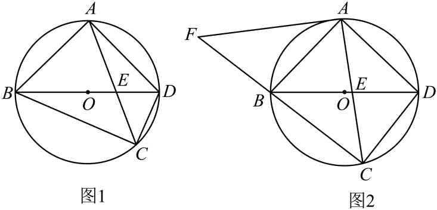

# Mathematics - 题目 3338

**ID**: 9555b45833294160831777681d8b1eb2
**年级**: Grade 9
**难度**: Medium-Hard
**题型**: Calculation

## 题目
已知四边形 $ABCD$ 内接于 $\mathrm{⊙}O$ ， $AC$ 与直径 $BD$ 交于点 $E$ ， $CA$ 平分 $\angle BCD$ ．（1）如图1，若 $\angle AEB=\angle BDC$ ，求证： $AC=BC$ ；​​​​​​​‌（2）如图2，点 $F$ 在 $CB$ 的延长线上，连接 $AF$ ， $BF=CD=3$ ， $BD=5$ ，求 $AC$ 的长．

## 解答

1. （1）证明： $\because BD$ 为 $\mathrm{⊙}O$ 的直径，
2. $\therefore \angle BCD=90{}\degree $ ，
3. $\because CA$ 平分 $\angle BCD$ ，
4. $\therefore \angle ACB=\angle ACD=\frac {1}{2}\angle BCD=45{}\degree $ ，
5. $\because \angle AEB=\angle BDC$ ， $\angle AEB=\angle CED$ ，
6. $\therefore \angle BDC=\angle CED=\frac {180{}\degree -\angle ACD}{2}=67.5{}\degree $ ，
7. $\because \angle BAC$ 和 $\angle BDC$ 是 $\overset{\frown}{{BC}}$ 所对的圆周角，
8. $\therefore \angle BAC=\angle BDC=67.5{}\degree $ ，
9. $\therefore \angle ABC=180{}\degree -\angle BAC-\angle ACB=67.5{}\degree $ ，
10. $\therefore \angle ABC=\angle BAC$ ，
11. $\therefore AC=BC$ ；
12. （2）解： $\because $ 在 ${\rm{R}}{\rm{t}}\mathrm{△}BCD$ 中， $CD=3$ ， $BD=5$ ， $\angle BCD=90{}\degree $ ，
13. $\therefore BC=\sqrt {BD{^{2}}-CD{^{2}}}=4$ ，
14. $\therefore CF=BF+BC=7$ ，
15. $\because CA$ 平分 $\angle BCD$ ，
16. $\therefore \angle ACB=\angle ACD$ ，
17. $\therefore \overset{\frown}{{AB}}=\overset{\frown}{{AD}}$ ，
18. $\therefore AB=AD$ ，
19. $\because $ 四边形 $ABCD$ 内接于 $\mathrm{⊙}O$ ，
20. $\therefore \angle ABC+\angle ADC=180{}\degree $ ，
21. $\because \angle ABF+\angle ABC=180{}\degree $ ，
22. $\therefore \angle ABF=\angle ADC$ ，
23. 在 $\mathrm{△}ABF$ 和 $\mathrm{△}ADC$ 中，
24. $\because AB=AD$ ， $\angle ABF=\angle ADC$ ， $BF=CD$ ，
25. $\therefore \mathrm{△}ABF≌\mathrm{△}ADC\left ({{\rm{S}}{\rm{A}}{\rm{S}}}\right )$ ，
26. $\therefore AF=AC$ ， $\angle BAF=\angle DAC$ ，
27. $\because BD$ 为 $\mathrm{⊙}O$ 的直径，
28. $\therefore \angle BAD=\angle BAC+\angle DAC=90{}\degree $ ，
29. $\therefore \angle CAF=\angle BAC+\angle BAF=90{}\degree $ ，
30. $\therefore \mathrm{△}CAF$ 为等腰直角三角形，
31. $\therefore AC{^{2}}+AF{^{2}}=CF{^{2}}$ ，
32. 即 $2AC{^{2}}=7{^{2}}$ ，
33. 解得 $AC=\frac {7\sqrt {2}}{2}$ ．

## 知识点

**中文**:
  - 半圆（或直径）所对的圆周角是直角
  - 圆内接四边形
  - 同弧或等弧所对的圆周角相等

**English**:
  - Angle in a Semicircle is Right
  - Cyclic Quadrilaterals
  - Angles Subtended by Same Arc are Equal

---
