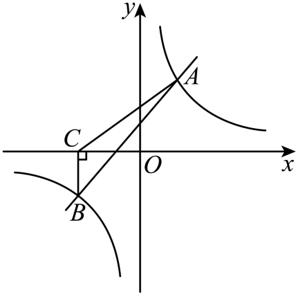

# Mathematics - 题目 3348

**ID**: 95be8cf25941420c9408b520483b51ec
**年级**: Grade 9
**难度**: Medium-Hard
**题型**: Calculation

## 题目
如图，一次函数 $y=kx+b$ 与反比例函数 $y=$  $\frac {m}{x}$ 的图象相交于 $A\left ({2,3}\right )$ ， $B\left ({-3,n}\right )$ 两点．过点 $B$ 作 $BC\bot x$ 轴，垂足为 $C$ ，(1)求一次函数与反比例函数的解析式；​​​​​​​‌(2)根据所给条件，请直接写出不等式 $kx+b>$  $\frac {m}{x}$ 的解集；(3)一次函数 $y=kx+b$ 的图像上是否存在一点 $P$ ，使得求 $S{{}_{\mathrm{△}BCP}}=2S{{}_{\mathrm{△}ABC}}$ ．若存在，求出 $P$ 点坐标，若不存在说明理由．

## 解答

1. （1）解：∵点 $A\left ({2,3}\right )$ 在反比例函数 $y=\frac {m}{x}$ 图象上，
2. ∴ $3=\frac {m}{2}$ ，得 $m=6$ ，
3. 即 $y=\frac {6}{x}$ ；
4. 把 $B\left ({-3,n}\right )$ 代入 $y=\frac {6}{x}$ 得，
5. $n=\frac {6}{-3}=-2$ ，
6. ∴ $B\left ({-3,-2}\right )$ ；
7. 把 $A\left ({2,3}\right )$ 、 $B\left ({-3,-2}\right )$ 代入 $y=kx+b$ 中得
8. $\begin{cases}3=2k+b\\-2=-3k+b\end{cases}$ ，
9. 解得： $\begin{cases}k=1\\b=1\end{cases}$ ；
10. ∴一次函数的解析式为 $y=x+1$ ，反比例函数的解析式为 $y=\frac {6}{x}$ ；
11. （2）根据函数图象可得：不等式 $kx+b>\frac {m}{x}$ 的解集是： $-3<x<0$ 或 $x>2$ ；
12. （3）设直线 $AB$ 与 $x$ 轴交于点 $D$ ，
13. 
14. 把 $y=0$ 代入 $y=x+1$ 可得： $x=$  $\mathbf{-}$  $1$ ，
15. 即 $D\left ({-1,0}\right )$ ；
16. $\because B\left ({-3,-2}\right )$ ， $BC\bot x$ 轴，垂足为 $C$ ，
17. $\therefore $  $C\left ({-3,0}\right )$
18. $\therefore $  $CD=2$ ， $BC=2$  $,$
19. $\therefore $  $S{{}_{\vartriangle ABC}}=\frac {1}{2}CD\times \left |{y{{}_{A}}-y{{}_{B}}}\right |=5$
20. 设点 $P$ 坐标为 $(a,a+1)$ ，
21. $\because $  $S{{}_{\mathrm{△}BCP}}=2S{{}_{\mathrm{△}ABC}}$
22. $\therefore $  $S{{}_{\vartriangle BCP}}=\frac {1}{2}\times BC\times \left |{x{{}_{P}}-x{{}_{C}}}\right |=10$
23. $\therefore $  $\left |{a+3}\right |=10$
24. 解得： $a=-13$ 或 $a=7$ ；
25. 因此，存在在点 $P$ 使得 $S{{}_{\mathrm{△}BCP}}=2S{{}_{\mathrm{△}ABC}}$ ，点 $P$ 的坐标为 $\left ({-13，-12}\right )$ 或 $\left ({7,8}\right )$ ．

## 知识点

**中文**:
  - 反比例函数的性质
  - 反比例函数解析式
  - 反比例函数综合
  - 待定系数法求一次函数解析式

**English**:
  - Properties of Inverse Proportionality Functions
  - Analytic Expression of Inverse Proportionality
  - Comprehensive Inverse Proportionality Problems
  - Finding Expressions by Undetermined Coefficients

---
