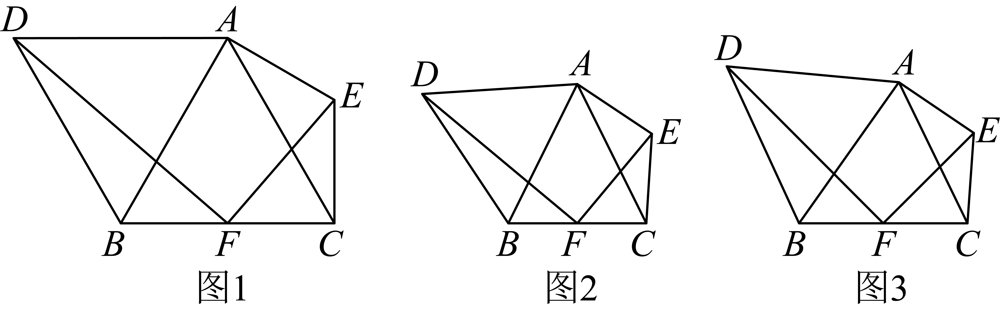

# Mathematics - 题目 3452

**ID**: 981fc836667c4dfab0c4e32bb01ef7e2
**年级**: Grade 9
**难度**: Medium-Hard
**题型**: Calculation

## 题目
锐角 $\vartriangle ABC$ 中 $BC=2$ ，以 $AB$ 为边向外作等边 $\mathrm{△}ABD$ ，以 $AC$ 为边向外作 $△ACE$ ，其中 $AE=CE$ ， $\angle AEC=120{}^\circ {\rm ，\mathit{F}}$ 为 $BC$ 的中点，分别连接 $DF，EF$ ．(1)如图 ${\rm 1，}\vartriangle ABC$ 为等边三角形，① $DF$ 与 $EF$ 的数量关系是；​​​​​​​‌ $DF$ 与 $EF$ 的位置关系是；②求 $DF$ 的长度；(2)如图 ${\rm 2，}AB=AC$ 时， $DF$ 与 $EF$ 的关系是否改变？如果不变请证明；如果改变请写出新的关系并证明；(3)如图 ${\rm 3，}\vartriangle ABC$ 为任意的锐角三角形，当 $EC=1$ 时直接写出 $DF$ 长度的取值范围．

## 解答

1. （1）①解：如图1，取 $AB$ 的中点 $N$ ， $AC$ 的中点 $M$ ，连接 $DN、FN、EM、FM$ ，
2. 
3. ∴ $FM/\mskip-4mu/AB，FM=\frac {1}{2}AB$ ， $FN/\mskip-4mu/AC，FN=\frac {1}{2}AC$ ，
4. ∴四边形 $AMFN$ 是平行四边形，
5. ∴ $\angle NFM=\angle BAC$ ，
6. ∴ $\angle FMC=\angle BAC，\angle FNB=\angle BAC$ ，
7. ∵等边 $\mathrm{△}ABD$ ， $AE=CE$ ， $\angle AEC=120{}^\circ $ ，
8. ∴ $DN\bot AB，EM\bot AC$ ， $AN=BN=\frac {1}{2}AB，AM=CM=\frac {1}{2}AC$ ， $\angle ADN=30{}^\circ $ ， $\angle AEM=60{}^\circ $ ， $\angle EAM=30{}^\circ $ ，
9. ∵ $\angle DNF=\angle DNB+\angle FNB=90{}^\circ +\angle BAC$ ， $\angle FME=\angle EMC+\angle FMC=90{}^\circ +\angle BAC$ ，
10. ∴ $\angle DNF=\angle FME$ ，
11. ∵ $\frac {FM}{DN}=\frac {AN}{DN}={\tan}30{}^\circ =\frac {\sqrt {3}}{3}$ ， $\frac {EM}{FN}=\frac {EM}{AM}={\tan}30{}^\circ =\frac {\sqrt {3}}{3}$ ，
12. ∴ $\frac {FM}{DN}=\frac {EM}{FN}$ ，
13. ∴ $\mathrm{△}EFM∽△FDN$ ，
14. ∴ $\frac {EF}{DF}=\frac {FM}{DN}=\frac {\sqrt {3}}{3}$ ， $\angle EFM=\angle FDN$ ， $\angle FEM=\angle DFN$ ，
15. ∴ $DF=\sqrt {3}EF$ ，
16. 设 $\angle NFM=\angle BAC=\angle 1$ ， $\angle EFM=\angle FDN=\angle 2$ ， $\angle FEM=\angle DFN=\angle 3$ ，
17. ∴ $\angle DFE=\angle DFN+\angle NFM+\angle EFM=\angle 3+\angle 1+\angle 2$ ，
18. ∵ $\angle ADF+\angle DFE+\angle AEF+\angle DAE=360{}^\circ $ ，
19. ∴ $\left ({\angle 2+30{}^\circ }\right )+\angle DFE+\left ({\angle 3+60{}^\circ }\right )+\left ({30{}^\circ +\angle 1+60{}^\circ }\right )=360{}^\circ $ ，整理得， $2\angle DFE+180{}^\circ =360{}^\circ $ ，
20. 解得， $\angle DFE=90{}^\circ $ ，
21. ∴ $DF\bot EF$
22. ②解：如图2，作 $DG\bot CB$ 的延长线于 $G$ ，
23. 
24. ∵ $\vartriangle ABC$ 为等边三角形，等边 $\mathrm{△}ABD$ ，
25. ∴ $DB=AB=BC=2$ ， $\angle ABD=60{}^\circ =\angle ABC$ ，
26. ∴ $\angle DBG=180{}^\circ -\angle ABD-\angle ABC=60{}^\circ $ ，
27. ∴ $BG=DB\cdot {\cos}60{}^\circ =1$ ， $DG=DB\cdot \sin 60{}^\circ =\sqrt {3}$ ，
28. ∴ $GF=2$ ，
29. 由勾股定理得， $DF=\sqrt {DG{^{2}}+GF{^{2}}}=\sqrt {7}$ ，
30. ∴ $DF$ 的长度为 $\sqrt {7}$ ；
31. （2）解：不变，证明如下；
32. 如图3，取 $AB$ 的中点 $N$ ， $AC$ 的中点 $M$ ，连接 $DN、FN、EM、FM$ ，
33. 
34. ∴ $FM/\mskip-4mu/AB，FM=\frac {1}{2}AB$ ， $FN/\mskip-4mu/AC，FN=\frac {1}{2}AC$ ，
35. ∴四边形 $AMFN$ 是平行四边形，
36. ∴ $\angle NFM=\angle BAC$ ，
37. ∴ $\angle FMC=\angle BAC，\angle FNB=\angle BAC$ ，
38. ∵等边 $\mathrm{△}ABD$ ， $AE=CE$ ， $\angle AEC=120{}^\circ $ ，
39. ∴ $DN\bot AB，EM\bot AC$ ， $AN=BN=\frac {1}{2}AB，AM=CM=\frac {1}{2}AC$ ， $\angle ADN=30{}^\circ $ ， $\angle AEM=60{}^\circ $ ， $\angle EAM=30{}^\circ $ ，
40. ∵ $\angle DNF=\angle DNB+\angle FNB=90{}^\circ +\angle BAC$ ， $\angle FME=\angle EMC+\angle FMC=90{}^\circ +\angle BAC$ ，
41. ∴ $\angle DNF=\angle FME$ ，
42. ∵ $\frac {FM}{DN}=\frac {AN}{DN}={\tan}30{}^\circ =\frac {\sqrt {3}}{3}$ ， $\frac {EM}{FN}=\frac {EM}{AM}={\tan}30{}^\circ =\frac {\sqrt {3}}{3}$ ，
43. ∴ $\frac {FM}{DN}=\frac {EM}{FN}$ ，
44. ∴ $\mathrm{△}EFM∽△FDN$ ，
45. ∴ $\frac {EF}{DF}=\frac {FM}{DN}=\frac {\sqrt {3}}{3}$ ， $\angle EFM=\angle FDN$ ， $\angle FEM=\angle DFN$ ，
46. ∴ $DF=\sqrt {3}EF$ ，
47. 设 $\angle NFM=\angle BAC=\angle 1$ ， $\angle EFM=\angle FDN=\angle 2$ ， $\angle FEM=\angle DFN=\angle 3$ ，
48. ∴ $\angle DFE=\angle DFN+\angle NFM+\angle EFM=\angle 3+\angle 1+\angle 2$ ，
49. ∵ $\angle ADF+\angle DFE+\angle AEF+\angle DAE=360{}^\circ $ ，
50. ∴ $\left ({\angle 2+30{}^\circ }\right )+\angle DFE+\left ({\angle 3+60{}^\circ }\right )+\left ({30{}^\circ +\angle 1+60{}^\circ }\right )=360{}^\circ $ ，
51. 整理得， $2\angle DFE+180{}^\circ =360{}^\circ $ ，
52. 解得， $\angle DFE=90{}^\circ $ ，
53. ∴ $DF\bot EF$ ，
54. ∴ $DF=\sqrt {3}EF$ ， $DF\bot EF$ ， $DF$ 与 $EF$ 的关系不变；
55. （3）解：由（1）①，（2）可知， $DF=\sqrt {3}EF$ ，
56. ∵ $EC=1$ ， $\angle AEC=120{}^\circ $ ，
57. ∴ $AC=\sqrt {3}$ ，
58. 当 $\angle ACB=90{}^\circ $ 时， $\angle ECF=120{}^\circ $ ，
59. 如图4，作 $CH\bot EF$ 于 $H$ ，
60. 
61. ∵ $CF=EF=1$ ，
62. ∴ $\angle ECH=60{}^\circ $ ， $EF=2EH=2EF\cdot \sin 60{}^\circ =\sqrt {3}$ ，此时 $DF=3$ ；
63. 当 $\angle BAC=90{}^\circ $ 时，
64. ∵ $\frac {AC}{BC}=\frac {\sqrt {3}}{2}={\cos}\angle ACB$ ，
65. ∴ $\angle ACB=30{}^\circ $ ，
66. ∴ $\angle FCE=\angle ACB+\angle ACE=60{}^\circ $ ，
67. ∴ $△CEF$ 是等边三角形，
68. ∴ $EF=1$ ，此时 $DF=\sqrt {3}$ ，
69. ∵ $\vartriangle ABC$ 是锐角三角形，
70. ∴ $\angle ACB<90{}^\circ $ ， $\angle BAC<90{}^\circ $ ，
71. ∴ $\sqrt {3}<DF<3$ ．

## 知识点

**中文**:
  - 平行四边形的判定与性质
  - 相似三角形的判定与性质综合
  - 解直角三角形

**English**:
  - Determination and Properties
  - Determination and Properties
  - Solving Right Triangles

---
